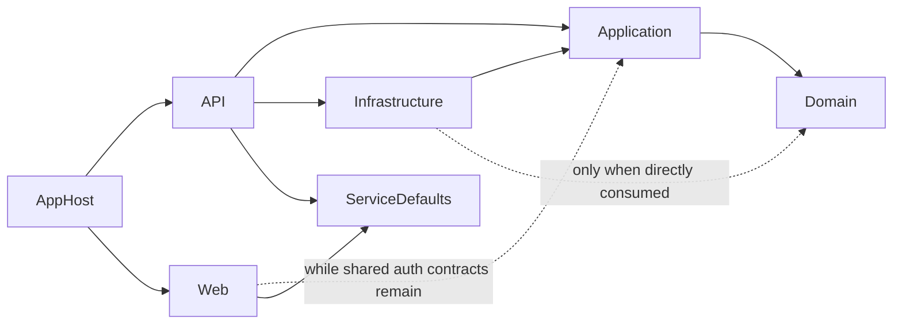

<!-- markdownlint-disable-file -->
# Task Research: Clean Architecture Migration

The solution already has a sound assembly-level dependency direction. The main
opportunity is not a wholesale project rewrite, but a staged correction of
responsibility placement inside Application and Infrastructure. The immediate
architecture should retain a combined core while Application is purified. A
separate Domain assembly becomes the conditional target only after a cohesive,
invariant-owning policy cluster has been extracted and tested.

## Task Implementation Requests

* Examine the current solution setup and dependency boundaries.
* Interpret `.github/instructions/architecture.instructions.md` for this repository.
* Recommend structure and naming changes, especially for Application and Infrastructure.
* Keep API, AppHost, ServiceDefaults, and Web stable except for narrow composition changes.
* Define an incremental migration path that preserves behavior and testability.

## Scope and Success Criteria

* Scope: Solution and project dependencies, source responsibilities, feature
  organization, policy, use cases, ports, persistence and external adapters,
  composition roots, tests, and migration sequencing. No product-code changes
  are included.
* Assumptions: The target is pragmatic Clean Architecture within the existing
  deployable topology. It does not imply microservices, event sourcing,
  separate command/query stores, or one project per architecture ring.
* Success Criteria:
  * Current strengths and violations are supported by file-and-line evidence.
  * Viable target structures are evaluated and one staged approach is selected.
  * The selected approach defines project roles, dependencies, source layout,
    migration stages, acceptance checks, and representative examples.
  * Existing HTTP and UI contracts can remain stable while internals migrate.

## Executive Recommendation

Use a two-state migration strategy.

The immediate state keeps the existing Application and Infrastructure projects:

```text
TNC.Trading.Platform.Application
  Framework-neutral policy, feature slices, use-case validation, and inner ports

TNC.Trading.Platform.Infrastructure -> Application
  EF Core, SQL Server, Data Protection, IG HTTP, email, and adapter translation
```

Purify Application, restore honest command/query behavior, define consistency
and concurrency semantics, move hosting outward, and repair provider boundaries
before adding a project.

The conditional target, reached only when the Domain extraction gate passes, is:

```text
TNC.Trading.Platform.Domain
  Framework-independent business state, value objects, invariants, and policies

TNC.Trading.Platform.Application -> Domain
  Feature slices, commands/queries, handlers, use-case validation, and inner ports

TNC.Trading.Platform.Infrastructure -> Application
  EF Core, SQL Server, Data Protection, IG HTTP, email, and adapter translation

TNC.Trading.Platform.Api -> Application, Infrastructure, ServiceDefaults
  HTTP inbound adapter and process composition root

TNC.Trading.Platform.Web -> ServiceDefaults
  Blazor inbound adapter that consumes API contracts over HTTP

TNC.Trading.Platform.AppHost -> Api, Web
  Distributed resource and process composition
```

Infrastructure may reference Domain only when an EF mapping or adapter directly
consumes a Domain type. Web may retain its current Application reference while
shared authentication contracts remain there. Neither edge should be added or
removed merely to complete the target diagram.

Do not create Domain as an empty project or move all Application records into it.
First make one policy cluster cohesive and dependency-free inside Application,
with validated construction or invariant-preserving transitions and direct tests.
Then create Domain and move that complete cluster as the first enforced boundary.
The trading schedule and platform state-transition policies are candidates, but
neither is ready to move unchanged today.

Keep the names `TNC.Trading.Platform.Application` and
`TNC.Trading.Platform.Infrastructure`. They accurately describe their target
roles. Remove the redundant `Infrastructure/Infrastructure` source path and
organize adapters by boundary. No `Core`, `Shared`, generic `Contracts`,
`Persistence`, or `Integrations` project is justified now.

## Outline

1. Current project graph and role assessment
2. Application and Infrastructure responsibility findings
3. Target dependency model and source organization
4. Alternatives and selected staged approach
5. Migration workstreams, acceptance checks, and risks

## Research Executed

### File Analysis

* `TNC.Trading.Platform.slnx:2-34`
  * Six production and nine test projects are solution-listed.
* `src/TNC.Trading.Platform.Application/TNC.Trading.Platform.Application.csproj:1-13`
  * Application has no production project dependency, but references the full
    ASP.NET Core shared framework.
* `src/TNC.Trading.Platform.Infrastructure/TNC.Trading.Platform.Infrastructure.csproj:1-23`
  * Infrastructure references Application and owns EF Core, Azure, and provider
    packages, which is the correct assembly-level direction.
* `src/TNC.Trading.Platform.Api/Program.cs:11-50`
  * API composes Application and Infrastructure, but also reaches directly into
    EF schema lifecycle, retention processing, and application reconciliation.
* `src/TNC.Trading.Platform.Application/Services/PlatformStateCoordinator.cs:9-29`
  * The 13-dependency coordinator is the actual shared workflow core behind most
    nominal feature handlers.
* `src/TNC.Trading.Platform.Infrastructure/Infrastructure/Platform/PlatformInfrastructureServiceCollectionExtensions.cs:16-68`
  * Infrastructure registers all outbound adapters and currently hard-codes the
    IG demo endpoint.
* `test/TNC.Trading.Platform.Architecture/TNC.Trading.Platform.Architecture.IntegrationTests/ProjectGraph/ProjectGraphValidator.cs:3-10`
  * Existing architecture tests detect missing references and cycles, but do not
    enforce architectural roles or framework/provider leakage.

### Code Search Results

* Production project references
  * Current direct edges are `AppHost -> Api`, `AppHost -> Web`,
    `Api -> Application`, `Api -> Infrastructure`, `Api -> ServiceDefaults`,
    `Infrastructure -> Application`, `Web -> Application`, and
    `Web -> ServiceDefaults`.
* Application feature shape
  * Six feature folders contain 18 files: one request, response, and handler per
    operation. Five handlers are thin wrappers over shared services.
* Application framework use
  * ASP.NET Core authorization, dependency injection, hosted services,
    `IConfiguration`, and logging all occur inside the inner project.
* Infrastructure policy use
  * Restart decisions, retention rules, recipient/provider selection, and
    operational redaction are mixed with adapter mechanisms.
* Test isolation
  * No Application handler has a direct unit test. The Application unit-test
    project references Infrastructure and constructs EF, Data Protection, and
    notification implementations.

### External Research

* Microsoft Learn: [Common web application architectures](https://learn.microsoft.com/en-us/dotnet/architecture/modern-web-apps-azure/common-web-application-architectures)
  * Compile-time dependencies point inward. Infrastructure implements
    Application Core interfaces. A UI-to-Infrastructure reference is acceptable
    for composition when concrete access stays in the composition root.
* Microsoft Learn: [Designing a DDD-oriented microservice](https://learn.microsoft.com/en-us/dotnet/architecture/microservices/microservice-ddd-cqrs-patterns/ddd-oriented-microservice)
  * Domain owns business state, rules, and invariants; Application coordinates
    tasks and delegates business decisions to the model.
* Microsoft Learn: [Designing the infrastructure persistence layer](https://learn.microsoft.com/en-us/dotnet/architecture/microservices/microservice-ddd-cqrs-patterns/infrastructure-persistence-layer-design)
  * EF Core context and repository implementations belong in Infrastructure.
    Custom repositories are optional, not a mandatory wrapper around every set.
* Microsoft Learn: [CQRS pattern](https://learn.microsoft.com/en-us/azure/architecture/patterns/cqrs)
  * Commands perform business tasks; queries are non-mutating. Separate stores,
    messaging, and event sourcing are optional complexity.
* Microsoft Learn: [EF Core migrations overview](https://learn.microsoft.com/en-us/ef/core/managing-schemas/migrations/)
  * Migrations and snapshots are source-controlled schema evolution artifacts
    and should remain beside the Infrastructure-owned context.
* ASP.NET Core: [HTTP requests with IHttpClientFactory](https://learn.microsoft.com/en-us/aspnet/core/fundamentals/http-requests?view=aspnetcore-10.0)
  * Typed clients encapsulate backend interaction and belong in the outbound
    adapter, while provider DTOs and exceptions should be translated at that boundary.
* Aspire: [What is the AppHost?](https://aspire.dev/get-started/app-host/)
  * AppHost declares distributed resources and relationships. It does not own
    in-process business behavior or each executable's service container.
* Aspire: [C# Service Defaults](https://aspire.dev/get-started/csharp-service-defaults/)
  * ServiceDefaults remains limited to discovery, resilience, health, and
    telemetry rather than shared application models or behavior.
* Original principles: [The Clean Architecture](https://blog.cleancoder.com/uncle-bob/2012/08/13/the-clean-architecture.html)
  * The number of circles is not prescribed. The invariant is inward source
    dependency and translation of external representations at boundaries.

### Project Conventions

* `.github/instructions/architecture.instructions.md:22-55`
  * Roles are responsibilities rather than mandatory project names. Policy and
    use cases must not depend on framework, provider, transport, or persistence
    details. Runtime calls may travel outward through inward-owned ports.
* `.github/instructions/architecture.instructions.md:61-89`
  * Organize by feature, use one request/response/handler per operation, keep
    endpoints thin, and test handlers and validators directly.
* `.github/copilot-instructions.md:26-29`
  * Keep one top-level C# type per file and use file-scoped namespaces.
* `.github/copilot-instructions.md:41-42`
  * Keep `Program.cs` focused on startup orchestration.
* `.github/instructions/configuration.instructions.md:17-49`
  * Persist operator configuration in SQL Server, protect IG credentials, and
    expose only credential presence to API and UI callers.

## Key Discoveries

### The Project Graph Is Already Pointing Inward

The current production graph is acyclic and its central dependency inversion is
correct:

```text
API composition -> Infrastructure adapter -> Application-owned port
API dispatch ----> Application use case
Web -------------> API over HTTP
AppHost ----------> API and Web executable resources
```

The focused graph test passed with one test passed and no failures. Infrastructure
implements nine Application-owned ports for configuration, runtime state, retry
cycles, operational events, IG snapshots and proof data, notifications,
credentials, and IG sessions. This is a valuable foundation to preserve.

The graph test proves only acyclicity and target resolution. It does not prove
that policy is in the correct assembly, that Application is framework-neutral,
or that provider models stop at the adapter boundary.

### Application Is a Mixed Core Rather Than a Clean Use-Case Layer

Application contains 76 source files and 82 top-level types. Only 18 files form
the six explicit vertical slices. The remainder is organized into broad
technical folders such as `Configuration`, `Services`, and `Infrastructure/Ig`.

The feature entry points are structurally promising, but most behavior sits in
`PlatformStateCoordinator`. `GetPlatformStatus` and `GetPlatformEvents` call
`TickAsync` before reading, so nominal queries can authenticate with IG, mutate
state, persist events and snapshots, schedule retries, and send notifications.
That contradicts CQRS query semantics and creates multiple reconciliation entry
points through startup, the hosted timer, status reads, and event reads.

Application also contains outer framework concerns:

* ASP.NET Core authorization registration in
  `src/TNC.Trading.Platform.Application/Authentication/PlatformAuthorizationPolicyRegistration.cs:1-35`
* DI registration in
  `src/TNC.Trading.Platform.Application/Services/PlatformApplicationServiceCollectionExtensions.cs:1-28`
* `BackgroundService` hosting in
  `src/TNC.Trading.Platform.Application/Services/PlatformAuthSupervisor.cs:1-48`
* `IConfiguration` and logging in
  `src/TNC.Trading.Platform.Application/Services/PlatformStateCoordinator.cs:1-28,677-684`

The `Application/Infrastructure/Ig` folder is a particularly useful migration
boundary. Its port is correctly inward-owned, but raw CST/security tokens, API
keys, headers, provider response shapes, sanitization, and provider mappings
should remain inside the IG adapter.

### Domain Policy Exists but Is Not Yet a Cohesive Domain Model

Meaningful policy already exists:

* Trading-window, holiday, weekend, and time-zone decisions in
  `src/TNC.Trading.Platform.Application/Services/TradingScheduleGate.cs:5-64`
* State-transition priority in
  `src/TNC.Trading.Platform.Application/Services/PlatformStateTransitionEngine.cs:5-75`
* Retry timing in
  `src/TNC.Trading.Platform.Application/Services/PlatformStateCoordinator.cs:752-768`
* Manual-retry eligibility, environment restrictions, deduplication, and state
  assignments throughout `PlatformStateCoordinator`
* Restart, retention, notification, and redaction decisions currently located
  in Infrastructure

Most configuration records are currently anemic. They accept invalid schedules,
empty trading days, invalid time zones, and inconsistent retry values. Mutable
runtime state exposes unrestricted setters. Moving all of these records directly
to a Domain project would create a nominal layer without meaningful encapsulation.

The right first extraction is behavior, invariants, and tests together. Domain
types should own valid construction and transitions rather than act as EF-shaped
or API-shaped data carriers.

### Infrastructure Has Correct Mechanisms but Mixed Policy

Infrastructure correctly owns:

* `PlatformDbContext`, EF entities, mappings, SQL Server, and provider behavior
* Data Protection credential encryption and decryption
* IG HTTP transport and JSON handling
* SMTP and Azure Communication Services transport
* Hosted adapter mechanics and external exception translation

It should not decide:

* Which configuration changes require a restart
* Which snapshots are retained and for how long
* Which recipient fallback or configured notification intent applies
* Which fields count as security-sensitive operational data

The project layout also repeats its role in paths and namespaces, for example
`Infrastructure/Infrastructure/Platform` and
`TNC.Trading.Platform.Infrastructure.Infrastructure.Platform`. The broad
`Platform` folder mixes unrelated adapter boundaries.

### API Needs Only Narrow Composition Changes

Most API endpoints already bind transport input, invoke one Application handler,
and map the result. The notable exception is authentication audit recording,
which executes configuration and persistence orchestration directly in API at
`src/TNC.Trading.Platform.Api/Features/Platform/RecordAuthAuditEventEndpointHandler.cs:10-54`.

API startup also directly resolves `PlatformDbContext` and a retention processor,
deletes the Development SQL database, creates the schema, applies startup
configuration, runs retention, and triggers reconciliation. A single
Infrastructure-owned startup initializer can preserve ordering while removing
concrete EF and processor access from API. API should retain its Infrastructure
project reference for registration and composition.

### AppHost and ServiceDefaults Should Stay Stable

AppHost already performs the correct distributed-composition role: it provisions
SQL Server, Mailpit, and Keycloak, registers API and Web, and wires references.
ServiceDefaults already centralizes discovery, resilience, health, and telemetry.
Neither should receive domain models, handlers, ports, persistence code, or
shared feature helpers during this migration.

### Web Can Become More Independent of Application

Web communicates with API through `PlatformApiClient` and owns its HTTP and view
models. Its Application reference appears driven by shared host authentication
configuration, not in-process use-case dispatch. As authentication setup moves
out of Application, Web should be able to remove that project reference and
remain an HTTP inbound/UI adapter. Avoid adding a new shared hosting project
unless the final API/Web duplication is substantial and stable.

### Tests Reveal the Actual Boundary Problems

The Application unit-test project references Infrastructure and creates concrete
EF stores, Data Protection services, and notification adapters. Those scenarios
are useful, but they are integration-style tests under the wrong owner. No
Application handler is directly unit tested.

The Infrastructure suite is healthier at the adapter level: all 44 focused tests
passed during research. Material gaps remain around live versus demo IG routing,
SQL Server-specific retention behavior, production Data Protection key-ring
durability, startup initialization, and successful external notification paths.

## Target Architecture

### Dependency Rules



Runtime calls may go from Application to Infrastructure through an
Application-owned port. Source references do not follow that runtime direction.

### Target Responsibilities

| Concern | Owner |
|---|---|
| Business vocabulary, invariants, state transitions, value objects | Domain |
| Commands, queries, handlers, use-case validation, transaction intent | Application feature slice |
| Ports required by a use case | Application, colocated with the consuming capability |
| HTTP binding and response models | API |
| Blazor view models and API client DTOs | Web |
| EF context, entities, mappings, migrations, SQL queries | Infrastructure |
| Provider wire models, typed HTTP clients, SDK exceptions | Infrastructure |
| Process DI and middleware | API or Web composition root |
| Distributed resources and references | AppHost |
| Telemetry, health, discovery, HTTP resilience defaults | ServiceDefaults |

### Proposed Source Layout

```text
src/
  TNC.Trading.Platform.Domain/
    PlatformConfiguration/
      TradingSchedule.cs
      RetryPolicy.cs
      PlatformEnvironment.cs
    PlatformAuthentication/
      AuthenticationState.cs
      AuthenticationTransition.cs
      AuthenticationTransitionPolicy.cs

  TNC.Trading.Platform.Application/
    Features/
      PlatformAuthentication/
        Reconcile/
        TriggerManualRetry/
        GetStatus/
        GetEvents/
        RecordAuditEvent/
        Ports/
      PlatformConfiguration/
        GetConfiguration/
        UpdateConfiguration/
        Ports/
      IgLoginHistory/
        GetHistory/
        Ports/
    DependencyInjection/

  TNC.Trading.Platform.Infrastructure/
    DependencyInjection/
    Persistence/
      EntityFramework/
        PlatformDbContext.cs
        Entities/
        Configurations/
        Migrations/
    Configuration/
      SqlServer/
    Credentials/
      DataProtection/
    Integrations/
      Ig/
    Notifications/
      Recorded/
      Smtp/
      AzureCommunicationServices/
    Operations/
      Retention/
    Time/
```

This tree is a direction, not a requirement to move every file at once. Each
feature migration should move only the types whose ownership is established by
that slice.

### Representative Port Boundary

The current IG port returns protocol credentials and provider-shaped responses.
For the current same-tick login and proof requirement, the target port should
describe one operation-scoped capability and return only sanitized inward data:

```csharp
namespace TNC.Trading.Platform.Application.Features.PlatformAuthentication.Ports;

internal interface IBrokerAuthenticationGateway
{
  Task<BrokerAuthenticationOutcome> AuthenticateAndCollectProofAsync(
        BrokerCredentials credentials,
        BrokerEnvironment environment,
        CancellationToken cancellationToken);
}

internal sealed record BrokerAuthenticationOutcome(
  BrokerAuthenticationStatus Status,
  AuthenticationEvidence Evidence,
  BrokerProofData? ProofData,
  BrokerAuthenticationFailure? Failure);
```

Infrastructure maps IG JSON, CST and security tokens, headers, status codes, and
provider exceptions to these inward concepts. Raw secrets needed for dependent
proof calls remain inside one Infrastructure adapter call and are discarded
before the sanitized result crosses inward. Do not introduce an opaque session
handle until a later use case defines expiry, disposal, process affinity, replica
routing, and restart semantics.

### Representative Use-Case Shape

```csharp
internal sealed class TriggerManualAuthRetryHandler(
    IAuthenticationStateStore stateStore,
    IBrokerAuthenticationGateway authenticationGateway,
  IAuthenticationOutcomeCommitter outcomeCommitter,
    TimeProvider timeProvider)
{
    public async Task<TriggerManualAuthRetryResponse> HandleAsync(
        TriggerManualAuthRetryRequest request,
        CancellationToken cancellationToken)
    {
        AuthenticationState state = await stateStore.LoadAsync(cancellationToken);
        ManualRetryDecision decision = state.RequestManualRetry(timeProvider.GetUtcNow());

        if (!decision.IsAllowed)
        {
            return TriggerManualAuthRetryResponse.Rejected(decision.Reason);
        }

        BrokerAuthenticationOutcome outcome = await authenticationGateway.AuthenticateAndCollectProofAsync(
            decision.Credentials,
            decision.Environment,
            cancellationToken);

        AuthenticationState updated = state.Apply(outcome, timeProvider.GetUtcNow());
        await outcomeCommitter.CommitAsync(updated, outcome, cancellationToken);

        return TriggerManualAuthRetryResponse.Accepted(updated.ToStatus());
    }
}
```

The example is illustrative. `IAuthenticationOutcomeCommitter` represents one
operation-specific local commit intent, not a generic unit of work. Its concrete
design must preserve state, event, retry, snapshot, and audit consistency while
keeping remote IG and notification I/O outside a database transaction. Domain
decides whether and how state changes; Application orders the use case;
Infrastructure performs provider and persistence work.

## Technical Scenarios

### Alternative 1: Keep a Combined Application Core

Keep all policy, use cases, and ports in Application, then enforce purity through
folders, namespaces, package restrictions, and architecture tests.

Advantages:

* Lowest migration cost and no new production project
* Good fit while business invariants remain small or uncertain
* Preserves all current project references

Limitations:

* The compiler cannot protect Domain policy from use-case or framework coupling
* Application can remain a broad collection of unrelated important code
* Existing drift demonstrates that convention-only separation is not sufficient

Decision: Selected as the immediate migration architecture. It remains valid
until a Domain extraction candidate passes the readiness gate.

### Alternative 2: Separate Domain, Application, and Infrastructure

Add one Domain assembly, retain feature-oriented Application, and retain
adapter-oriented Infrastructure.

Advantages:

* Gives business policy compile-time isolation from ASP.NET Core, EF Core, HTTP,
  Azure, Aspire, and UI frameworks
* Preserves the existing host topology and most project references
* Complements the repository's CQRS-style feature guidance
* Supports fast Domain and Application tests with no host, database, or provider

Limitations:

* An empty or anemic Domain project would add ceremony without protection
* Public namespace moves require staged consumer updates
* The team must distinguish Domain policy from workflow and projection records

Decision: Selected as the conditional target, with Domain created only when the
first cohesive policy cluster and tests are ready to move together.

### Alternative 3: Split by Bounded-Context Modules

Create separate Domain, Application, and Infrastructure boundaries for
authentication, trading, configuration, or other business capabilities.

Advantages:

* Strong feature ownership and future extraction options
* Limits growth of global Domain and Application assemblies
* Supports independent evolution when contexts become stable

Limitations:

* Highest project, registration, test, and transaction-boundary overhead
* Current capability boundaries and shared state are not mature enough
* A premature split would create translation and coordination work without
  current deployment or team-ownership benefits

Decision: Reject for now. Reassess after change history demonstrates stable
bounded contexts; do not infer microservices from Clean Architecture.

### Alternative Comparison

| Criterion | Combined core | Separate Domain | Context modules |
|---|---:|---:|---:|
| Host disruption | Very low | Low | Low to medium |
| Compile-time policy isolation | Low | High | High |
| Initial migration cost | Lowest | Moderate | Highest |
| Current solution fit | Best now | Conditional target | Premature |
| Long-term modular autonomy | Low | Medium | High |

## Migration Plan

### Stage 0: Establish Semantic Baselines and Safety Rails

1. Decide the initial deployment replica count and whether reconciliation uses
  a single process writer, database lease, or optimistic concurrency.
2. State the local transaction guarantee for configuration, credentials, and
  audit data. Preserve their current one-context commit when ports are split.
3. Define whether reconciliation effects use one local atomic commit or an
  idempotent, resumable workflow. Keep IG and notification I/O outside the
  database transaction.
4. Decide notification delivery semantics, proof-data durability, ephemeral IG
  token lifetime, Data Protection key-ring persistence, and schema migration
  ownership.
5. Add API and Web characterization tests for paths, status codes, response JSON,
  Problem Details, authorization names, startup readiness, and latest-known
  status behavior.
6. Record intended assembly roles in architecture tests without freezing exact
  project counts or folder inventories.
7. Add rules that Application cannot reference Infrastructure, API, Web,
  AppHost, ServiceDefaults, EF Core, Azure SDKs, Aspire hosting, `HttpContext`,
  `HttpClient`, Razor types, or provider SDK types.
8. Add corresponding Domain rules only when that project is introduced.
9. Keep the existing cycle and missing-target checks.

Acceptance check: semantic decisions are recorded, current external behavior is
characterized, and architecture tests fail against a deliberate local forbidden
reference probe before that probe is removed.

### Stage 1: Make Queries Honest and Reconciliation Explicit

1. Add an explicit `ReconcilePlatformAuthentication` command/use case.
2. Move scheduler cadence, scope creation, cancellation, logging, and
  error-continuation behavior to an API-owned hosted adapter.
3. Preserve the current blocking startup reconciliation and readiness ordering
  unless a new `Starting` status and availability contract are defined.
4. Make `GetPlatformStatus` and `GetPlatformEvents` side-effect-free through
  non-creating read ports and an explicit missing-state outcome.
5. Include last-reconciled or observed-at data so latest-known state is not
  presented as current when supervision has stopped.
6. Serialize startup reconciliation, scheduled reconciliation, manual retry, and
  configuration-triggered reconciliation through the Stage 0 writer model.
7. Add direct handler and concurrency tests for the command and both queries.

Acceptance check: status and event queries perform no IG calls, inserts, writes,
notifications, or state transitions; freshness semantics and reconciliation
behavior remain covered.

### Stage 2: Move Validation and Policy Inward

1. Keep API validation limited to transport parsing and malformed input.
2. Move schedule, retry, Test/Live compatibility, and restart decisions to
   Application policy or cohesive Domain candidates.
3. Replace exception-driven normal outcomes, such as manual retry conflicts,
   with typed use-case results.
4. Move retention eligibility and redaction classification inward while leaving
   EF deletion and provider transport outward.
5. Create one type per file while extracting the current multi-type files.

Acceptance check: non-HTTP callers cannot bypass business rules, and policy
tests run without Infrastructure.

### Stage 3: Introduce the Domain Project Through One Policy Cluster

Create Domain only when one candidate meets every readiness condition:

* It owns validated construction or invariant-preserving transitions.
* It accepts Domain-owned values rather than Application snapshots.
* It has direct behavior tests with no host, persistence, or provider.
* Application can map into and out of it without a reverse dependency.
* The move removes a real forbidden dependency or stabilizes shared policy.

When the gate passes:

1. Create `src/TNC.Trading.Platform.Domain` and a mirrored unit-test project.
2. Move the complete behavior, values, results, and tests together.
3. Keep requests, responses, handlers, persistence ports, query projections,
  and provider DTOs out of Domain.
4. Add `Application -> Domain`. Add `Infrastructure -> Domain` only for a
  demonstrated direct mapping or adapter use.
5. Extend graph tests to enforce Domain's zero-outward-dependency rule.

Acceptance check: the moved policy cluster has no framework dependency and all
of its behavior tests pass in-process.

### Stage 4: Refactor One Use Case at a Time

Use `TriggerManualAuthRetry` as the first substantial write slice because it
currently exposes policy, orchestration, provider, persistence, and result
translation boundaries.

1. Move orchestration from `PlatformStateCoordinator` into the feature handler
   and feature-local collaborators.
2. Narrow the ports to the capabilities used by that feature.
3. Preserve operation-specific local commit intent; do not split configuration,
  credential, audit, state, event, or snapshot writes into unrelated commits.
4. Add durable idempotency where external effects can be retried.
5. Add fakes for Application unit tests.
6. Move existing EF-backed workflow tests to Infrastructure or service
   integration coverage.
7. Repeat for configuration update, audit recording, reconciliation, status,
   event history, and IG login history.

Acceptance check: each migrated handler has direct tests, depends on narrow
ports, and preserves its existing API response behavior.

### Stage 5: Normalize the IG Adapter Boundary

1. Replace `IIgSessionClient` for the current workflow with an operation-scoped
  authenticate-and-collect-proof capability and secret-safe result.
2. Move IG wire records, raw tokens, headers, JSON mappings, sanitizers, and
   status-code translation into `Infrastructure/Integrations/Ig`.
3. Keep CST, security token, and API key values inside the adapter for dependent
  proof calls, then discard them.
4. Reject unsupported Live requests at the capability boundary until product
  requirements authorize Live broker calls. Do not silently route them to Demo.
5. Add a focused environment-behavior test and sanitized-result tests.

Acceptance check: Application source does not mention CST, IG response headers,
API keys, `HttpClient`, provider JSON records, or provider exceptions.

### Stage 6: Clean Composition and Hosting Boundaries

1. Choose source-controlled migrations, the transition from the existing
  no-history database, and whether deployment or guarded local startup applies them.
2. Introduce one Infrastructure startup initializer under that decided model.
3. Call that initializer from API startup without resolving `PlatformDbContext`
   or the concrete retention processor.
4. Move ASP.NET Core authentication policy and options registration to API and
   Web. Share only framework-neutral constants when their ownership is clear.
5. Remove API's duplicate EF and Azure packages and production friend-assembly
   access when no concrete use remains.
6. Treat Web's Application reference removal as optional. Retain it temporarily
  for neutral authentication contracts, or create a narrowly named host-auth
  contract assembly only if the remaining shared surface is substantial and stable.

Acceptance check: API references Infrastructure only through registration and
startup composition surfaces; Application no longer needs `Microsoft.AspNetCore.App`.

### Stage 7: Reorganize Infrastructure Mechanically

After behavior boundaries are stable, move adapters into the proposed layout
and remove duplicated `Infrastructure.Infrastructure` namespaces. Keep each move
mechanical and independently buildable. Do not combine namespace churn with
policy redesign in the same change.

Acceptance check: all adapter tests pass, namespaces describe adapter boundaries,
and no new pass-through abstraction exists solely to satisfy the folder layout.

### Stage 8: Complete Operational Hardening

Implement and verify the Stage 0 decisions across deployment and failure paths:

* SQL Server migrations, constraints, transaction behavior, and rollback
* Durable shared Data Protection key-ring storage and rotation
* Proof-data durability or explicit process-lifetime cache semantics
* Notification idempotency or outbox behavior
* Configuration-update and reconciliation consistency
* Multi-replica writer leasing or optimistic concurrency

These concerns are decided first and completed incrementally. Stage 8 is the
deployment-level proof that the chosen semantics hold under restart, failure,
and replica concurrency.

## Architecture Fitness Tests

Add focused checks to the existing architecture-test project:

* Domain references no production project and no framework/provider package.
* Application references Domain only among inner production projects.
* Infrastructure may reference Application, and Domain only when directly
  required, but not API, Web, AppHost, or ServiceDefaults.
* Web does not reference Infrastructure; its Application reference may remain
  while neutral host-authentication contracts are intentionally shared there.
* API Infrastructure use is constrained to registration and startup composition.
* Domain and Application types do not mention EF, HTTP transport, UI, provider
  SDK, or Infrastructure types.
* Provider wire DTOs remain in Infrastructure.
* EF entities do not cross into Application, API contracts, or Web models.
* Each operation retains one request, response, handler, and validator when
  validation is required.
* Queries are side-effect free.
* Domain and Application unit tests run without Aspire, a web host, SQL Server,
  Keycloak, or an external API.

Fitness tests should encode stable dependency decisions. They should not freeze
the repository's exact project count, filename inventory, or temporary migration
paths.

## Validation Strategy

Run validation at each migration step, not only after the whole restructure:

1. Direct Domain policy tests
2. Direct Application handler and validator tests with fakes
3. Infrastructure adapter tests with fake HTTP handlers or EF InMemory where
   provider behavior is not relevant
4. SQL Server integration tests for mappings, constraints, migrations,
   transactions, and provider-specific retention queries
5. API unit tests for transport mapping and Problem Details translation
6. Aspire closed-box tests for authentication, service discovery, resource
   wiring, health, and representative end-to-end behavior
7. Architecture tests for project, package, and source boundaries
8. Full solution build and test suite at the end of each migration work package

## Risks and Pitfalls

* Do not treat four Clean Architecture circles as four mandatory projects.
* Do not move anemic records to Domain solely because their names sound like
  business concepts.
* Do not create an interface for every class or wrap every `DbSet` in a generic
  repository.
* Do not let provider-shaped interfaces remain in Application; an interface can
  still expose an outer dependency.
* Do not share one DTO across HTTP, use cases, UI, persistence, and providers.
* Do not return Domain entities directly from API queries or bind them to UI forms.
* Do not move in-process DI composition into AppHost or business helpers into
  ServiceDefaults.
* Do not combine folder/namespace churn with behavioral refactoring.
* Do not add messaging, separate stores, event sourcing, or microservices until
  a specific consistency, scale, or ownership requirement demands them.
* Do not retain transition adapters indefinitely. Give each one a retirement
  condition and remove it when callers have migrated.

## Potential Next Research

* Define database lifecycle and deployment ownership.
  * Reasoning: No migrations were found, and API currently deletes Development
    SQL before `EnsureCreatedAsync`.
  * Reference: `src/TNC.Trading.Platform.Api/Program.cs:26-40`.
* Confirm reconciliation consistency and concurrency semantics.
  * Reasoning: Startup, hosted ticks, and reads can currently enter the same
    workflow, with no visible version or single-writer boundary.
  * Reference: `src/TNC.Trading.Platform.Application/Services/PlatformStateCoordinator.cs:31-146`.
* Confirm IG Demo and Live endpoint requirements.
  * Reasoning: The adapter ignores the requested environment and always uses the
    demo endpoint.
  * Reference: `src/TNC.Trading.Platform.Infrastructure/Infrastructure/Platform/PlatformInfrastructureServiceCollectionExtensions.cs:62-65`.
* Decide proof-data durability and notification delivery guarantees.
  * Reasoning: Proof data is process-local, and notification transport occurs
    before audit persistence, which can permit loss or duplicate delivery.
  * Reference: `src/TNC.Trading.Platform.Infrastructure/Infrastructure/Platform/InMemoryPlatformIgProofDataStore.cs:6-17` and
    `src/TNC.Trading.Platform.Infrastructure/Infrastructure/Platform/NotificationDispatcher.cs:25-122`.

## Selected Approach and Rationale

Select Alternative 1 as the immediate architecture and Alternative 2 as the
conditional target. This avoids a speculative Domain project while Application
still mixes policy, workflow, hosting, and provider concepts. It also preserves
the current deployable topology and the already-correct inward project graph.

Create Domain only when the readiness gate proves that real business behavior
merits compile-time isolation. At that point Alternative 2 supplies that
protection with one new production project and no required host restructuring.

The first implementation work package should record the Stage 0 consistency,
replica, migration, key-ring, notification, and IG-token decisions; add
role-aware fitness tests; and characterize existing API/Web behavior. The second
should introduce explicit reconciliation plus non-creating, freshness-aware
status reads and direct handler tests. The first Domain work package follows only
when the schedule or transition cluster can move as validated behavior,
invariants, values, and tests.

## Evidence Documents

* `.copilot-tracking/research/subagents/2026-07-26/solution-graph-and-conventions-research.md`
* `.copilot-tracking/research/subagents/2026-07-26/application-layer-research.md`
* `.copilot-tracking/research/subagents/2026-07-26/infrastructure-layer-research.md`
* `.copilot-tracking/research/subagents/2026-07-26/external-clean-architecture-guidance-research.md`
* `.copilot-tracking/research/subagents/2026-07-26/clean-architecture-recommendation-review.md`
