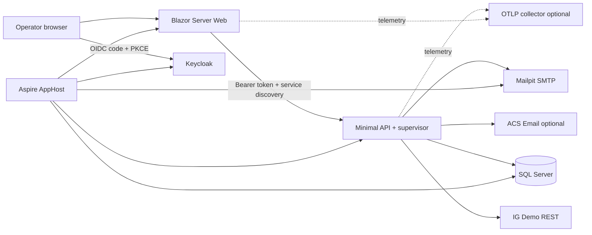
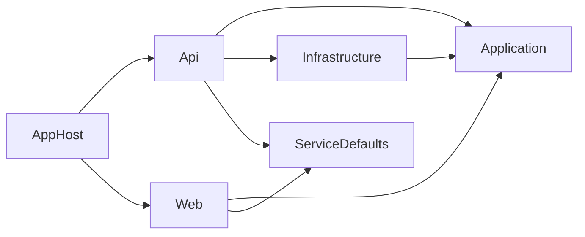
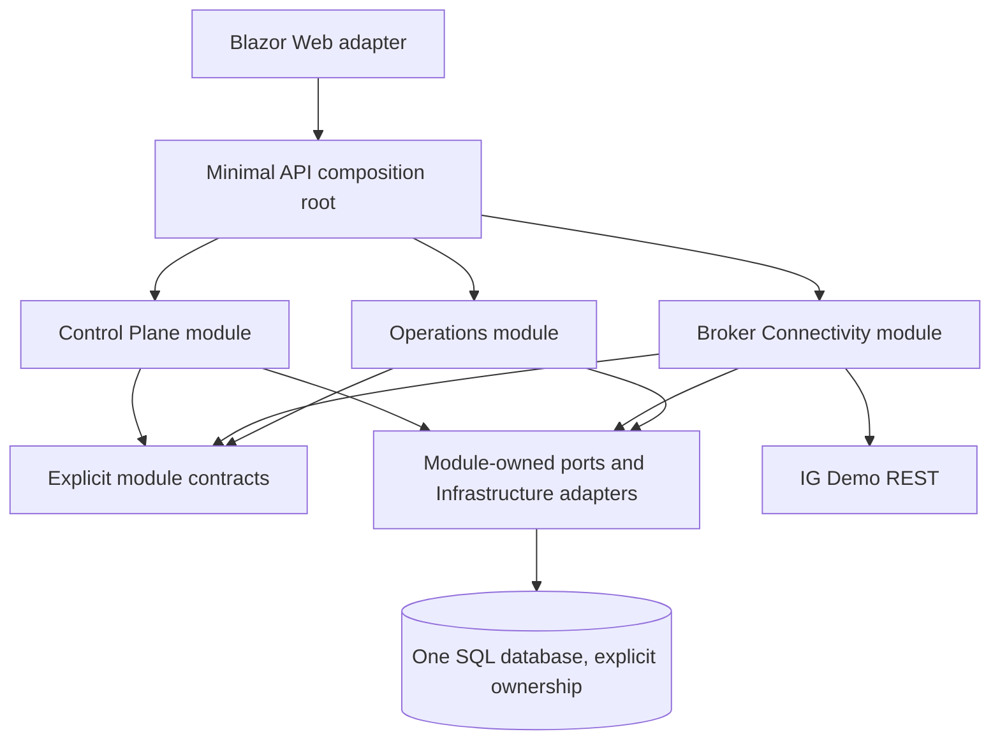

<!-- markdownlint-disable-file -->
# Task Research: .NET Solution Architecture Assessment

Architecture assessment of the TNC.Trading.Platform solution based on verified codebase evidence, project dependencies, tests, documentation, and relevant platform guidance.

## Task Implementation Requests

* Summarize application purpose, project responsibilities, technologies, dependencies, integrations, and assumptions.
* Compare the solution with Layered, Clean, Onion, Hexagonal, Vertical Slice, and Modular Monolith architectures, including evidence and confidence scores.
* Analyze dependency direction, cycles, coupling, separation of concerns, Dependency Inversion, infrastructure leakage, and architectural smells.
* Evaluate modularity, maintainability, testability, scalability, comprehensibility, and feature extensibility.
* Recommend a practical target architecture, prioritized improvements, an overall score, and an executive summary.

## Scope and Success Criteria

* Scope: Current solution structure, all project references, representative production paths, automated tests, implementation documentation, and external integrations. Runtime performance and production topology are assessed only where repository evidence exists.
* Assumptions:
  * Findings describe the repository state on 2026-07-26.
  * The documented operating context is one internal operator and one part-time owner; no staffed multi-team organization is assumed.
  * The checked-in AppHost topology represents supported local operation: one API, one Web host, SQL Server, Keycloak, and Mailpit.
  * Future market data, strategy, risk, order, and live-execution capabilities are requirements, not delivered architecture.
  * Scores are evidence-based architectural judgments, not measured reliability or security certifications.
* Success Criteria:
  * Every architecture classification is supported by file-and-line evidence and a 0-10 confidence score.
  * Dependency direction and architectural risks are verified from project files and representative code.
  * One practical target architecture is selected with prioritized, effort-sized improvements.

## Outline

1. Executive summary and current classification.
2. Application purpose, projects, technologies, and integrations.
3. Dependency graph and boundary review.
4. Comparison with six candidate architectural styles.
5. Design quality assessment.
6. Target architecture alternatives and selected direction.
7. Prioritized implementation improvements.

## Potential Next Research

* Reproduce the real IG Demo proof-data path with sanitized outbound-header capture.
  * Reasoning: Confirm the likely API-key contract defect before implementation.
  * Reference: src/TNC.Trading.Platform.Application/Services/PlatformIgProofDataEnricher.cs:12-18.
* Run two supervisor instances against one SQL database.
  * Reasoning: Measure duplicate work and concurrency behavior before scale-out or worker extraction.
  * Reference: src/TNC.Trading.Platform.Application/Services/PlatformAuthSupervisorRunner.cs:11-50.
* Produce a use-case and data-ownership map for the proposed initial modules.
  * Reasoning: Validate module cohesion before moving folders, namespaces, or assemblies.
  * Reference: src/TNC.Trading.Platform.Application/Services/PlatformStateCoordinator.cs:9-146.
* Define recovery, transaction, and idempotency invariants before live execution.
  * Reasoning: Financial execution needs explicit durable outcomes and reconciliation guarantees.
  * Reference: docs/business-requirements.md:69-98.
* Establish approved Azure topology, replica count, workload targets, RPO, and RTO.
  * Reasoning: These inputs determine whether and when process extraction is justified.
  * Reference: .github/copilot-instructions.md:47-65.

## Research Executed

### File Analysis

* TNC.Trading.Platform.slnx:1-29
  * Six production projects and eight test projects are included.
* global.json:1-6
  * The repository pins .NET SDK 10.0.200; all projects target net10.0.
* src/**/*.csproj and test/**/*.csproj
  * All project and package references were inventoried; 18 direct project-reference edges and no cycles were found.
* Representative API, Application, Infrastructure, Web, AppHost, ServiceDefaults, and test paths
  * Verified endpoint-to-handler flows, ports/adapters, state orchestration, EF persistence, auth, IG REST, notifications, telemetry, health, and closed-box tests.
* README.md:3-30; docs/business-requirements.md:10-119; docs/wiki/*.md
  * Distinguished delivered control-plane and IG Demo authentication behavior from the future algorithmic-trading scope.

### Code Search Results

* ProjectReference inventory
  * Production direction is AppHost -> API/Web, API -> Application/Infrastructure/ServiceDefaults, Web -> Application/ServiceDefaults, Infrastructure -> Application.
* Application port and Infrastructure adapter search
  * Configuration, runtime state, events, retries, snapshots, notifications, credentials, and IG access use inward-owned interfaces with outward implementations.
* Feature handler search
  * Operation-named request/response/handler types exist, but most behavior converges on shared services and PlatformStateCoordinator.
* SaveChangesAsync and transaction search
  * Persistence adapters frequently commit independently; no use-case-level unit-of-work boundary was found for multi-store workflows.
* Deployment and infrastructure search
  * No production deployment manifests, EF migrations, backup/restore definitions, durable messaging, or production secret/key-store configuration were found.

### External Research

* Microsoft Learn: domain analysis and service boundaries
  * Business capabilities and bounded contexts should drive module/service boundaries, not technical layers alone.
  * Source: [Domain analysis for microservices](https://learn.microsoft.com/azure/architecture/microservices/model/domain-analysis)
* Microsoft Learn: interservice communication
  * Network boundaries introduce latency, resiliency, versioning, and partial-failure costs.
  * Source: [Interservice communication](https://learn.microsoft.com/azure/architecture/microservices/design/interservice-communication)
* Microsoft Learn: EF Core transactions
  * Explicit transaction mechanics are available after the application defines the correct unit of work.
  * Source: [Using transactions](https://learn.microsoft.com/ef/core/saving/transactions)
* Microsoft Learn: hosted services
  * The current supervisor follows the hosted-service lifecycle; process extraction should respond to lifecycle and scaling requirements.
  * Source: [Background tasks with hosted services](https://learn.microsoft.com/aspnet/core/fundamentals/host/hosted-services)

### Project Conventions

* Standards referenced: .github/copilot-instructions.md:13-96; .github/instructions/architecture.instructions.md:17-56; .github/instructions/dotnet-stack.instructions.md:13-67; .github/instructions/tests.instructions.md:13-67.
* Intended architecture: cohesive Vertical Slices with CQRS-style contracts, thin endpoints, explicit dependencies, Aspire orchestration, Minimal APIs, Blazor, and SQL Server.
* Validation: an automated XML/DFS pass found 18 project-reference edges and zero cycles. `dotnet build TNC.Trading.Platform.slnx --no-restore` succeeded with zero errors and 73 warnings. Warnings included transitive package vulnerabilities, preview SDK notice, and test nullable warnings.

## Key Discoveries

### Project Structure

The product goal is an internal algorithmic trading platform for IG, eventually covering market data, strategies, orders, risk, run controls, monitoring, and auditability. The delivered system is narrower: an operator control plane and IG Demo authentication foundation with role-based access, configuration, supervised broker login, operational history, notifications, and read-only account/position proof queries. Live execution, streaming market data, strategy execution, order lifecycle, and trading-risk controls are not implemented. Evidence: docs/business-requirements.md:10-47; README.md:3-30.

| Project | Responsibility | Key evidence |
|---------|----------------|--------------|
| TNC.Trading.Platform.Application | Application core: feature contracts/handlers, business policy, orchestration, ports, and hosted supervisor. No source-project dependency. | src/TNC.Trading.Platform.Application/TNC.Trading.Platform.Application.csproj:1-13; src/TNC.Trading.Platform.Application/Services/PlatformApplicationServiceCollectionExtensions.cs:1-28 |
| TNC.Trading.Platform.Infrastructure | Outbound adapters: EF Core/SQL, credential protection, IG HTTP, SMTP/ACS notification, and persistence implementations. Depends on Application. | src/TNC.Trading.Platform.Infrastructure/TNC.Trading.Platform.Infrastructure.csproj:9-23; src/TNC.Trading.Platform.Infrastructure/Infrastructure/Platform/PlatformInfrastructureServiceCollectionExtensions.cs:18-68 |
| TNC.Trading.Platform.Api | Minimal API inbound adapter and backend composition root. Registers Application and Infrastructure and hosts the supervisor. | src/TNC.Trading.Platform.Api/Program.cs:1-99; src/TNC.Trading.Platform.Api/TNC.Trading.Platform.Api.csproj:1-23 |
| TNC.Trading.Platform.Web | Blazor Server operator UI/BFF. Uses OIDC and service-discovered HTTP clients to call API. | src/TNC.Trading.Platform.Web/Program.cs:1-73; src/TNC.Trading.Platform.Web/TNC.Trading.Platform.Web.csproj:1-17 |
| TNC.Trading.Platform.AppHost | Aspire local distributed-application composition for API, Web, SQL Server, Keycloak, and Mailpit. | src/TNC.Trading.Platform.AppHost/AppHost.cs:1-14; src/TNC.Trading.Platform.AppHost/AppHostProjectRegistration.cs:1-50 |
| TNC.Trading.Platform.ServiceDefaults | Shared service discovery, resilience, OpenAPI, health, logging, metrics, tracing, and optional OTLP export. | src/TNC.Trading.Platform.ServiceDefaults/Extensions.cs:21-156 |

The eight test projects mirror runtime surfaces. Application and Infrastructure have unit suites; AppHost has composition-model tests; API has unit and distributed integration tests; Web has unit, functional, and Playwright E2E suites. Application unit tests directly reference Infrastructure, so that test project does not enforce pure Application isolation. Evidence: TNC.Trading.Platform.slnx:1-29; test/TNC.Trading.Platform.Application/TNC.Trading.Platform.Application.UnitTests/TNC.Trading.Platform.Application.UnitTests.csproj:18-25.

### Technologies and Dependencies

* .NET 10 / C# with Minimal APIs and Blazor Server.
* .NET Aspire 13.2.3 for local orchestration, resource wiring, service discovery, resilience, and observability.
* EF Core 10.0.5 with SQL Server; guarded InMemory support for synthetic-auth tests.
* ASP.NET Core OIDC/OAuth 2.0 and JWT bearer auth; Keycloak locally, Entra configuration support for Azure.
* Radzen Blazor UI components.
* Data Protection for broker credentials.
* OpenTelemetry logging, tracing, metrics, and optional OTLP export.
* xUnit, Aspire distributed testing, bUnit, and Playwright.
* Notable package concerns: decentralized versions, Aspire Testing version skew, likely redundant Azure/EF references in API, and build-time transitive vulnerability warnings.

### External Integrations

* IG Demo REST API: session authentication, accounts, and open positions through a typed HTTP adapter. Evidence: src/TNC.Trading.Platform.Infrastructure/Infrastructure/Platform/Ig/IgSessionClient.cs:20-144.
* Keycloak: local identity provider orchestrated by Aspire with imported realm and role claims. Evidence: src/TNC.Trading.Platform.AppHost/AppHostInfrastructureRegistration.cs:27-40.
* Microsoft Entra ID: configuration and resolver support exist, but no reviewed deployment proves an operational Entra environment.
* SQL Server: durable configuration, credentials, runtime state, retries, login snapshots, events, audits, and notifications. Evidence: src/TNC.Trading.Platform.Infrastructure/Infrastructure/Persistence/PlatformDbContext.cs:5-114.
* Mailpit/SMTP and optional Azure Communication Services email.
* Optional OTLP collector/export endpoint.

### Implementation Patterns

The solution has real feature-oriented entry points. API endpoints map transport models into Application requests and invoke operation-specific handlers. However, handlers usually delegate to shared services, especially PlatformStateCoordinator, which depends on configuration plus six persistence/integration ports, state/schedule helpers, notifications, time, and logging. This makes Vertical Slice a surface organization rather than end-to-end ownership. Evidence: src/TNC.Trading.Platform.Api/Features/Platform/PlatformEndpoints.cs:57-97; src/TNC.Trading.Platform.Application/Services/PlatformStateCoordinator.cs:9-32.

Dependency Inversion is a clear strength. Application owns output ports such as IPlatformConfigurationStore and IPlatformEventStore; Infrastructure implements and registers them. Deterministic state-transition and schedule policies are independent of EF and HTTP. Evidence: src/TNC.Trading.Platform.Application/Services/IPlatformConfigurationStore.cs:5-16; src/TNC.Trading.Platform.Infrastructure/Infrastructure/Platform/PlatformInfrastructureServiceCollectionExtensions.cs:46-64; src/TNC.Trading.Platform.Application/Services/PlatformStateTransitionEngine.cs:7-75.

The principal boundary weaknesses are:

* Application references the full ASP.NET Core shared framework and registers AuthorizationOptions, weakening framework neutrality.
* API startup resolves PlatformDbContext and other concrete Infrastructure types.
* Friend assemblies expose internals to specific hosts and tests.
* The auth audit endpoint performs use-case orchestration in API rather than dispatching an Application handler.
* PlatformConfigurationRestartPolicy is Infrastructure policy coupled to an EF entity.
* PlatformApiClient is a broad cross-feature Web facade.

### Complete Examples

Representative configuration update flow:

```text
Blazor Configuration page
  -> PlatformApiClient PUT /api/platform/configuration
  -> API validation and mapping
  -> UpdatePlatformConfigurationHandler
  -> IPlatformConfigurationStore
  -> SqlPlatformConfigurationStore
    -> configuration + protected credentials + audit
    -> one EF SaveChangesAsync
  -> PlatformStateCoordinator.TickAsync
    -> separately committing state/event/retry/notification operations
```

The transport-to-handler path is a vertical slice. The command is not one atomic unit: configuration commits before reconciliation, and coordinator collaborators can commit independently. A failure can therefore produce a durable update plus an error response. Evidence: src/TNC.Trading.Platform.Application/Features/UpdatePlatformConfiguration/UpdatePlatformConfigurationHandler.cs:9-13; src/TNC.Trading.Platform.Infrastructure/Infrastructure/Platform/SqlPlatformConfigurationStore.cs:45-115; src/TNC.Trading.Platform.Infrastructure/Infrastructure/Platform/EfPlatformEventStore.cs:38-56.

Representative status query flow:

```text
GET /api/platform/status
  -> GetPlatformStatusHandler
  -> PlatformStateCoordinator.GetStatusAsync
    -> TickAsync may mutate state and invoke external work
    -> read configuration, state, schedule, snapshot, and proof data
  -> status projection
```

This violates normal CQRS expectations: a read can persist changes and depend on external integration availability. Evidence: src/TNC.Trading.Platform.Application/Services/PlatformStateCoordinator.cs:34-77.

### API and Schema Documentation

API routes are grouped under PlatformEndpoints and protected by Viewer, Operator, and Administrator policies. Scalar/OpenAPI is enabled by the host. The persistence schema is represented by one PlatformDbContext with eight entity sets across configuration, credentials, authentication state, retry, snapshots, events, audits, and notifications. No EF migration files were found; startup uses EnsureCreatedAsync and, in Development with SQL Server, EnsureDeletedAsync. Evidence: src/TNC.Trading.Platform.Api/Features/Platform/PlatformEndpoints.cs:22-122; src/TNC.Trading.Platform.Api/Program.cs:24-41; src/TNC.Trading.Platform.Infrastructure/Infrastructure/Persistence/PlatformDbContext.cs:5-114.

### Configuration Examples

The runtime topology is:



## Technical Scenarios

### Current Architecture Classification

The closest match is **a Clean/Hexagonal-inspired layered monolith with vertical-slice entry points, plus separate Web and Aspire host processes**.

Scores measure implementation fit, not architecture quality or probability.

| Style | Fit | Evidence for | Evidence against |
|-------|----:|--------------|------------------|
| Layered / N-Tier | 8.5/10 | Projects clearly separate presentation/process hosts, Application, Infrastructure, and hosting defaults. The graph is acyclic. | Infrastructure points inward through interfaces rather than classic downward-layer dependencies; API startup accesses concrete EF/Infrastructure behavior; Application carries shared Web auth concerns. |
| Clean Architecture | 7.0/10 | Application has no source-project dependency and owns ports implemented by Infrastructure. DTO mappings prevent EF entities crossing HTTP. | No separate domain center; Application references ASP.NET Core; friend assemblies and concrete EF startup access weaken strict boundaries. |
| Onion Architecture | 4.5/10 | Policy and ports sit inward of EF, HTTP, email, and IG adapters. | No explicit domain/application/infrastructure rings or domain-owned aggregate model; the inner project is not framework-neutral. |
| Hexagonal / Ports and Adapters | 7.0/10 | Strong outbound ports for stores, credentials, notifications, time, and IG, with EF/HTTP/email adapters. API and Web are inbound adapters. | Inbound boundaries are inconsistent; audit orchestration is in API, some store ports are broad, and Web shares Application auth implementation. |
| Vertical Slice | 6.0/10 | Operation-named API/Application folders, CQRS-style request/response/handler contracts, validators, and mappings are real. | Most behavior converges on shared services and PlatformStateCoordinator; slices do not own persistence and transactions end to end; audit bypasses the pattern. |
| Modular Monolith | 2.5/10 | One main backend deployment and internal assembly surfaces offer a starting point. | Projects are technical layers, not business modules. One coordinator and one DbContext span concerns; no module contracts, local composition roots, ownership rules, or enforced module dependencies exist. |

Layered scores highest because it best describes the solution-level project topology. Clean and Hexagonal describe its dependency rule and adapter technique. Vertical Slice describes the organization of many inbound operations, but not the full behavior path. Onion is only an influence. Modular Monolith is a useful target direction, not the current architecture.

### Dependency Review

An arrow means a direct ProjectReference from tail to head.



Production dependency findings:

* Direction: presentation/composition depends on Application and adapters; Infrastructure depends inward on Application. This is appropriate for Clean/Hexagonal dependency inversion.
* Circular dependencies: none across all 14 projects. Automated traversal found 18 direct edges and zero cycles; the solution builds successfully.
* Tight coupling: concentrated in PlatformStateCoordinator, the single PlatformDbContext, API startup access to concrete infrastructure, friend assemblies, and broad PlatformApiClient.
* Separation of concerns: good at project and adapter level; weaker at use-case and business-capability level.
* Dependency Inversion violations: no production reverse project reference from Application to Infrastructure exists. Framework coupling in Application and Infrastructure-owned restart policy are boundary leaks rather than project-cycle violations.
* Infrastructure leakage: API directly resolves PlatformDbContext and retention types; restart policy depends on an EF entity. EF entities were not found leaking into HTTP contracts.
* Test-boundary smell: Application unit tests reference Infrastructure and instantiate concrete EF adapters.
* Transaction smell: stores own SaveChangesAsync, making multi-store workflow atomicity implicit and partial commits possible.
* CQRS smell: status and event reads can trigger TickAsync and mutate state.
* Scaling smell: each API replica would host the one-second supervisor; no distributed lease, leader election, or concurrency token was evidenced.
* Package smell: package versions are decentralized and skewed, with current vulnerability warnings.

### Design Evaluation

| Attribute | Assessment | Strengths | Areas for improvement |
|-----------|------------|-----------|-----------------------|
| Modularity | 6.5/10 | Six production projects, explicit ports/adapters, feature entry points, separate Web/API processes. | Technical layers dominate ownership; shared coordinator and DbContext span capabilities. |
| Maintainability | 6.5/10 | Thin endpoints, mappings, explicit registrations, deterministic policy helpers, focused tests. | Coordinator hotspot, duplicated rules across UI/API/Application, pass-through services, documentation contradictions. |
| Testability | 7.5/10 | Port abstractions, time/delay fakes, state-engine tests, real Keycloak distributed tests, AppHost model tests, Playwright smoke. | Fake response masks likely IG contract mismatch; Application tests cross into Infrastructure; historical mutation score is low. |
| Scalability | 5.0/10 | Stateless HTTP and SQL provide an evolutionary base; a future worker can be extracted. | Supervisor duplicates per API replica, proof data is process-local, no distributed coordination or measured workload targets. |
| Ease of understanding | 6.5/10 | Clear project names, feature contracts, documentation, state names, and explicit runtime composition. | Actual behavior requires tracing across host, handler, coordinator, multiple stores, and adapters; stale wiki claims add ambiguity. |
| Ease of adding features | 7.0/10 adjacent / 5.0/10 trading | Nearby control-plane features fit existing handler/port patterns. | Adding market data, strategies, risk, execution, and reconciliation to the same coordinator would create unsafe coupling. |
| Reliability and recoverability | 5.5/10 | Retry/backoff, state policy, retention, audit records, and non-fatal proof enrichment are thoughtful. | Development deletes SQL, no migrations, shallow readiness, no production backup/restore evidence, ambiguous partial commits. |
| Security and observability | 7.0/10 | OIDC/PKCE, JWT roles, protected credentials, redaction, OpenTelemetry, request scopes, and audit history. | Production Data Protection key persistence, secret store, host restrictions, dependency health, alerts, and deployment posture are unproven. |

Overall strengths:

* Correct acyclic dependency direction and meaningful Dependency Inversion.
* Proportionate single-backend deployment for one part-time owner.
* Strong safety foundation around roles, secrets, Test/Demo safeguards, audit, retries, and state decisions.
* A useful test pyramid spanning deterministic logic through real Keycloak and browser flows.
* Aspire and OpenTelemetry provide a solid local operations foundation.

Main weaknesses:

* Use-case cohesion and transaction ownership lag behind the project-level boundaries.
* PlatformStateCoordinator is an emerging god service and a poor home for future trading domains.
* Read operations can mutate state.
* The current runtime is intentionally single-instance but does not enforce that constraint.
* Schema evolution, dependency readiness, key persistence, deployment, backup, and recovery are not production-ready.
* A likely IG proof-data defect and destructive Development startup undermine delivered behavior.

### Recommended Target Architecture

Adopt an **evolutionary business-module modular monolith**, while preserving the current Clean/Hexagonal dependency direction, vertical-slice use-case contracts, Web/API process topology, Aspire orchestration, one SQL database, and one backend deployment initially.

This means gradual business ownership, not a rewrite and not a project per feature. Start with delivered capabilities:

* Control Plane: operator configuration, run controls, environment safeguards, and status projections.
* Broker Connectivity: IG credentials, session lifecycle, retry policy, and broker proof data.
* Operations: audit events, notifications, retention, and operational history.

Future Market Data, Strategy Runtime, Risk, Execution, and Reconciliation modules should be introduced only when requirements and invariants are implemented. Risk must be an explicit execution precondition, not an optional downstream subscriber.

Keep cross-module calls in process until asynchronous behavior or independent scaling has a measured benefit. A module may begin as namespaces/folders enforced by architecture tests; separate assemblies are justified when they materially improve enforcement. Keep one physical database while assigning table and write ownership logically. Do not default to separate databases or an event bus.



Extract a worker only when evidence shows one of these triggers:

* API must scale horizontally while exactly one broker-session owner remains active.
* Market-data or strategy work has materially different CPU, memory, latency, connection, or restart behavior.
* Continuous work causes API deployment/failure coupling that violates an availability target.
* Load tests show one process cannot meet both control-plane and trading objectives.

Before extraction, implement leases or durable work claiming, idempotency, checkpoints, bounded retries, poison-work handling, trace correlation, health semantics, and recovery tests.

#### Considered Alternatives

| Alternative | Weighted fit | Decision |
|-------------|-------------:|----------|
| Tighten current technical layers | 7.60/10 | Good stabilization strategy and lowest migration cost, but it does not create durable business ownership for future trading capabilities. Use it as Stage 0, not the final direction. |
| Evolutionary modular monolith | 8.08/10 | Selected. Best balance of safety, cohesion, test continuity, migration cost, and one-owner operability. |
| Additional services/microservices | 5.63/10 | Reject broad decomposition now. It adds deployment, messaging, consistency, auth, observability, and recovery costs before independent scaling or team autonomy exists. Retain conditional worker extraction. |

### Prioritized Improvements

Effort assumes one developer familiar with the solution.

| Priority | Improvement | Benefit | Effort |
|---------:|-------------|---------|--------|
| P0 | Correct the IG proof API-key contract and add a composed auth-adapter-to-proof-enricher test. | Restores delivered account/position proof behavior and catches adapter-contract drift. | S |
| P0 | Remove normal Development EnsureDeletedAsync and prove SQL data survives API/AppHost restart. | Prevents unexpected data loss and makes persistent resources truthful. | S |
| P0 | Define truthful configuration-update/reconciliation outcomes. Persist a durable pending/failed state or make the owned operation atomic. | Removes ambiguous error-after-commit behavior and enables safe retry/recovery. | M |
| P1 | Introduce EF migrations and a tested startup migration policy. | Controlled, reviewable schema evolution for durable use. | M |
| P1 | Enforce one active supervisor; add lease/concurrency controls before scale-out. | Prevents duplicate IG calls, events, notifications, and lost updates. | M |
| P1 | Add SQL and identity-provider readiness checks. | Makes readiness reflect ability to serve protected control-plane operations. | S |
| P1 | Persist and protect Data Protection keys; test restart/replacement behavior. | Keeps broker credentials decryptable across host replacement. | M |
| P1 | Audit vulnerability warnings and align package versions, preferably through central package management. | Reduces dependency risk and version drift. | S-M |
| P1 | Separate read projections from state-changing ticks/commands. | Restores predictable CQRS behavior and reduces read-path coupling. | M |
| P1 | Define Control Plane, Broker Connectivity, and Operations contracts, ownership, and dependency rules. | Stops coordinator growth and creates practical future extraction boundaries. | M |
| P1 | Move auth audit orchestration into an Application/module command. | Restores a consistent thin transport boundary. | S |
| P1 | Replace hidden store commits with explicit use-case transaction ownership. | Makes atomicity, retries, idempotency, and partial failure reviewable. | L |
| P1 | Add architecture tests for inward dependencies and module rules. | Prevents reverse references and folder-only modularity. | S |
| P2 | Move business restart policy inward and make auth policy definitions framework-neutral where practical. | Reduces EF and ASP.NET Core leakage into inner policy. | M |
| P2 | Split PlatformApiClient by module capability while sharing HTTP/auth plumbing. | Limits route and DTO coupling as modules grow. | S-M |
| P2 | Move Infrastructure-using Application tests to the correct suite or use core-owned fakes. | Makes test boundaries accurately signal coverage type. | S-M |
| P2 | Reconcile wiki contradictions and raise mutation/coverage sensitivity around state, transactions, idempotency, and failure ordering. | Improves maintainability and refactoring confidence. | M-L |
| P3 | Design a worker extraction proof only after a scaling/lifecycle trigger is measured. | Enables independent lifecycle without premature distributed-system cost. | M |

Recommended delivery sequence:

1. Stabilize correctness and persistence behavior.
2. Add migrations, readiness, key persistence, and single-supervisor guarantees.
3. Establish module ownership and architecture tests one use case at a time.
4. Make transactions and cross-module consistency explicit.
5. Extract a worker only after measured runtime evidence.

## Executive Summary

TNC.Trading.Platform most closely follows a **Layered architecture**, strengthened by **Clean/Hexagonal dependency inversion** and **partial Vertical Slice organization**. Its production graph is acyclic, Application owns meaningful ports, Infrastructure implements adapters, and Web reaches API over HTTP. It is not currently Onion in a strong sense and is not a Modular Monolith because business modules, ownership boundaries, and module contracts are absent.

The current architecture is appropriate for the delivered operator control plane and IG Demo authentication foundation, especially for one part-time owner. Replacing it or splitting it into microservices would be disproportionate. The right evolution is to retain the deployment and dependency model, fix immediate correctness and operational defects, then introduce explicit in-process business modules before future trading capabilities expand the shared coordinator.

The overall architecture score is **6.3/10**: a sound, testable foundation with good security and dependency direction, but significant gaps in use-case cohesion, transaction semantics, schema lifecycle, scale-out safety, and production operations. Addressing the P0/P1 items would move the solution toward a strong 7-8/10 foundation without architectural churn.

### Overall Score Rubric

| Criterion | Weight | Score | Weighted result |
|-----------|-------:|------:|----------------:|
| Dependency and boundary integrity | 15% | 8.0 | 1.20 |
| Use-case and module cohesion | 15% | 5.5 | 0.83 |
| Correctness and safety semantics | 20% | 5.5 | 1.10 |
| Transactions and recoverability | 15% | 5.0 | 0.75 |
| Testability and verification | 15% | 7.5 | 1.13 |
| Operational readiness | 10% | 5.5 | 0.55 |
| Team fit and evolutionary capacity | 10% | 7.5 | 0.75 |
| Total | 100% | | **6.30** |

## Research Sources

Detailed delegated evidence is retained in:

* .copilot-tracking/research/subagents/2026-07-26/solution-dependencies-research.md
* .copilot-tracking/research/subagents/2026-07-26/implementation-boundaries-research.md
* .copilot-tracking/research/subagents/2026-07-26/runtime-quality-research.md
* .copilot-tracking/research/subagents/2026-07-26/target-architecture-alternatives-research.md
