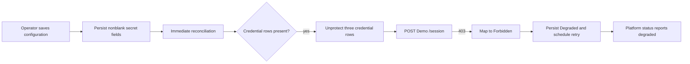

<!-- markdownlint-disable-file -->
# Task Research: IG Login 403 Degraded Health

Investigate why saving credentials that succeed in IG API Companion produces a `403` response and marks the platform degraded after a recent refactor.

## Task Implementation Requests

* Trace the saved IG credential flow to the HTTP request and degraded-health status.
* Identify the regression introduced by the recent refactor.
* Recommend the smallest evidence-based repair and validation.

## Scope and Success Criteria

* Scope: Current workspace implementation, tests, relevant git history, and IG API requirements as evidenced by project references or official documentation.
* Assumptions: The submitted credentials are valid because they succeed in IG API Companion; the observed `403` is returned by an IG endpoint during post-save validation or login.
* Success Criteria:
  * Identify the exact request, configuration, and health-status code path.
  * Establish the likely refactor regression with file-and-line evidence.
  * Evaluate feasible fixes and select one with targeted validation steps.

## Outline

1. Identify the request and state transition that produces the reported degraded status.
2. Compare pre- and post-refactor authentication behavior.
3. Evaluate migration, protocol, and diagnostic alternatives.
4. Select the smallest repair and exact validation sequence.

## Executive Conclusion

The platform is becoming degraded because an IG `POST /session` response with
HTTP `403` is mapped to a `Forbidden` broker-authentication result and persisted
as degraded authentication state. The status display is reporting the upstream
failure correctly; it is not the cause.

The most likely regression introduced by the 2026-07-28 Clean Architecture
refactor is unavailable or partially replaced Data Protection ciphertext after
the new SQL-backed shared key-ring migration. The new credential read path
catches an `CryptographicException` and substitutes an empty value, but the
credential-presence check still says that the three database rows are complete.
The application can therefore send an empty or mixed credential set to IG,
receive `403`, and report degraded state. A configuration save preserves old
ciphertext for every blank secret field, so entering fewer than all three
secrets does not repair a migrated row.

This is a strong, but conditional, diagnosis. It is confirmed only if the
active API cannot decrypt one or more Demo credential rows, or the configuration
audit shows that a field was omitted during the attempted repair. A complete
three-field re-save that decrypts successfully falsifies this cause for that
attempt and moves the investigation to IG request compatibility and provider
diagnostics.

The discovered missing `Accept` header and the `Version: 3` plus CST/header-token
combination are genuine IG protocol defects, but they predate the refactor. The
pre-refactor client used the same base URL, headers, version, JSON body, lack of
`Accept`, and response-token expectation. They should be corrected, but are not
the best explanation for a failure that began immediately after this refactor.

## Research Executed

### File Analysis

* `src/TNC.Trading.Platform.Api/Features/Platform/PlatformEndpoints.cs:40-41`
  * `PUT /api/platform/configuration` requires the Operator policy. A `403` on
    this route is distinct from an IG authentication failure and prevents the
    save/reconciliation flow from executing.
* `src/TNC.Trading.Platform.Application/Features/UpdatePlatformConfiguration/UpdatePlatformConfigurationHandler.cs:13-16`
  * A successful configuration write immediately initiates platform-authentication
    reconciliation.
* `src/TNC.Trading.Platform.Infrastructure/Infrastructure/Credentials/DataProtection/ProtectedCredentialService.cs:17-28,31-47,49-75`
  * Presence means protected rows exist, nonblank submitted secrets alone are
    updated, and unreadable ciphertext becomes an empty value.
* `src/TNC.Trading.Platform.Infrastructure/Infrastructure/Integrations/Ig/IgBrokerAuthenticationGateway.cs:35-65,174-183`
  * The active client posts Demo credentials to `session`; session `403` maps to
    a `Forbidden` result. The user log text, `Received HTTP response headers
    after 51.9866ms - 403`, is consistent with `HttpClient` receiving this
    upstream response but does not identify its URL on its own.
* `src/TNC.Trading.Platform.Application/Features/ReconcilePlatformAuthentication/PlatformAuthenticationReconciler.cs:371-396,536-572`
  * A failed gateway authentication is converted into persisted degraded state,
    a retry cycle, an `auth/FailureDetected` event, and notification work.
* `src/TNC.Trading.Platform.Infrastructure/Infrastructure/DependencyInjection/PlatformInfrastructureServiceCollectionExtensions.cs:91-94`
  * The client is fixed to `https://demo-api.ig.com/gateway/deal/`; it cannot
    authenticate against IG Live in the current implementation.
* `src/TNC.Trading.Platform.ServiceDefaults/Extensions.cs:66-87`
  * The refactor introduced the SQL-backed Data Protection key-ring setup.
* `src/TNC.Trading.Platform.Api/Program.cs:14-20`
  * Data Protection is configured before Infrastructure registration and use.

### Git History Analysis

* `8df68d8880b2af3015722095ebbad30e1908a71c` (2026-07-28, `Refactor Solution towards a Clean Architecture`)
  * Replaced `IgSessionClient`, introduced the shared SQL-backed Data Protection
    key ring, and changed unavailable-key behavior from an exception to empty
    credentials.
* Parent of `8df68d8880b2af3015722095ebbad30e1908a71c`, `src/TNC.Trading.Platform.Infrastructure/Infrastructure/Platform/Ig/IgSessionClient.cs:22-62,87-135`
  * Confirms the old request used the same `POST session`, `X-IG-API-KEY`,
    `Version: 3`, body, and CST/header-token follow-up model as the replacement.
* `abe477a343ed59a4c9d370165d25d0ee775c4b8b` (2026-03-15)
  * Added the shared HTTP-client resilience pipeline before the live IG login
    implementation and before the refactor, so it is not a credible introduced
    cause.

### Test Evidence

* `test/TNC.Trading.Platform.Infrastructure/TNC.Trading.Platform.Infrastructure.UnitTests/ProtectedCredentialServiceTests.cs:10-37`
  * Proves unreadable ciphertext now yields empty runtime values.
* `test/TNC.Trading.Platform.Infrastructure/TNC.Trading.Platform.Infrastructure.UnitTests/ProtectedCredentialServiceTests.cs:75-110`
  * Proves a full current-process overwrite reprotects all three values.
* `test/TNC.Trading.Platform.Infrastructure/TNC.Trading.Platform.Infrastructure.UnitTests/Integrations/Ig/IgBrokerAuthenticationGatewayTests.cs:13-153`
  * Proves Demo routing, session status mapping, and non-fatal proof-query
    failures. A `403` from accounts/positions does not degrade an otherwise
    authenticated session.
* `test/TNC.Trading.Platform.Infrastructure/TNC.Trading.Platform.Infrastructure.UnitTests/AuthRetryCycleTests.cs:467-502`
  * Proves a rejected authentication result persists degraded state and retries.

### External Research

* IG Labs [REST Trading API Guide](https://labs.ig.com/rest-trading-api-guide.html)
  * Requires JSON request/response media types, an `X-IG-API-KEY`, and a
    `Version` header. It documents Demo and Live gateway URLs separately,
    `errorCode` in error bodies, and `X-REQUEST-ID` correlation.
  * It documents CST plus `X-SECURITY-TOKEN` for session v1/v2 and OAuth bearer
    tokens plus `IG-ACCOUNT-ID` for v3.
* IG Labs [FAQ](https://labs.ig.com/faq.html)
  * Lists invalid/disabled API keys, wrong environment credentials, missing
    request headers, and malformed requests as login causes. It recommends
    validating with API Companion.

### Project Conventions

* Standards referenced: `.github/copilot-instructions.md`,
  `.github/instructions/architecture.instructions.md`,
  `.github/instructions/auth.instructions.md`,
  `.github/instructions/configuration.instructions.md`, and
  `.github/instructions/tests.instructions.md`.
* Instructions followed: Clean Architecture dependency direction, protected
  secret handling, minimal evidence-led repair selection, and focused tests.

## Key Discoveries

### Runtime Flow



The platform's public degraded indicator is application state returned by
`GET /api/platform/status`; it is not an ASP.NET readiness-check result. The
application can therefore report degraded IG authentication while
`/health/ready` remains healthy.

### Data Protection Regression Mechanism

The relevant behavior reduces to the following sequence:

```text
legacy protected credential row
  -> active shared key ring cannot unprotect it
  -> credential service returns "" instead of surfacing unusability
  -> presence still reports the row exists
  -> reconciler attempts POST /session with blank or mixed values
  -> IG returns 403
  -> reconciler persists Degraded
```

The write-only UI intentionally displays secret fields as empty. Empty fields
also mean "retain prior ciphertext," not "clear and replace." Thus an operator
may submit an API key and leave identifier/password blank, believe the
credentials were refreshed, and still use one or two unreadable pre-refactor
rows at login.

### IG Request Compatibility Finding

The current request is:

```http
POST https://demo-api.ig.com/gateway/deal/session
X-IG-API-KEY: [protected Demo API key]
Version: 3
Content-Type: application/json

{"identifier":"[redacted]","password":"[redacted]","encryptedPassword":false}
```

It does not explicitly send `Accept: application/json; charset=UTF-8` and then
expects CST plus `X-SECURITY-TOKEN`, which corresponds to IG session v1/v2 rather
than v3 OAuth. This should be repaired by using a consistent v2/header-token
contract if accounts and positions continue to depend on these two headers.

## Technical Scenarios

### Scenario 1: Refactor-Migrated Credentials Cannot Be Read

**Requirements:**

* Repair a pre-refactor credential set without logging, exposing, or attempting
  to recover its secret material.
* Avoid continued IG login attempts when a configured credential row cannot be
  decrypted.

**Preferred Approach:**

* Verify per-field decryptability in the active API process and inspect the
  existing redacted configuration audit's secret-update flags.
* If a field is unreadable or omitted, re-enter all three Demo secrets in one
  save so they are protected by the active key ring.
* For a durable fix, distinguish usable credentials from merely present rows and
  stop before calling IG when a row is unreadable.

```text
Current operational repair:
  Running API + active SQL key ring
    -> submit nonblank Demo API key, identifier, and password together
    -> save / reconcile
    -> verify a new successful session

Permanent implementation changes:
  ProtectedCredentialService.cs
  PlatformStateTransitionEngine.cs
  PlatformAuthenticationReconciler.cs
  ProtectedCredentialServiceTests.cs
```

**Implementation Details:**

Do not add automatic migration for ciphertext that cannot be unprotected. Its
plaintext is unavailable, so a safe migration is impossible. Instead, introduce
a redacted result such as `ApiKeyUsable`, `IdentifierUsable`, and
`PasswordUsable`; use it to produce configuration-remediation state before the
gateway is invoked. Do not include secret values, ciphertext, or key material in
events, logs, tests, or diagnostics.

#### Considered Alternatives

* Automatic ciphertext re-encryption: rejected for unreadable ciphertext; it
  cannot be decrypted to plaintext and would conceal the remediation required.
* Treating row presence as sufficient: rejected; this is the false-complete
  condition enabling the regression.

### Scenario 2: IG Header-Token Session Compatibility

**Requirements:**

* Make the session request compatible with the current CST/header-token proof
  requests while preserving Demo-only support and secret redaction.

**Preferred Approach:**

* Set `Accept: application/json; charset=UTF-8` and use `Version: 2` for the
  session request. Keep `/accounts` v1 and `/positions` v2 header-token calls.

```csharp
request.Headers.Accept.ParseAdd("application/json; charset=UTF-8");
request.Headers.Add("Version", "2");
```

This is a follow-up protocol correction, not the selected root-cause repair for
the refactor regression. It becomes the next repair when all three newly saved
credentials are confirmed decryptable and the provider-side `403` persists.

#### Considered Alternatives

* Retain v3 while consuming CST/header tokens: rejected because IG documents
  OAuth bearer authentication for v3, not the header-token model.
* Full OAuth v3 migration: technically valid but rejected for this incident; it
  requires access/refresh-token parsing, renewal, bearer propagation, and
  `IG-ACCOUNT-ID` management across dependent calls.
* Add `Accept` only: rejected as incomplete because it leaves the session-model
  mismatch intact.

### Scenario 3: Distinguishing an IG 403 From a Platform API 403

**Requirements:**

* Determine the origin of a `403` without leaking secrets.

**Preferred Approach:**

* Correlate the timestamp with outbound OpenTelemetry HTTP activity and the
  persisted `auth/AuthAttempted` and `auth/FailureDetected` events. Record only
  the provider `errorCode`, `X-REQUEST-ID`, route/path, response status,
  `Version`, `Accept` presence, and credential-decryptability booleans.

#### Considered Alternatives

* Logging raw HTTP bodies or all headers: rejected because they can contain
  credentials, CST, `X-SECURITY-TOKEN`, or OAuth tokens.

## Selected Approach And Validation Plan

### Selected Approach

Treat the incident first as a Data Protection migration/readability regression.
Perform a secret-safe active-process check that each of the three Demo rows is
decryptable, inspect whether the previous save updated all three fields, then
submit all three Demo secrets in one save if any field is unreadable or omitted.

This is the smallest evidence-based remediation: the existing save path already
reprotects supplied values with the active key ring, and it directly repairs the
only behavior introduced by the relevant refactor. No automatic conversion of
unknown ciphertext is safe or possible.

### Discriminating Checks

1. Identify the 403 route from its trace. `PUT /api/platform/configuration`
   means Operator authorization failed; `POST /gateway/deal/session` is the IG
   failure that explains degraded state.
2. Review the configuration audit for `SecretsUpdated` metadata for API key,
   identifier, and password. All three must be true for a complete rotation.
3. In the active API process, test only boolean decryptability for each Demo
   field. Do not emit values, ciphertext, or key identifiers.
4. When one is unreadable or was omitted, re-enter all three Demo values in one
   save. Confirm the next session attempt no longer returns `403`.
5. When all are readable and the session still returns `403`, capture only IG
   `errorCode` and `X-REQUEST-ID`, then implement the Scenario 2 v2 plus
   `Accept` correction and repeat the Demo verification.

### Focused Automated Tests For Authorized Implementation

* Seed one unreadable and two readable protected credential rows; assert the
  reconciler exposes a remediation state and makes no IG session request.
* Verify a complete nonblank three-field update creates three readable rows
  under the active provider and works from a fresh provider sharing the SQL key
  ring.
* Verify a partial update retains an unreadable omitted field and is not falsely
  treated as a usable credential set.
* Capture the gateway session request and assert `Accept`, JSON content type,
  `Version: 2`, redacted credential field names, and compatible header-token
  proof calls.
* Verify a synthetic provider `403` records only allowlisted `errorCode` and
  `X-REQUEST-ID` diagnostic metadata.

## Potential Next Research

* Validate the detailed IG `/session` v2 contract in the interactive reference
  before changing the wire protocol.
  * Reasoning: the selected header-token correction is supported by IG's guide,
    but exact version-specific fields should be confirmed before implementation.
  * Reference: [IG Labs REST Trading API Reference](https://labs.ig.com/rest-trading-api-reference.html)
* Verify the Data Protection key-ring database topology for all active API
  replicas.
  * Reasoning: a single instance may rotate credentials successfully while a
    replica with different key access continues to fail.
  * Reference: `src/TNC.Trading.Platform.ServiceDefaults/Extensions.cs:66-87`

## Related Research

* `.copilot-tracking/research/subagents/2026-08-06/ig-login-flow-research.md`
* `.copilot-tracking/research/subagents/2026-08-06/ig-login-refactor-history-research.md`
* `.copilot-tracking/research/subagents/2026-08-06/ig-api-auth-requirements-research.md`
* `.copilot-tracking/research/subagents/2026-08-06/ig-login-403-alternatives-research.md`
