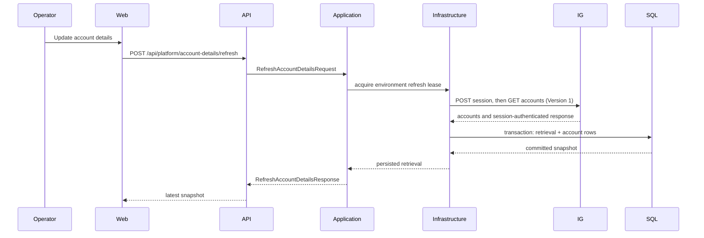

<!-- markdownlint-disable-file -->
# Task Research: Account Details

Research the delivery of IG account-details retrieval from the IG test account, SQL persistence with timestamps, UI presentation, and an operator-triggered update option for the trading application.

## Task Implementation Requests

* Retrieve account details from the IG `GET /gateway/deal/accounts` endpoint.
* Store returned accounts and their balances in SQL with a date stamp.
* Display the stored account details on a new Account Details UI page.
* Provide an option to update the details.

## Scope and Success Criteria

* Scope: Design an Account Details vertical slice that retrieves real data from the configured IG test account across Application, Infrastructure, API, Web, SQL Server, and tests. The initial UI reads the latest saved retrieval; history is retained for audit/recovery but is not initially navigable.
* Exclusions: Live IG support, funds-transfer actions, polling, raw provider-payload storage, and session-token persistence.
* Assumptions: "Date stamp" means a UTC timestamp shared by all accounts returned by one successful refresh. The supplied two-account JSON is representative; the implementation must persist every valid item returned, not hard-code two accounts.
* Success Criteria:
  * Retrieve the authenticated IG test-account list with IG API version 1 and its existing session-header model.
  * Atomically save a timestamped retrieval and every returned account in SQL Server.
  * Automatically save the first successful account retrieval of each trading day after the first successful logon, while retaining an Operator-only update command.
  * Provide a Viewer-readable Account Details page that can browse the latest and earlier saved retrievals.
  * Preserve the repository's Clean Architecture boundaries: Application owns contracts and ports; Infrastructure owns IG, EF Core, and secrets; API routes remain thin; Web never receives IG credentials or session tokens.

## Outline

1. Evidence and project conventions
2. Account API and persistence contract
3. Evaluated alternatives and selected approach
4. Automatic daily retrieval, API, and historical UI design
5. Delivery, validation, risks, and open product decisions

## Research Executed

### File Analysis

* src/TNC.Trading.Platform.Infrastructure/Infrastructure/Integrations/Ig/IgBrokerAuthenticationGateway.cs:L13-L175
  * The existing IG test-environment gateway creates an IG v2 session, retains CST and X-SECURITY-TOKEN only in local request flow, and already calls `GET accounts` at version 1.
  * The existing call reduces the provider response to a preferred-account proof. It is deliberately best-effort and cannot be repurposed as the required account-details business operation.
* src/TNC.Trading.Platform.Application/Features/PlatformAuthentication/Ports/BrokerAuthenticationProof.cs:L3-L8
  * The current proof is a narrow authentication artifact, not an account-list contract.
* src/TNC.Trading.Platform.Infrastructure/Infrastructure/Persistence/EntityFramework/EfPlatformIgProofDataStore.cs:L8-L68
  * The present account projection is a one-row, environment-scoped upsert and cannot retain all returned accounts or the response as an atomic historical retrieval.
* src/TNC.Trading.Platform.Infrastructure/Infrastructure/Persistence/EntityFramework/EfPlatformIgLoginSnapshotStore.cs:L11-L76
  * The repository already distinguishes latest state from retained snapshots, including the first successful snapshot each trading day. This is the nearest persistence precedent for automatic daily account retrieval.
* src/TNC.Trading.Platform.Infrastructure/Infrastructure/Persistence/EntityFramework/ManualAuthRetryCommitter.cs:L16-L58
  * Related durable changes are committed in a relational transaction.
* src/TNC.Trading.Platform.Infrastructure/Infrastructure/Persistence/EntityFramework/SqlPlatformReconciliationLease.cs:L12-L42
  * SQL Server `sp_getapplock` is the established cross-replica ownership mechanism.
* src/TNC.Trading.Platform.Infrastructure/Infrastructure/Operations/Retention/OperationalRecordRetentionProcessor.cs:L15-L76
  * Retention is SQL set-based with a test-provider fallback. The default retention policy is 90 days at src/TNC.Trading.Platform.Application/Services/OperationalRecordRetentionPolicy.cs:L5-L24.
* src/TNC.Trading.Platform.Api/Features/Platform/PlatformEndpoints.cs:L24-L49
  * Platform API routes use Viewer authorization for reads and Operator authorization for state-changing operations.
* src/TNC.Trading.Platform.Web/Components/Pages/Status/Status.razor:L161-L184
  * The Status page already shows the reduced preferred-account proof; it is not the requested multi-account detail page.
* src/TNC.Trading.Platform.Web/Components/Pages/IgLogin/IgLoginHistory.razor:L1-L115
  * This is the nearest separate, Viewer-protected, API-backed page pattern.
* src/TNC.Trading.Platform.Web/Components/Layout/MainLayout.razor:L16-L34
  * This is the Viewer navigation extension point.

### External Research

* IG Labs: [Accounts reference](https://labs.ig.com/reference/accounts.html)
  * `GET /accounts` is version 1, returns an `accounts` array, and requires an authenticated IG session. Recheck the provider reference immediately before implementation for contract changes.
* IG Labs: [REST trading API guide](https://labs.ig.com/rest-trading-api-guide.html)
  * A v1/v2-session request uses `X-IG-API-KEY`, `CST`, `X-SECURITY-TOKEN`, `Accept: application/json; charset=UTF-8`, and explicit `Version: 1`. The v3 OAuth scheme uses bearer authorization and must not be mixed with CST/session-token headers.
* IG Labs: [FAQ](https://labs.ig.com/faq.html)
  * The IG test-environment endpoint is `https://demo-api.ig.com/gateway/deal`; default non-trading limits are 60 calls/minute per application and 30 calls/minute per account. Re-authenticate on `401`; do not depend on a locally calculated session expiry.

### Project Conventions

* Standards referenced: .github/copilot-instructions.md, .github/instructions/architecture.instructions.md, .github/instructions/auth.instructions.md, .github/instructions/configuration.instructions.md, .github/instructions/csharp.instructions.md, .github/instructions/dotnet-stack.instructions.md, .github/instructions/radzen-blazor.instructions.md, .github/instructions/tests.instructions.md, and .github/instructions/playwright.instructions.md.
* The recommended design follows one request/response/handler per Application operation, inward-owned ports, EF Core migrations for SQL schema, protected credential handling, Keycloak-based local authorization, and one top-level C# type per file.

## Key Discoveries

### Existing Integration Boundary

The platform already has the HTTP mechanics needed to call `/accounts` against IG's test environment, but only during broker authentication and only to collect non-essential proof data. This is real data returned by IG for a test account, not synthetic data. Its public Application contract intentionally excludes CST and security tokens. A UI update must therefore create a dedicated account-details operation that establishes a fresh IG session entirely within Infrastructure. Passing existing tokens through the API, Web, Application, SQL, or logs would break the current security boundary.

The initial delivery is test-account only because the current broker configuration and typed client intentionally support that environment. Model every retrieval with `BrokerEnvironment` from the beginning. A future Live extension should add an explicitly selected and independently credentialed Live environment, then let the authorized operator choose the active environment; it must never reroute a Live request through the test-account client or share credentials, tokens, or snapshots across environments.

"Test account" means real account and balance data returned for the configured IG test account. It is not synthetic data and must follow the same validation, persistence, authorization, concurrency, and audit-safe handling as a future Live implementation. The test endpoint's `demo-api` hostname does not make the feature test-data-only.

### Supplied Account Contract

Persist every account item in the supplied `accounts` array with a common `RetrievedAtUtc` value. The account row must contain these fields:

| Provider field | Persisted type | Notes |
| --- | --- | --- |
| `accountId` | `nvarchar(64)` | Required per retrieval; unique within one retrieval |
| `accountName` | `nvarchar(256)` | Required |
| `accountAlias` | `nvarchar(256)` nullable | Provider may return `null` |
| `status`, `accountType` | `nvarchar(64)` | Preserve strings for forward compatibility |
| `preferred`, `canTransferFrom`, `canTransferTo` | `bit` | Retain wire meaning; do not use transfer flags for transfer behavior in this feature |
| `balance.balance`, `deposit`, `profitLoss`, `available` | `decimal(19,5)` | Monetary values |
| `currency` | `nvarchar(16)` | Required |

At the provider boundary, use nullable wire DTO fields and validate every field required for durable storage before starting the SQL transaction. An empty array, duplicate account IDs, malformed JSON, or an account missing required values is a failed refresh: do not create a partial snapshot. Do not store the raw HTTP payload, API key, user identifier, password, CST, or X-SECURITY-TOKEN.

### Complete Mapping Example

```csharp
internal sealed record IgAccountsResponseBody(
    [property: JsonPropertyName("accounts")] List<IgAccountRaw>? Accounts);

internal sealed record IgAccountRaw(
    [property: JsonPropertyName("accountId")] string? AccountId,
    [property: JsonPropertyName("accountName")] string? AccountName,
    [property: JsonPropertyName("accountAlias")] string? AccountAlias,
    [property: JsonPropertyName("status")] string? Status,
    [property: JsonPropertyName("accountType")] string? AccountType,
    [property: JsonPropertyName("preferred")] bool? Preferred,
    [property: JsonPropertyName("balance")] IgAccountBalanceRaw? Balance,
    [property: JsonPropertyName("currency")] string? Currency,
    [property: JsonPropertyName("canTransferFrom")] bool? CanTransferFrom,
    [property: JsonPropertyName("canTransferTo")] bool? CanTransferTo);

internal sealed record IgAccountBalanceRaw(
    [property: JsonPropertyName("balance")] decimal? Balance,
    [property: JsonPropertyName("deposit")] decimal? Deposit,
    [property: JsonPropertyName("profitLoss")] decimal? ProfitLoss,
    [property: JsonPropertyName("available")] decimal? Available);
```

The provider DTO remains Infrastructure-private. Map it to an Application-owned account-details record only after validation.

## Technical Scenarios

### Timestamped Account Retrieval

**Requirements:**

* Fetch all IG test-account details after the first successful logon of each trading day, and on an authorized deliberate user update.
* Save the response atomically with a common UTC date stamp.
* Support current and historical UI views without discarding prior successful data.

#### Considered Alternatives

| Alternative | Decision | Evidence-based rationale |
| --- | --- | --- |
| Expand `BrokerAuthenticationProof` and `IgProofData` | Rejected | The proof exists for login evidence, stores one preferred account only, and is non-fatal when account collection fails. It cannot guarantee every account is captured or that an explicit refresh has correct failure semantics. |
| Current-state per-account upsert table | Rejected as sole model | It can show current data but cannot represent which accounts arrived together, loses balance history, and complicates disappearance/deletion semantics. |
| Immutable retrieval header with immutable account rows | Selected | It represents one external response as an atomic fact, retains the meaningful timestamp, displays the latest view efficiently, and supports future audit/history without another data redesign. |

**Selected approach:** Add an immutable `AccountDetailsRetrieval` header and `AccountDetailsAccount` child rows. Insert one header and all validated response accounts in one transaction. The initial GET selects the newest successful header for the active `BrokerEnvironment` and includes its children.

```text
AccountDetailsRetrievals
  AccountDetailsRetrievalId uniqueidentifier PK
  BrokerEnvironment nvarchar(32) NOT NULL
  RetrievedAtUtc datetimeoffset NOT NULL
  TradingDay date NOT NULL
  AccountCount int NOT NULL
  TriggerSource nvarchar(32) NOT NULL
  TriggeredBy nvarchar(128) NULL

AccountDetailsAccounts
  AccountDetailsAccountId uniqueidentifier PK
  AccountDetailsRetrievalId uniqueidentifier NOT NULL FK cascade delete
  AccountId nvarchar(64) NOT NULL
  AccountName nvarchar(256) NOT NULL
  AccountAlias nvarchar(256) NULL
  Status nvarchar(64) NOT NULL
  AccountType nvarchar(64) NOT NULL
  IsPreferred bit NOT NULL
  Balance decimal(19,5) NOT NULL
  Deposit decimal(19,5) NOT NULL
  ProfitLoss decimal(19,5) NOT NULL
  Available decimal(19,5) NOT NULL
  Currency nvarchar(16) NOT NULL
  CanTransferFrom bit NOT NULL
  CanTransferTo bit NOT NULL
```

Create `IX_AccountDetailsRetrievals_BrokerEnvironment_RetrievedAtUtc_AccountDetailsRetrievalId` for deterministic latest and keyset-history reads, and `UX_AccountDetailsAccounts_Retrieval_AccountId` to reject duplicate account IDs within a provider response. Add a filtered SQL Server unique index on `(BrokerEnvironment, TradingDay)` where `TriggerSource = 'Automatic'`; this allows unrestricted manual refreshes while making an automatic daily capture unique. Add an additive EF Core migration, model snapshot, DbSets, entity mappings, and the startup migration-baseline table-list update required by src/TNC.Trading.Platform.Infrastructure/Infrastructure/Startup/PlatformStartupInitializer.cs:L17-L66.

Apply existing operational retention for 90 days initially. Delete expired headers set-wise and cascade children, but preserve the newest successful retrieval in each environment so an IG outage does not turn the page empty. A separate retention setting is only warranted after an explicit operational requirement.

### Automatic Daily Retrieval and Refresh Command

**Requirements:**

* The first successful logon on each trading day triggers one automatic account snapshot without the Web or Application layer holding provider session credentials.
* An Operator can request an update without creating duplicate IG calls across concurrent requests or API replicas.
* Existing saved data remains visible after an automatic or manual refresh fails.

**Selected approach:** After every durable successful platform logon, invoke an Application `CaptureDailyAccountDetails` command. This must occur after both reconciler-owned success paths and the separate direct manual-auth-retry commit; hooking only the reconciler would miss an authorized manual retry. It checks whether a successful automatic account retrieval already exists for the active `BrokerEnvironment` and current trading day. If one exists, it completes without calling IG; otherwise it establishes a fresh IG session in Infrastructure, calls `/accounts`, validates it, then writes the immutable snapshot. A separate Operator `RefreshAccountDetails` command uses the same retrieval service but deliberately bypasses the once-per-day check. Neither command may reuse the best-effort proof collection as its success criterion.



Create an Application `IAccountDetailsGateway` that returns validated Application records, `IAccountDetailsSnapshotStore` for atomic persistence and latest/day/history reads, and `IAccountDetailsRefreshLease` for cross-replica ownership. Infrastructure obtains protected test-account credentials, posts an IG session, retains CST and X-SECURITY-TOKEN only in request headers/local variables, and calls `GET accounts` with `Version: 1` and `Accept: application/json; charset=UTF-8`. A private extracted session helper may reduce duplication with the authentication gateway, but its public port must not change.

Calculate and persist `TradingDay` using a shared Application operation on the existing `TradingScheduleGate` and configured schedule time zone. Do not use UTC midnight or duplicate time-zone conversion. The daily command rechecks the filtered automatic-capture index after acquiring the lease and treats a uniqueness collision as an already-captured success, not an error.

Add same-instance request coalescing and a SQL Server `sp_getapplock` lease named by broker environment, such as `TNC.Trading.Platform.AccountDetailsRefresh.Test`. The process-local coalescer joins simultaneous calls on one instance. The SQL lease prevents a second instance from opening another IG session for that environment. An automatic capture that finds another instance owns the lease returns without blocking successful logon; the next successful logon retries the daily check. A manual request held by another instance returns a typed `RefreshInProgress` result and HTTP `409 Conflict` with the newest known timestamp; it does not issue another provider call.

The automatic command is best-effort after logon: account-detail failure must be recorded/observable but must not invalidate an otherwise successful platform logon. The manual command returns `200` on success; no saved data on GET returns `200` with `retrieval: null`; an IG allowance error is a provider `403` and maps to platform `429` only after its documented allowance `errorCode` is recognized; timeout maps to `504`; unreachable/rejected upstream session to `503`; malformed/unexpected upstream data to `502`; unsupported environment or manual in-progress state to `409`. Preserve the prior persisted retrieval on all command failures.

### API and Account Details Page

**Requirements:**

* Display the newest stored account details on a dedicated page and permit a user to iterate earlier saved retrievals.
* Restrict data viewing and broker-refresh authority separately.

**Selected approach:** Use these separate operations and policies:

* `GET /api/platform/account-details?cursor={opaqueKeysetCursor}`: `GetAccountDetailsRequest`, `GetAccountDetailsHandler`, `GetAccountDetailsResponse`, and Viewer policy/scope. Without a cursor, return the newest retrieval. The opaque cursor represents `(RetrievedAtUtc, AccountDetailsRetrievalId)` and supports deterministic retrieval of an adjacent historical snapshot.
* `POST /api/platform/account-details/refresh`: `RefreshAccountDetailsRequest`, `RefreshAccountDetailsHandler`, `RefreshAccountDetailsResponse`, and Operator policy/scope.

Add a Viewer-protected `/account-details` page and navigation item next to IG login history. It loads only saved snapshots and never issues an IG request on navigation. Render the retrieval timestamp and trading date, one account section per saved row, all identity/status/preference/currency/transfer fields, and the four labelled balances. Show an empty state until an update succeeds. Preserve displayed values while a command is in progress or fails.

Return opaque keyset metadata with each GET response: `OlderCursor` identifies the adjacent earlier snapshot and `NewerCursor` identifies the adjacent newer snapshot. Both encode the retrieval timestamp and retrieval identifier, which prevents repeated or skipped entries when manual refreshes share a timestamp. The UI uses stable previous/next icon controls with accessible labels to iterate the history without loading all rows or using page-number offsets. When showing the newest snapshot, disable the newer control; when no prior cursor exists, disable the earlier control. The initial page lands on the newest stored retrieval.

Use `PlatformNavigationAccessCoordinator` and the existing `PlatformApiClient` boundary. Render the update command only for Operator or Administrator access, disable it while the request is pending, and reload from the successful command response. A Viewer can read but cannot call the POST.

## Delivery Sequence

1. Add the Application `Features/AccountDetails/` contracts, read and refresh handlers, validated account/retrieval records, typed refresh outcomes, ports, and direct unit tests.
2. Add a shared configured-time-zone trading-day operation to `TradingScheduleGate`, then extend every durable successful-logon completion path with the best-effort `CaptureDailyAccountDetails` command. Test reconciler and direct manual-retry success paths, once-per-trading-day capture, retry after automatic failure, and unchanged successful-logon outcomes.
3. Add Infrastructure's private IG accounts DTOs, session-backed `IAccountDetailsGateway` implementation, EF entities/store, dedicated account-details application-lock implementation, day-aware/keyset retrieval query, registrations, and database migration. Update retention and startup baseline/migration tests.
4. Add API feature response mappings, handler registration, and thin routes in `PlatformEndpoints`; test policy, cursor navigation, and outcome-to-HTTP mappings.
5. Add Web API-client methods, account-details presenter/view models, `/account-details` Razor page, and Viewer navigation. Add bUnit tests for empty/latest/earlier/newer/error/update states and access-aware command visibility.
6. Add SQL-backed integration coverage and an AppHost/Playwright journey that proves automatic first-logon daily capture, Operator update, and Viewer history navigation.
7. Update `docs/wiki/` as part of implementation, before the work is considered complete. Document that Account Details retrieves real data from the configured IG test account, the future Live-environment boundary, and the test endpoint hostname distinction; automatic first-successful-logon-per-trading-day capture using the configured trading schedule time zone; Viewer read versus Operator refresh authorization; composite-keyset cursor historical GET and refresh POST API contract; refresh/error/concurrency behavior; SQL retrieval-and-account snapshot model, filtered daily uniqueness index, retention, and migration operations; and local IG test-account configuration/credential expectations. Update existing relevant wiki pages rather than creating duplicate documentation, and add a page only when no appropriate owning page exists.

## Validation Plan

| Layer | Focused checks |
| --- | --- |
| Application | Reject empty, malformed, duplicate, and incomplete account results; prove GET performs no IG call; prove first-successful-logon daily capture in reconciler and direct manual-retry flows, configured-zone trading-day calculation, retry after automatic failure, refresh outcomes, composite-keyset cursor traversal, and same-process coalescing. |
| Infrastructure IG | Verify test-environment routing, v1 `accounts` header set including `Accept`, fresh session per refresh, provider-`403` allowance-error normalization, other error mappings, and token non-disclosure. |
| Infrastructure EF | Prove one transaction creates the header and all accounts, rollback leaves no rows, latest/day/composite-keyset retrieval is environment-scoped, filtered automatic daily uniqueness holds while manual refreshes remain unrestricted, and retention preserves the latest success. |
| API | Viewer GET succeeds for newest and cursor-selected history; Viewer POST is denied; Operator POST succeeds; outcome mappings yield the specified HTTP responses. |
| Web | Verify both account records, retrieval timestamp, and trading date render; test empty/earlier/newer/error/in-progress states, update disablement, and Viewer/Operator command visibility. |
| Hosted | Test the Keycloak authorization boundary and SQL migration; prove first successful logon captures once per trading day, and competing refreshes across replicas make only one upstream accounts call. |

Use focused project tests while implementing, then run `dotnet build TNC.Trading.Platform.slnx`, the affected unit tests, Web functional tests, and the relevant Playwright E2E suite.

## Risks and Open Decisions

| Risk or decision | Recommendation |
| --- | --- |
| IG quota exhaustion | Operator-only refresh, local disablement, same-instance coalescing, SQL lease, and explicit `429` feedback. No polling. |
| Token or credential leakage | Keep tokens transport-local, retain only domain fields, and use existing bounded/redacted error diagnostics. |
| Partial response persistence | Validate the complete list before transaction start and commit header/children atomically. |
| Historical-data growth | Use operational retention with the newest-success exception. |
| Automatic retrieval failure | Keep automatic capture best-effort after successful logon, surface operational diagnostics, and retry on the next successful logon until that trading day's snapshot exists. |
| Trading-day boundary | Reuse the configured trading schedule/time zone; do not use UTC midnight or a hard-coded calendar day. |
| IG transfer flags have unclear prose documentation | Display wire values only; do not drive transfer behavior until verified with IG. |
| Operator audit attribution | Decide whether `TriggeredBy` must hold the initiating subject; the schema allows it but the first UI does not require a history screen. |
| Historical navigation | Deliver earlier/newer cursor navigation in the initial page. Defer only bulk-list and page-number history views until requested. |
| Future Live-account support | Keep the initial feature test-account only. Later add an explicit environment selector backed by isolated Live credentials and endpoint configuration; scope all reads, snapshots, refresh leases, and authorization/audit records by `BrokerEnvironment`. |

## Potential Next Research

* Revalidate the complete `/accounts` provider schema against an anonymized real IG test-account response immediately before implementation.
  * Reasoning: The user-supplied payload is sufficient for this design, but provider documentation should be checked for current contract changes.
  * Reference: https://labs.ig.com/reference/accounts.html
* Research the controlled addition of Live account details and operator environment switching when Live trading is in scope.
  * Reasoning: Live requires separate credentials, endpoint selection, guardrails, and audited activation; the immutable retrieval model already supports isolated snapshots by `BrokerEnvironment`.
  * Reference: src/TNC.Trading.Platform.Application/Configuration/BrokerEnvironmentKind.cs:L3-L7
* Confirm whether the initiating operator identity must be retained and surfaced for audit.
  * Reasoning: This affects whether the optional `TriggeredBy` field becomes mandatory and how the API receives trusted subject context.
  * Reference: src/TNC.Trading.Platform.Application/Authentication/PlatformAuthenticationDefaults.cs:L64-L113

## Architecture Verification Addendum

The focused architecture verification is recorded in
`.copilot-tracking/research/subagents/2026-08-07/account-details-architecture-research.md`.

* Automatic capture must run only after the reconciler has durably saved a new successful
  login in `ReconcileCoreAsync`, and after `TriggerManualAuthRetryHandler` has completed its
  final success commit. The HTTP manual-retry route does not call the reconciler's unused
  `TriggerManualRetryAsync` helper.
* Additive Account Details migrations must not extend
  `PlatformStartupInitializer.RequiredPlatformTables`. That guarded table set identifies the
  original schema only; changing it would incorrectly alter the migration-baseline behavior.
* The plan selects the configured trading-schedule time zone for `TradingDay`, opaque
  previous/next history cursors for the initial UI, and `409 Conflict` for a manual refresh
  that another replica currently owns. These decisions follow the supplied requirements and
  retain the existing durable snapshot when a refresh fails.
