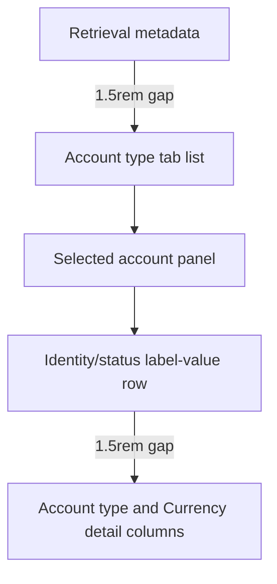

<!-- markdownlint-disable-file -->
# Task Research: Account Details Layout Refinements

Research the requested Account details page refinements: vertical spacing after Trigger, account-summary field alignment, spacing before secondary account fields, and subtler tab styling.

## Task Implementation Requests

* Add visible space between the Trigger metadata row and the CFD/Spreadbet tabs.
* Show Account ID, Alias, and Status values to the right of their labels in a summary row.
* Add separation between that summary row and the Account type/Currency detail columns.
* Replace the heavy, differently coloured tab surround with a subtle, page-integrated tab treatment based on the supplied Radzen Tabs reference.

## Scope and Success Criteria

* Scope: Identify the owning Account details UI components, their styles, and an established in-application tab styling pattern. Evaluate minimal, convention-aligned implementation options.
* Assumptions: The supplied screenshot represents the current implementation; changes are presentation-only unless research identifies a data-layout constraint.
* Success Criteria:
  * Locate the source files and relevant markup/style rules using workspace evidence.
  * Document a selected implementation approach with exact file and line references.
  * Identify validation appropriate to the affected Blazor UI surface.

## Outline

1. Inspect the Account details page and its markup/style ownership.
2. Locate nearby or shared components that demonstrate the preferred tab design.
3. Evaluate layout and styling options against established conventions.
4. Record one recommended implementation path and validation steps.

## Research Executed

### File Analysis

* `src/TNC.Trading.Platform.Web/Components/Pages/AccountDetails/AccountDetails.razor`
  * Lines 27-29 render the retrieval metadata immediately before `RadzenTabs`; this boundary controls the requested Trigger-to-tabs spacing.
  * Lines 36-53 render each account as a nested `panel`: an identity/status `<dl>` followed immediately by the Account type and Currency `RadzenColumn` groups.
  * Lines 38-42 hold Account ID, Alias, and Status; lines 45-53 render the lower detail columns.
  * Lines 68-120 retain the active account type across refresh and history navigation. The existing `RadzenTabs` bindings, `AriaLabel`, and `@key` must remain unchanged.
* `src/TNC.Trading.Platform.Web/wwwroot/app.css`
  * Lines 1-35 define platform color tokens for light and dark themes.
  * Lines 241-248 define the shared `panel` surface, border, padding, radius, and shadow.
  * Lines 295-321 define the reusable key/value grid and the current three-column Account details header, which makes labels appear above their values.
  * Lines 502-517 collapse the account header and key/value grids below 960px.
* `src/TNC.Trading.Platform.Web/Components/App.razor`
  * Lines 9-16 load `app.css` and the Radzen theme/script.
* `src/TNC.Trading.Platform.Web/Components/Layout/PlatformThemeState.cs`
  * Lines 73-76 select the Radzen `software` or `software-dark` theme.
* `test/TNC.Trading.Platform.Web/TNC.Trading.Platform.Web.UnitTests/AccountDetailsTests.cs`
  * Lines 20-116 cover tab accessibility, selection, active content, refresh retention, history retention, and fallback behavior, but do not assert computed CSS or responsive geometry.

### External And Package Evidence

* Local `Radzen.Blazor` 10.3.2 package metadata and Software theme assets were inspected by the delegated research.
  * `RadzenTabs` supports the existing selection and change APIs but exposes no supported parameter for a top-position tab strip with a baseline and selected bottom underline.
  * Default `software` themes render connected, rounded, bordered top tabs and a framed panel. The visible heavier tab surround in the screenshot is therefore inherited Radzen theme behavior, not Account details-specific CSS.
  * The relevant rendered selectors are `.rz-tabview`, `.rz-tabview-top > .rz-tabview-nav`, `.rz-tabview-nav li`, `.rz-tabview-selected`, and `.rz-tabview-panels`.
* [Radzen Tabs](https://blazor.radzen.com/tabs) and the user-supplied screenshot establish the intended hierarchy: transparent navigation that blends into the parent page surface, one low-contrast baseline across the tab list, a restrained bottom selected indicator, and no additional border, fill, shadow, or radius around the tab content.

### Project Conventions

* Standards referenced: page-local visual changes should not alter shared `panel` or `platform-key-value-grid` utilities without a global design requirement; preserve Radzen accessibility and behavior; use platform color tokens across theme modes.
* Instructions followed: `.github/instructions/radzen-blazor.instructions.md`, `.github/instructions/architecture.instructions.md`, `.github/instructions/csharp.instructions.md`, `.github/instructions/tests.instructions.md`, and applicable Markdown authoring guidance, as verified by delegated research.

## Key Discoveries

### Project Structure

The complete visual surface is owned by the Account details Razor page and CSS. Its presenter, models, and API client merely retrieve and expose the data; none determine this layout. The change should remain in the Web UI layer.

There is no existing line-style tab implementation to reuse. Account details is currently the only `RadzenTabs` consumer. Its default Radzen styling creates both the unwanted connected-tab headers and an additional framed tab-content panel, so an Account-details-scoped treatment is necessary rather than copying an existing component.

### Implementation Patterns

* The `account-details-account-header` is already a dedicated identity/status region, but it is a three-column grid. Each child must become a small label/value grid to put values to the right of labels.
* The retrieval metadata and identity/status regions lack page-local spacing hooks. A class on the former and a wrapper around the tab component permit direct, resilient gap rules without changing shared grids.
* The lower Account type and Currency area remains a `RadzenRow`; a bottom margin on the identity/status region creates the requested visual separation while retaining the responsive column behavior.
* An isolated CSS file can scope the unavoidable Radzen rendered-markup selectors using `::deep`, leaving future global tab use unaffected. Supported `--rz-tabs-*` variables remove default nested surfaces; selectors retain only the baseline, selected underline, and square tab edges. The treatment uses platform tokens and leaves Radzen focus behavior intact.

### Complete Examples

The selected markup change preserves the current dynamic tab loop and all current tab behavior:

```razor
<dl class="platform-key-value-grid account-details-retrieval">
  <dt>Retrieved at</dt><dd>@retrieval.RetrievedAtUtc.ToLocalTime().ToString("g")</dd>
  <dt>Trading day</dt><dd>@retrieval.TradingDay</dd>
  <dt>Trigger</dt><dd>@retrieval.TriggerSource</dd>
</dl>
<div class="account-details-tabs">
  <RadzenTabs @bind-SelectedIndex="selectedIndex" Change="OnTabChanged" AriaLabel="Account types">
    <Tabs>
      @* Keep the existing accountTypeGroups loop and tab items unchanged. *@
    </Tabs>
  </RadzenTabs>
</div>
```

```css
.account-details-retrieval {
  margin-bottom: 1.5rem;
}

.account-details-account-header {
  display: grid;
  grid-template-columns: repeat(3, minmax(0, 1fr));
  gap: 0.75rem 1rem;
  margin: 0 0 1.5rem;
}

.account-details-account-header > div {
  display: grid;
  grid-template-columns: max-content minmax(0, 1fr);
  align-items: center;
  column-gap: 0.5rem;
}

.account-details-tabs ::deep .rz-tabview-top > .rz-tabview-nav {
  border-bottom: 1px solid var(--platform-border-color);
}

.account-details-tabs ::deep .rz-tabview {
  --rz-tabs-background-color: transparent;
  --rz-tabs-border: 0;
  --rz-tabs-shadow: none;
  --rz-tabs-padding: 1.25rem 0 0;
  --rz-tabs-tab-background-color: transparent;
  --rz-tabs-tab-selected-background-color: transparent;
  --rz-tabs-tab-hover-background-color: transparent;
  --rz-tabs-tab-color: var(--platform-muted-text-color);
  --rz-tabs-tab-selected-color: var(--platform-text-color);
  --rz-tabs-tab-hover-color: var(--platform-text-color);
}

.account-details-tabs ::deep .rz-tabview-top > .rz-tabview-nav li {
  background-color: transparent;
  border: 0;
  border-bottom: 2px solid transparent;
  border-radius: 0;
}

.account-details-tabs ::deep .rz-tabview-top > .rz-tabview-nav .rz-tabview-selected {
  border-bottom: 2px solid var(--platform-accent-color);
  margin-bottom: -1px;
}

.account-details-tabs ::deep .rz-tabview-panels {
  background-color: transparent;
  border: 0;
  border-radius: 0;
  box-shadow: none;
}

@media (max-width: 960px) {
  .account-details-account-header {
    grid-template-columns: 1fr;
  }
}
```

The initial values, `1.5rem` for structural gaps and `0.5rem` for inline label/value spacing, reuse the existing panel rhythm and can be tuned after visual review.

## Technical Scenarios

### Account Details Layout And Tab Styling

The requested result needs direct control over three visual boundaries: retrieval metadata to tabs, identity/status row to details, and Radzen's tab header/panel frame. It must preserve the current dynamic tabs, keyboard behavior, ARIA semantics, selection persistence, and both platform themes.

**Requirements:**

* Keep data retrieval, view models, and tab state behavior unchanged.
* Add spacing immediately after Trigger and after the identity/status row.
* Render Account ID, Alias, and Status as left-to-right label/value pairs on desktop, retaining a practical mobile collapse.
* Replace only Account details' default connected tab and content-panel visuals with page-integrated, transparent navigation; a full-width subtle baseline; a selected accent underline; and no nested tab-content frame.
* Retain visible Radzen focus indicators and use platform tokens rather than hard-coded colors.

**Preferred Approach:**

* Select a small markup change in `AccountDetails.razor` plus a new adjacent `AccountDetails.razor.css` stylesheet. Add `account-details-retrieval` to the retrieval `<dl>` and wrap the existing `RadzenTabs` in `account-details-tabs`; use the dedicated Account details header class to create horizontal field pairs and a lower margin.
* Scope the required `::deep` Radzen selector rules beneath `account-details-tabs`. Use supported `--rz-tabs-*` variables to remove the default nested surfaces, and selectors for the baseline, square tab edges, and bottom selected underline. This localizes the dependency on Radzen 10.3.2's rendered classes, since no supported tabs parameter or CSS variable can create the required full baseline plus a bottom selected underline.

```text
src/TNC.Trading.Platform.Web/
  Components/Pages/AccountDetails/
    AccountDetails.razor                 modified: layout hooks and tabs wrapper
    AccountDetails.razor.css             added: Account details layout and tab visual rules
```



**Implementation Details:**

* Keep `@bind-SelectedIndex`, `Change`, `AriaLabel`, the dynamic account-type loop, and `@key` exactly as implemented today.
* Use a three-column identity/status row above 960px, where each item internally uses `max-content minmax(0, 1fr)`. At or below 960px, collapse the outer row to one column as current behavior does.
* Use `--platform-border-color` for the baseline and `--platform-accent-color` for the selected underline, so light/dark themes inherit their established colors. Keep tab backgrounds transparent and use `--platform-muted-text-color` / `--platform-text-color` for unselected/selected labels.
* Remove only the nested Radzen tab-content panel background, border, radius, and shadow. Leave shared `panel` and `platform-key-value-grid` rules untouched; the outer Account details panel and nested account card remain the intended framed surfaces.
* Revalidate the two `::deep` selectors when updating Radzen beyond 10.3.2.

#### Considered Alternatives

* **CSS-only changes to shared grids:** Rejected. They can alter identity layout but cannot reliably target the retrieval-to-tabs boundary, and would affect unrelated `platform-key-value-grid` consumers.
* **Radzen Tabs parameters or theme-variable overrides only:** Rejected as incomplete. Variables can remove nested surfaces but do not provide a top-position baseline plus bottom selected underline.
* **Global generated-markup selectors in `app.css`:** Rejected. They would alter all present and future Radzen tab instances and broaden a necessary package-DOM dependency.
* **Replacing `RadzenTabs` with custom buttons/panels:** Rejected. It would duplicate Radzen-managed roles, keyboard navigation, ARIA linkage, and current selection behavior.

## Validation And Next Steps

1. Modify the two Account details UI files described above; leave the presenter, view models, API client, and shared CSS unchanged.
2. Run the focused behavior test:

   ```powershell
   dotnet test test/TNC.Trading.Platform.Web/TNC.Trading.Platform.Web.UnitTests/TNC.Trading.Platform.Web.UnitTests.csproj --filter FullyQualifiedName~AccountDetailsTests
   ```

3. Add a narrow bUnit markup assertion for the new retrieval and tabs wrapper classes if implementation proceeds.
4. Manually verify desktop and <=960px layouts in both platform themes: the two requested gaps, horizontal summary pairs, tab baseline/underline, transparent tab headers and content, hover and focus visibility, keyboard navigation, selection persistence through refresh, and older/newer navigation.

## Potential Next Research

* Confirm visual values after an implementation screenshot.
  * Reasoning: The request specifies the desired hierarchy but not exact dimensions; the selected values are convention-aligned starting points.
  * Reference: User-supplied screenshot and `src/TNC.Trading.Platform.Web/wwwroot/app.css:241-321`.
* Reassess scoped Radzen selectors when upgrading `Radzen.Blazor`.
  * Reasoning: The selected underline treatment intentionally depends on the version-pinned rendered class structure.
  * Reference: `src/TNC.Trading.Platform.Web/TNC.Trading.Platform.Web.csproj:10`.
