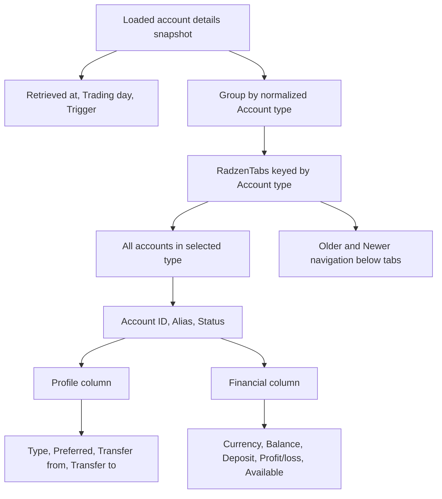

<!-- markdownlint-disable-file -->
---
title: Account Details Tabbed Redesign Research
description: Evidence-backed recommendation for a professional tabbed Account details page using free Radzen Blazor Components.
author: GitHub Copilot
ms.date: 2026-08-08
ms.topic: concept
keywords:
  - account details
  - radzen blazor
  - tabs
  - accessibility
---

## Task Implementation Requests

* Redesign Account details to display accounts grouped on separate in-page Account type tabs.
* Preserve the page's existing professional visual language.
* Keep retrieval metadata at the top of the page.
* Display Account ID, Alias, and Status across the selected account panel's top.
* Put Account type, Preferred, Transfer from, and Transfer to in the left column.
* Put Currency, Balance, Deposit, Profit/loss, and Available in the right column.
* Research the free Radzen Blazor Components before implementation.

## Scope and Success Criteria

* Scope: Research and an implementation-ready recommendation only. No product code was changed.
* Assumptions:
  * An individual tab means one tab per Account type, such as CFD and Spreadbet.
  * The current snapshot contains a small enough account collection for all tab panels to render initially.
  * A direct, bookmarkable URL for each account is not presently required.
* Success criteria:
  * Select a free, already-configured Radzen component with evidence.
  * Preserve the existing query, refresh, authorization, and retrieval-history contracts.
  * Specify an accessible and responsive layout that matches the stated field placement.
  * Identify focused tests that verify the redesign.

## Outline

1. Current page and system boundary
2. Free Radzen component evidence
3. Recommended technical scenario
4. Rejected alternatives
5. Implementation and validation steps

## Research Executed

### File Analysis

* `src/TNC.Trading.Platform.Web/Components/Pages/AccountDetails/AccountDetails.razor`
  * The Viewer-authorized `/account-details` page renders retrieval metadata, then every account as consecutive articles in one panel, followed by retrieval history navigation (lines 1-40).
  * Loading, refresh, empty-state, and retrieval-history behavior already live in this view (lines 15-51).
* `src/TNC.Trading.Platform.Web/Components/Pages/AccountDetails/AccountDetailsViewModels.cs`
  * Each immutable account view model already contains Account ID, alias/name, Account type, status, profile, transfer, currency, and all requested financial fields (lines 3-29).
* `src/TNC.Trading.Platform.Web/Components/Pages/AccountDetails/AccountDetailsPagePresenter.cs`
  * The presenter owns retrieval loading, error state, refresh, and newer/older cursors, but no account or account-type selection state (lines 5-51).
* `src/TNC.Trading.Platform.Infrastructure/Infrastructure/Persistence/EntityFramework/EfAccountDetailsSnapshotStore.cs`
  * Persisted account records are ordered by Account ID only, so the page must provide a deterministic Account type-tab ordering (lines 61-64).
* `src/TNC.Trading.Platform.Infrastructure/Infrastructure/Integrations/Ig/IgAccountDetailsGateway.cs`
  * Normal IG captures reject blank Account types, making any `Other` UI group a defensive fallback for malformed or legacy data (lines 69-76).
* `src/TNC.Trading.Platform.Web/wwwroot/app.css`
  * Existing `panel` and `platform-key-value-grid` styles are the relevant presentation vocabulary; the key-value grid already has a one-column mobile fallback (lines 241-248, 295-310, 500-502).
* `test/TNC.Trading.Platform.Web/TNC.Trading.Platform.Web.UnitTests/AccountDetailsTests.cs`
  * The focused bUnit suite covers empty, one-account, and refresh-failure rendering, but not multiple accounts or tab selection (lines 9-61).

### Project Conventions

* `src/TNC.Trading.Platform.Web/TNC.Trading.Platform.Web.csproj`
  * `Radzen.Blazor` version 10.3.2 is already referenced (lines 8-17).
* `src/TNC.Trading.Platform.Web/Components/_Imports.razor`, `src/TNC.Trading.Platform.Web/PlatformWebUiServiceCollectionExtensions.cs`, and `src/TNC.Trading.Platform.Web/Components/App.razor`
  * Radzen namespaces, services, theme/script resources, and Interactive Server rendering are already configured (lines 1-14, 7-22, and 1-16 respectively).
* `.github/instructions/radzen-blazor.instructions.md`
  * Free Radzen controls are preferred for common UI interactions; require accessible configuration and focused interaction tests.
* `.github/instructions/architecture.instructions.md`
  * Account-tab selection is inbound Blazor presentation state and must not be added to application or persistence contracts.
* `.github/instructions/tests.instructions.md`
  * Presentation behavior belongs in focused xUnit/bUnit tests with requirement-oriented comments.

### External Research

* [Radzen Tabs](https://blazor.radzen.com/tabs)
  * `RadzenTabs` supports dynamic items, selection binding, and client/server rendering modes.
* [Radzen Tabs API](https://blazor.radzen.com/api/tabs.md)
  * The current API documents `SelectedIndex`, `Change`, `RenderMode`, and tab-list labelling parameters. The installed 10.3.2 package must be the implementation authority because its XML documentation does not confirm the current `AriaLabel` parameters.
* [Radzen Row](https://blazor.radzen.com/row) and [Radzen Column](https://blazor.radzen.com/column)
  * `Size="12" SizeMD="6"` provides one column below medium width and two equal columns at or above it.
* [Radzen Badge](https://blazor.radzen.com/badge)
  * `RadzenBadge` provides semantic textual status treatment using `BadgeStyle` values including `Success`, `Warning`, `Danger`, and `Info`.
* [Radzen Blazor GitHub README](https://github.com/radzenhq/radzen-blazor)
  * The component library is free, open-source, MIT-licensed, and permitted for commercial use.
* [WAI-ARIA Tabs Pattern](https://www.w3.org/WAI/ARIA/apg/patterns/tabs/)
  * A tabs UI requires associated tab and panel semantics, keyboard operation, and a labelled tab list.

## Key Discoveries

### Current Page Boundary

The returned account collection is already an ordered, immutable list. API mapping projects the whole collection without a selected-account or selected-type field in `src/TNC.Trading.Platform.Api/Features/Platform/AccountDetailsEndpointMapping.cs` (lines 5-55), and the application snapshot remains UI-agnostic in `src/TNC.Trading.Platform.Application/Features/AccountDetails/AccountDetailsSnapshot.cs` (lines 5-11). This makes the redesign presentation-only: no API, application, persistence, or authorization change is justified.

`AccountDetails.razor` already keeps Retrieved at, Trading day, and Trigger above account content. That metadata must remain outside the tab control so changing tabs does not visually reclassify it as account-specific data.

### Component Selection

Use `RadzenTabs` for the Account type chooser and `RadzenRow` with two `RadzenColumn` elements for each account's two-column body. Use the existing `panel` class and `platform-key-value-grid` inside each tab panel. This combines the requested interaction with the site's existing spacing, surfaces, definition-list semantics, and responsive behavior without adding nested cards or generated-markup CSS.

Use `RadzenBadge` for Status in the selected account header. It must retain the visible status text, with color providing reinforcement rather than the only meaning. Exact status-to-style mapping should be based on verified IG status values; unknown values should use `Info`.

## Technical Scenarios

### In-Page Account Type Tabs

**Requirements:**

* One selectable tab per distinct Account type in the loaded retrieval.
* Each account in the selected type tab has Account ID, Alias, and Status across its panel top.
* A left column with Account type, Preferred, Transfer from, and Transfer to.
* A right column with Currency, Balance, Deposit, Profit/loss, and Available.
* Existing retrieval metadata, empty state, refresh behavior, and cursor navigation remain unchanged.

**Preferred Approach:**

* Use dynamic, top-positioned `RadzenTabs` bound to a component-local selected index, with one item for each normalized Account type.
* Use the default server render mode because the page is already Interactive Server and the number of account types is small. It renders only the active type panel and keeps selection reconciliation straightforward after retrieval changes.
* Normalize Account type with `Trim()` and group using `StringComparer.OrdinalIgnoreCase`, so casing-only differences do not create duplicate tabs. Render valid type labels such as `CFD` and `Spreadbet` exactly as supplied after trimming. Map malformed blank values to an `Other` fallback placed last.
* Sort valid type labels by ordinal case-insensitive comparison, retaining original account order inside each group. This provides deterministic type-tab order rather than inheriting Account ID persistence order.
* Add `@key="group.Key"` to generated `RadzenTabsItem` elements. Track selection by normalized Account type key, not by index. Preserve that type after refresh or retrieval-history navigation when it remains present; otherwise select the first type.

```text
AccountDetails.razor
  Retrieval metadata: Retrieved at, Trading day, Trigger
  RadzenTabs (one item per Account type)
    Tab label: CFD, Spreadbet, or defensive Other
    One article per account in selected type
      Existing panel surface
        Header row: Account ID | Alias | Status badge
        RadzenRow
          RadzenColumn (12 / MD 6): Account type, Preferred, Transfer from, Transfer to
          RadzenColumn (12 / MD 6): Currency, Balance, Deposit, Profit/loss, Available
  Existing Older/Newer history navigation
```



**Implementation details:**

The following is a shape-preserving sketch. Parameters are restricted to those verified for installed Radzen 10.3.2. It is not a product-code change.

```razor
<RadzenTabs @bind-SelectedIndex="selectedTypeIndex">
    <Tabs>
    @foreach (var group in accountTypeGroups)
        {
      <RadzenTabsItem Text="@group.Label" @key="group.Key">
        @foreach (var account in group.Accounts)
        {
        <article class="panel">
                    <dl class="platform-key-value-grid account-details-account-header">
                        <div><dt>Account ID</dt><dd>@account.AccountId</dd></div>
                        <div><dt>Alias</dt><dd>@account.AccountAlias</dd></div>
                        <div>
                            <dt>Status</dt>
                            <dd><RadzenBadge Text="@account.Status"
                                             BadgeStyle="@GetStatusStyle(account.Status)" /></dd>
                        </div>
                    </dl>
                    <RadzenRow>
                        <RadzenColumn Size="12" SizeMD="6">
                            <dl class="platform-key-value-grid">
                                <div><dt>Account type</dt><dd>@account.AccountType</dd></div>
                                <div><dt>Preferred</dt><dd>@account.Preferred</dd></div>
                                <div><dt>Transfer from</dt><dd>@account.CanTransferFrom</dd></div>
                                <div><dt>Transfer to</dt><dd>@account.CanTransferTo</dd></div>
                            </dl>
                        </RadzenColumn>
                        <RadzenColumn Size="12" SizeMD="6">
                            <dl class="platform-key-value-grid">
                                <div><dt>Currency</dt><dd>@account.Currency</dd></div>
                                <div><dt>Balance</dt><dd>@account.Balance</dd></div>
                                <div><dt>Deposit</dt><dd>@account.Deposit</dd></div>
                                <div><dt>Profit/loss</dt><dd>@account.ProfitLoss</dd></div>
                                <div><dt>Available</dt><dd>@account.Available</dd></div>
                            </dl>
                        </RadzenColumn>
                    </RadzenRow>
                  </article>
                  }
            </RadzenTabsItem>
        }
    </Tabs>
</RadzenTabs>
```

The existing history `<nav>` stays after `RadzenTabs`, outside every `RadzenTabsItem`. This preserves its retrieval-wide meaning, its current bottom-of-content reading order, and its existing accessible label and cursor-disabled rules. The short CSS addition should be scoped to the Account details page and should only establish the three-item desktop header grid and its narrow-screen stack. Existing color variables, panel styling, key-value-grid typography, and page spacing should remain the source of visual consistency. Do not use custom styling to replace the tab library's active, keyboard-focus, or ARIA behavior.

#### Considered Alternatives

* **Route-backed `RadzenLink` navigation:** Rejected for now. It would require an Account type-specific route, selection restoration, and a browser-history contract not requested by the current snapshot workflow. Adopt it only for a future bookmark/share/deep-link requirement.
* **Native tabs:** Rejected. Radzen is already configured and explicitly preferred by repository guidance. Native implementation would also make the application responsible for tab ARIA and keyboard behavior.
* **Accordion or repeated panels:** Rejected. It resembles nearby IG history UI but directly conflicts with the requested tabs-based account switching.
* **Data grid with a detail pane:** Rejected. It is justified for large collections and sorting/scanning workflows, neither of which is evidenced by the present contract.

## Implementation Validation

1. Extend `test/TNC.Trading.Platform.Web/TNC.Trading.Platform.Web.UnitTests/AccountDetailsTests.cs` with two CFD accounts and one Spreadbet account. Verify exactly two type labels, both CFD records in the CFD panel, and no per-account tabs.
2. Add a selection test that activates the Spreadbet tab and confirms it renders only its records, each with Account ID, Alias, Status, the profile fields, and the financial fields in the requested panels.
3. Test case-insensitive type grouping and defensive blank-type fallback ordering, preferably through a pure page-local grouping helper.
4. Test that refresh and cursor navigation retain the selected type where it persists and safely reset to the first type when it does not. A failed refresh must preserve the selected type.
5. Assert the labelled Older/Newer navigation is after `RadzenTabs` and outside every tab panel, retaining existing cursor-disabled states.
6. Run the focused web unit-test project. Add a Playwright test only when browser-level keyboard and responsive requirements are included in the delivery scope; use role/label locators and web-first assertions.
7. Manually verify wide and narrow viewports: metadata remains above tabs, each account header reads across at wide width, both field groups are two columns at medium width and stack cleanly below it, the history navigation remains at the bottom, and tab focus is visible.

## Potential Next Research

* Inspect a running 10.3.2 `RadzenTabs` instance before implementation to confirm tab-list labelling and exact keyboard behavior.
  * Reasoning: Current online API documentation includes ARIA label parameters that are not confirmed in the installed package version.
  * Reference: [Radzen Tabs API](https://blazor.radzen.com/api/tabs.md)
* Confirm whether Account type labels require a business-defined order rather than the recommended alphabetical default.
  * Reasoning: The repository has no established Account type vocabulary or ordering contract.
  * Reference: `src/TNC.Trading.Platform.Infrastructure/Infrastructure/Persistence/EntityFramework/EfAccountDetailsSnapshotStore.cs`
* Confirm saved IG account-status values from tests or recorded snapshots.
  * Reasoning: The status badge should map only verified statuses to semantic colors.
  * Reference: `src/TNC.Trading.Platform.Application/Features/AccountDetails/AccountDetailsAccount.cs`

## Selected Approach

Implement one dynamic `RadzenTabsItem` per normalized Account type within the existing Account details page. Preserve metadata above the tabs and retrieval history navigation below them. Render every account of the selected type as an existing panel surface, place identity/status across each account panel's top, and use two responsive Radzen columns for the requested profile and financial fields.

This is the smallest design that fulfills the user-facing layout precisely, uses the already installed free component library, retains the site's visual language, and keeps UI selection out of backend contracts.
