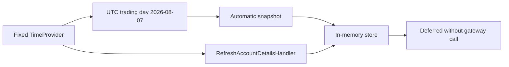

<!-- markdownlint-disable-file -->
# Task Research: Account Details Automatic Deduplication Failure

Research why `CaptureAutomaticAsync_ShouldDeduplicateSuccessAndRetryAfterFailure` now fails despite no code changes, and recommend one evidence-based fix.

## Task Implementation Requests

* Reproduce or otherwise identify the failing assertion and execution path.
* Determine why the test changed behavior without source changes.
* Recommend a focused fix without modifying production or test code.

## Scope and Success Criteria

* Scope: The selected unit test, `RefreshAccountDetailsHandler`, trading-day derivation, test time dependencies, and relevant repository history or conventions.
* Assumptions: The workspace state is authoritative; the current date is 2026-08-30; research must not modify product or test files.
* Success Criteria:
  * The failure mechanism is supported by test output and file-and-line evidence.
  * The explanation accounts for the no-code-change timing.
  * One preferred fix is selected after evaluating viable alternatives.

## Outline

1. Reproduce the selected test and record the failing assertion.
2. Trace automatic capture through trading-day calculation and store lookup.
3. Check repository history and neighboring tests for intended time-control patterns.
4. Evaluate test-only and production alternatives.
5. Select and detail the smallest robust fix.

## Potential Next Research

* Add a separate regression test proving that a manual snapshot does not suppress automatic capture.
  * Reasoning: Production de-duplicates only successful automatic snapshots, but the current fake store does not preserve this distinction.
  * Reference: `src/TNC.Trading.Platform.Infrastructure/Infrastructure/Persistence/EntityFramework/EfAccountDetailsSnapshotStore.cs:19-21`

## Research Executed

### File Analysis

* `test/TNC.Trading.Platform.Application/TNC.Trading.Platform.Application.UnitTests/Features/AccountDetails/AccountDetailsHandlerTests.cs:96-120`
  * The selected test seeds a snapshot for a fixture-owned day, expects automatic capture to return `Deferred`, then verifies that a failed capture can be retried.
* `test/TNC.Trading.Platform.Application/TNC.Trading.Platform.Application.UnitTests/Features/AccountDetails/AccountDetailsHandlerTests.cs:145-166`
  * The fixture hard-codes `TradingDay` as `2026-08-07` but injects `TimeProvider.System` into `RefreshAccountDetailsHandler`.
  * The snapshot helper always creates a `Manual` snapshot.
* `src/TNC.Trading.Platform.Application/Features/AccountDetails/RefreshAccountDetailsHandler.cs:19-41`
  * Automatic capture computes the current trading day from the injected clock and configured timezone, checks for an existing successful day before and after lease acquisition, and calls the provider only when both checks miss.
* `src/TNC.Trading.Platform.Application/Features/AccountDetails/RefreshAccountDetailsHandler.cs:79-95`
  * A successful default gateway result is saved and returned as `Saved`, which explains the observed actual type after the date check misses.
* `src/TNC.Trading.Platform.Application/Services/TradingScheduleGate.cs:53-57`
  * `GetTradingDay` converts the supplied instant to the configured timezone and returns that calendar date; it does not apply weekend eligibility rules.
* `src/TNC.Trading.Platform.Infrastructure/Infrastructure/Persistence/EntityFramework/EfAccountDetailsSnapshotStore.cs:19-21`
  * Production de-duplication requires matching environment, trading day, and `Automatic` trigger source.

### Code Search Results

* `TimeProvider.System`
  * The selected fixture is the only identified application unit-test setup combining a fixed calendar expectation with a system clock on this path.
  * Nearby tests use nested fixed `TimeProvider` implementations at `test/TNC.Trading.Platform.Application/TNC.Trading.Platform.Application.UnitTests/Features/TriggerManualAuthRetry/TriggerManualAuthRetryHandlerTests.cs:147-150,275-278` and `test/TNC.Trading.Platform.Application/TNC.Trading.Platform.Application.UnitTests/Features/RecordAuthAuditEvent/RecordAuthAuditEventHandlerTests.cs:136-143,190-193`.
* Git history for the selected test and handler
  * Commit `8863cd9` introduced the test, hard-coded `2026-08-07` date, system-clock injection, and handler on 2026-08-07; focused blame found no later changes to these lines.
  * No retained historical test result was found, so history supports but does not independently prove the reported prior pass.

### External Research

* None required. The failure is fully explained by repository code, isolated test output, system time, and source history.

### Project Conventions

* Standards referenced: Repository test naming, traceability comments, vertical-slice handler testing, deterministic testing practices.
* Instructions followed: `.github/copilot-instructions.md`, `.github/instructions/architecture.instructions.md`, `.github/instructions/tests.instructions.md`, and applicable Markdown authoring rules.
* Deterministic unit tests and constructor-injected test clocks are established repository patterns; no new package is required.

## Key Discoveries

### Project Structure

The test directly exercises the application handler through inward-owned gateway, store, lease, and configuration ports. The production SQL adapters are relevant only to verify fake fidelity; no production boundary or API change is needed.

### Implementation Patterns

Three isolated runs failed consistently at `AccountDetailsHandlerTests.cs:109`:

```text
Assert.IsType() Failure: Value is not the exact type
Expected: AccountDetailsRefreshOutcome.Deferred
Actual:   AccountDetailsRefreshOutcome.Saved
```

The sequence is deterministic given the current mixed clocks:

1. The test stores a snapshot with trading day `2026-08-07`.
2. On the verified 2026-08-30 run, the handler asks `TimeProvider.System` for the current instant.
3. The fixture schedule timezone is UTC, so the handler computes trading day `2026-08-30`.
4. Both existence checks miss because the dates differ.
5. The default fake gateway returns success, so the handler saves and returns `Saved`.

This explains why unchanged source passed around its introduction date and later failed. The machine was in British Summer Time, but UTC configuration makes local offset irrelevant. The current date was a Sunday, but `GetTradingDay` does not evaluate weekend rules, and the fixture also configures full-weekend inclusion.

Static manual-request coalescing, test ordering, parallelism, lease contention, and gateway races are not necessary causes: the automatic path does not use the static in-flight dictionary, three single-test runs failed identically, each fixture owns its state, and the fake lease is acquired by default.

### Complete Examples

The recommended test-only shape is:

```csharp
private sealed class FixedTimeProvider(DateTimeOffset utcNow) : TimeProvider
{
  public override DateTimeOffset GetUtcNow() => utcNow;
}

private sealed class Fixture
{
  public readonly DateTimeOffset UtcNow;
  public readonly DateOnly TradingDay;

  public Fixture(DateTimeOffset? utcNow = null)
  {
    UtcNow = utcNow ?? new DateTimeOffset(2026, 8, 7, 12, 0, 0, TimeSpan.Zero);
    var timeProvider = new FixedTimeProvider(UtcNow);
    TradingDay = DateOnly.FromDateTime(timeProvider.GetUtcNow().UtcDateTime);

    Gateway.Result = new AccountDetailsGatewayResult.Succeeded([Account]);
    Configuration = new PlatformConfigurationService(new FakeConfigurationStore());
    Refresh = new RefreshAccountDetailsHandler(
      Configuration,
      Gateway,
      Store,
      Lease,
      new TradingScheduleGate(),
      timeProvider);
    Get = new GetAccountDetailsHandler(Configuration, Store);
  }
}
```

The selected test should seed an automatic snapshot using that same instant:

```csharp
fixture.Store.Snapshots.Add(fixture.Snapshot(
  fixture.UtcNow,
  fixture.TradingDay,
  AccountDetailsTriggerSource.Automatic));
```

The helper should accept an optional trigger defaulting to `Manual`, and the fake store's `ExistsForTradingDayAsync` should also require `x.TriggerSource == AccountDetailsTriggerSource.Automatic` to match production.

### API and Schema Documentation

No API or schema change is required. The recommended fix is confined to one unit-test file.

### Configuration Examples

The fixed instant should be `2026-08-07T12:00:00Z`. Noon is intentionally away from a day boundary, and the fixture's configured schedule timezone remains UTC.

## Technical Scenarios

### Deterministic Automatic Capture Test

The verified scenario is a test fixture whose snapshot date is fixed while its injected clock advances with wall time.

**Requirements:**

* Preserve production trading-day semantics.
* Make the unit test deterministic across calendar dates and time zones.
* Continue proving both successful-day deduplication and retry after failure.

**Preferred Approach:**

Inject a fixed `TimeProvider` into the fixture, derive its trading day and retrieval timestamp from the same fixed instant, and make the fake-store setup preserve production's automatic-trigger predicate. This repairs the test without changing valid production behavior.



**Implementation Details:**

* Add an optional fixed instant to `Fixture`, defaulting to noon UTC on 2026-08-07.
* Inject a nested `FixedTimeProvider` instead of `TimeProvider.System`.
* Expose `UtcNow` and derive `TradingDay` from that provider.
* Seed this specific de-duplication scenario with trigger `Automatic`.
* Add an optional trigger argument to `Snapshot`, retaining `Manual` as the default for unrelated tests.
* Require `Automatic` in the fake store's day-existence predicate, matching the EF adapter.
* Validate first with the fully qualified filtered test, then run the application unit-test project.

#### Considered Alternatives

1. Derive the seed date from `DateTimeOffset.UtcNow` or `TimeProvider.System` at runtime.
  * Rejected because arrange and act perform separate clock reads and can straddle UTC midnight. It reduces frequency but does not make the test deterministic.
2. Change production handler logic, de-duplication semantics, or time sourcing.
  * Rejected because production already uses the injected clock and configured timezone correctly. Counting manual snapshots or weakening daily de-duplication would change the feature contract to accommodate a defective fixture.
3. Replace the literal with a future date or periodically update it.
  * Rejected because a future date fails both before and after that date, while periodic updates preserve recurring calendar-dependent failures.

## Selected Recommendation

Treat the failure as a deterministic-test defect, not a production regression. Apply the fixed-clock test-only change and align the fake store with the production automatic-trigger predicate in the same focused edit. The date mismatch is the immediate root cause; the trigger correction prevents the repaired test from passing against behavior that production does not implement.

The cheapest non-editing confirmation is a debugger breakpoint at `src/TNC.Trading.Platform.Application/Features/AccountDetails/RefreshAccountDetailsHandler.cs:23`, where `tradingDay` should be `2026-08-30` while the seeded snapshot day is `2026-08-07`. The three isolated failures and traced values already provide sufficient evidence to proceed.

## Evidence Log

* Isolated test execution, three runs: one failed, zero passed; expected `Deferred`, actual `Saved`, at test line 109.
* System clock during investigation: `2026-08-30T11:30:51.5918143+01:00`; configured fixture timezone: UTC.
* Primary delegated evidence: `.copilot-tracking/research/subagents/2026-08-30/account-details-test-failure-evidence.md`.
* Alternatives analysis: `.copilot-tracking/research/subagents/2026-08-30/account-details-test-fix-alternatives.md`.
