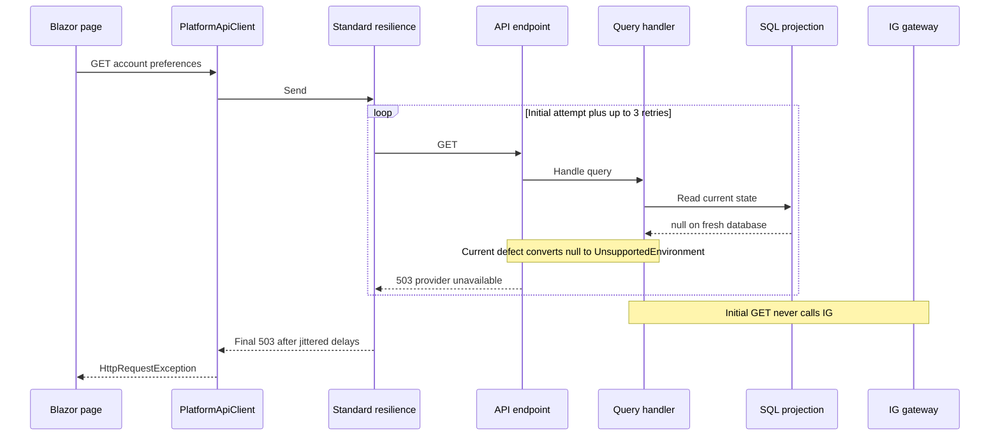

<!-- markdownlint-disable-file -->
# Task Research: Account Preferences Load Performance and Provider Availability

Research why the Account preferences page takes 5 to 10 seconds to load and then reports that the account preferences provider is unavailable, and recommend a faster, more resilient loading path.

## Task Implementation Requests

* Identify the code path responsible for initial page loading and the 5 to 10 second delay.
* Determine why the account preferences provider is unavailable in the captured state.
* Recommend one implementation approach that reduces perceived and actual load time and mitigates the warning without hiding genuine failures.

## Scope and Success Criteria

* Scope: Account preferences UI, its application/API/provider dependencies, startup and configuration behavior, resilience policies, and relevant automated tests. Implementation changes are excluded from this research task.
* Assumptions: The screenshot reflects the current repository implementation running through the normal local Aspire topology; the warning appears after an awaited operation rather than being immediately rendered from static state.
* Success Criteria:
  * Trace the controlling request path with file-and-line evidence.
  * Explain the delay and warning using verified code or runtime evidence.
  * Evaluate viable mitigations and select one approach with implementation details and validation steps.

## Outline

1. Trace page initialization and account-preferences state loading.
2. Trace provider registration, transport, timeout, retry, and startup readiness behavior.
3. Compare the screenshot with tests, logs, and documented expected behavior.
4. Evaluate loading and resilience alternatives.
5. Recommend implementation and validation steps.

## Potential Next Research

* Capture one post-fix Aspire trace for an authenticated fresh-database page load.
  * Reasoning: Confirm one current-state request, one subsequent history request, and no IG request attributable to the initial GET.
  * Reference: src/TNC.Trading.Platform.ServiceDefaults/Extensions.cs:84-128.
* Measure healthy current-state and history latency before considering progressive history rendering.
  * Reasoning: The reported delay is already explained by retries; UI concurrency adds state complexity and should be justified by healthy-path measurements.
  * Reference: src/TNC.Trading.Platform.Web/Components/Pages/AccountPreferences/AccountPreferencesPagePresenter.cs:22-53.

## Research Executed

### File Analysis

* src/TNC.Trading.Platform.Web/Components/Pages/AccountPreferences/AccountPreferences.razor:60-82
  * Authorization completes before the presenter load. The page cancellation token has no page-level timeout.
* src/TNC.Trading.Platform.Web/Components/Pages/AccountPreferences/AccountPreferencesPagePresenter.cs:22-53
  * Current state loads first. History loads only after current state succeeds; a current-state failure suppresses history.
* src/TNC.Trading.Platform.Web/PlatformApiClient.cs:140-147,188-219
  * The client calls `GET /api/platform/account-preferences`; non-success Problem Details titles become `HttpRequestException` messages.
* src/TNC.Trading.Platform.Application/Features/AccountPreferences/GetAccountPreferencesHandler.cs:14-27
  * Production DI selects the SQL current-state branch. A missing row becomes failed `UnsupportedEnvironment` even though it means preferences are not configured.
* src/TNC.Trading.Platform.Api/Features/Platform/GetAccountPreferencesEndpointHandler.cs:7-13
  * The endpoint ignores the new `State` property and maps only the legacy provider `Outcome`.
* src/TNC.Trading.Platform.Api/Features/Platform/AccountPreferencesEndpointMapping.cs:28-52
  * All failure categories except rate limit, malformed provider data, and timeout fall through to 503 with `Account preferences provider is unavailable.`
* src/TNC.Trading.Platform.ServiceDefaults/Extensions.cs:34-50
  * The standard HTTP resilience handler is applied globally to all clients.
* src/TNC.Trading.Platform.Web/Program.cs:7-19
  * `PlatformApiClient` inherits that global pipeline without a client-specific override.
* src/TNC.Trading.Platform.Infrastructure/Infrastructure/Persistence/EntityFramework/EfAccountPreferencesCurrentStateStore.cs:8-26
  * An empty partition returns null; the first desired-state commit creates the row.
* src/TNC.Trading.Platform.Infrastructure/Infrastructure/Persistence/EntityFramework/Migrations/20260831130930_AddAccountPreferencesCurrentState.cs:13-91
  * The migration creates tables but deliberately does not insert a bootstrap row.
* src/TNC.Trading.Platform.Infrastructure/Infrastructure/DependencyInjection/PlatformInfrastructureServiceCollectionExtensions.cs:90-121
  * Production registers both the SQL projection store and IG gateway. The initial GET exits through SQL before the gateway can be called.
* test/TNC.Trading.Platform.Infrastructure/TNC.Trading.Platform.Infrastructure.IntegrationTests/AccountPreferencesSqlIntegrationTests.cs:176-188
  * Existing integration coverage proves a fresh migrated database legitimately has no current-state row.
* test/Shared/Authentication/RealAppHostProcessFactory.cs:55-123 and src/TNC.Trading.Platform.AppHost/AppHostInfrastructureRegistration.cs:7-23
  * Closed-box tests reuse persistent SQL storage, which can retain a state row and mask the fresh-database defect.

### Code Search Results

* `Account preferences provider is unavailable.`
  * Generated in src/TNC.Trading.Platform.Api/Features/Platform/AccountPreferencesEndpointMapping.cs:45-52.
  * Extracted by src/TNC.Trading.Platform.Web/PlatformApiClient.cs:199-219.
  * Prefixed with `Unable to load account preferences.` by src/TNC.Trading.Platform.Web/Components/Pages/AccountPreferences/AccountPreferencesPagePresenter.cs:29-37,115-116.
* `Unconfigured`
  * The view model starts in this state at src/TNC.Trading.Platform.Web/Components/Pages/AccountPreferences/AccountPreferencesPageViewModel.cs:3-21.
  * The Razor page renders null desired/account/observation fields as unconfigured defaults at src/TNC.Trading.Platform.Web/Components/Pages/AccountPreferences/AccountPreferences.razor:14-31.
  * These values are constructor defaults left in place after the request fails; they are not stale or fallback data.
* `AddStandardResilienceHandler`
  * Registered for every client at src/TNC.Trading.Platform.ServiceDefaults/Extensions.cs:39-49.
  * Existing TRX logs identify the active `Standard-Retry` strategy at artifacts/quality-gates/account-preferences-ui-clarity/20260831-124715/trx/martynfewtrell_TNCITWOR001_2026-08-31_12_47_50_net10.0.trx:4639-4769.

### External Research

* Microsoft Learn: `Build resilient HTTP apps`
  * The standard handler retries HTTP 408, 429, and 500+, `HttpRequestException`, and attempt timeout exceptions. Defaults are three retries, two-second exponential delay with jitter, a 30-second total timeout, and a 10-second attempt timeout.
  * The API supports `RemoveAllResilienceHandlers`, configurable `ShouldHandle`, and `DisableForUnsafeHttpMethods`.
  * Source: [Build resilient HTTP apps](https://learn.microsoft.com/dotnet/core/resilience/http-resilience).
* RFC 9110: `Retry-After`
  * A server uses this header to estimate how long a client should wait. Its absence is not an explicit invitation to retry a deterministic 503.
  * Source: [Retry-After](https://www.rfc-editor.org/rfc/rfc9110.html#name-retry-after).
* RFC 9457: Problem Details
  * `title` should remain stable for a problem type; occurrence-specific explanation belongs in `detail`.
  * Source: [Problem Details for HTTP APIs](https://www.rfc-editor.org/rfc/rfc9457.html).
* .NET Aspire documentation
  * Test AppHost configuration can omit data volumes; volumes survive container disposal and must not be used for fresh-state contract tests.
  * Sources: [Manage the AppHost in tests](https://aspire.dev/testing/manage-app-host/) and [Persist data with volumes](https://aspire.dev/fundamentals/persist-data-volumes/).

### Project Conventions

* Standards referenced: .github/copilot-instructions.md; .github/instructions/architecture.instructions.md; .github/instructions/configuration.instructions.md; .github/instructions/tests.instructions.md; .github/instructions/aspire-tests.instructions.md; .github/instructions/radzen-blazor.instructions.md.
* Instructions followed: The recommendation keeps query semantics in Application, HTTP mapping in API, resilience composition in Web startup, and test infrastructure in test projects. Research-only changes are confined to .copilot-tracking/research/.

## Key Discoveries

### Project Structure

The page is a Blazor component backed by a presenter and typed API client. The API delegates to an Application query handler. Production Infrastructure supplies a SQL current-state store and an IG gateway, but the SQL-backed read returns before provider access. Service Defaults globally decorates the Web-to-API typed client with service discovery and the standard resilience pipeline.



### Implementation Patterns

#### Verified root cause

1. **Very high confidence: incomplete SQL-projection contract migration.** The response now carries both legacy `Outcome` and SQL `State`, but the endpoint still reads only `Outcome`. No SQL row is converted to `UnsupportedEnvironment`, then broadly mapped to a misleading provider 503. Git history shows the original provider-backed feature in commit `f4b3b3b4669a8e783e063b881403ee5bcd17dcd5`; the SQL state branch and richer response are current working-tree changes, consistent with an incomplete boundary migration.
2. **High confidence: global standard retries amplify the defect.** The deterministic 503 receives an initial attempt plus up to three retries. Nominal retry delays are approximately 2, 4, and 8 seconds before jitter and the 30-second total limit, matching the reported multi-second pause.
3. **Low confidence: SQL startup or query latency is additive.** It can add time, but cannot by itself explain the exact API-authored warning.
4. **Very low confidence: IG outage causes the initial failure.** Production query control flow never reaches IG.

#### Why the screen looks contradictory

The warning is a request error. The state beneath it is the untouched view-model constructor state: null values rendered as `Unconfigured`, `Not configured`, and `No observation`. History is empty because the presenter does not request it after current-state failure. The page is not showing a successfully loaded fallback or stale snapshot.

#### Intended contract

Repository documentation says the initial GET is SQL-only, remains available during IG outage, and returns `Unconfigured` for a new installation. Evidence: docs/wiki/api-reference.md:550-568, docs/wiki/runtime-behavior.md:727-747, and docs/wiki/operator-guide.md:566-600.

### Complete Examples

The permanent Application shape should distinguish configured and unconfigured query results without fabricating persistence identity:

```csharp
public abstract record AccountPreferencesQueryState
{
  public sealed record Unconfigured(BrokerEnvironment Environment)
    : AccountPreferencesQueryState;

  public sealed record Configured(AccountPreferencesCurrentState State)
    : AccountPreferencesQueryState;
}
```

The API endpoint should map both query states to successful responses and reserve legacy outcome mapping for the temporary provider-backed branch:

```csharp
return result.QueryState switch
{
  AccountPreferencesQueryState.Unconfigured =>
    TypedResults.Ok(AccountPreferencesResponse.Unconfigured()),
  AccountPreferencesQueryState.Configured configured =>
    TypedResults.Ok(configured.State.ToResponse()),
  _ => result.Outcome.ToHttpResult()
};
```

The exact names can follow the final domain design. The invariant is that absence is explicit and successful, not inferred from every null `State`, because legacy failures also carry null state.

At Web composition, replace rather than stack the inherited resilience handler:

```csharp
services.AddHttpClient<PlatformApiClient>(client =>
  client.BaseAddress = new Uri("https+http://api"))
  .RemoveAllResilienceHandlers()
  .AddStandardResilienceHandler(options =>
  {
    options.Retry.ShouldHandle = AccountPreferencesApiRetryPolicy.ShouldHandle;
    options.Retry.ShouldRetryAfterHeader = true;
    options.Retry.DisableForUnsafeHttpMethods();
  });
```

The predicate should retry safe transport failures and attempt timeouts; safe HTTP 408, 502, and 504; and HTTP 429/503 only when a valid `Retry-After` is present. It should not retry deterministic 4xx responses or unsafe methods.

### API and Schema Documentation

Recommended GET contract:

| Condition | HTTP result | Meaning | Automatic retry |
| --- | --- | --- | --- |
| No persisted preference | 200, `verificationStatus: "Unconfigured"` | No operator intent has been saved | No |
| Persisted SQL projection | 200 with complete state | Durable desired and observed state | No |
| Invalid input | 400 Problem Details | Request invalid | No |
| Platform authentication/authorization | 401/403 | Sign-in or scope required | No |
| Unsupported environment, stale revision, account mismatch | 409 Problem Details | Deterministic state conflict | No |
| Provider throttling | 429 Problem Details | Allowance exhausted | Only with `Retry-After` |
| Malformed upstream response | 502 Problem Details | Invalid provider response | Safe reads only |
| Temporary dependency outage | 503 Problem Details | Dependency unavailable | Only with `Retry-After` |
| Upstream timeout | 504 Problem Details | Dependency timed out | Safe reads only |

The account-preferences `Unauthorized` enum value represents an IG 401, not failed platform login. It should have a provider-session-specific problem type rather than instructing the operator to sign into the platform again.

### Configuration Examples

Closed-box tests should explicitly disable persistent SQL state, while local development keeps it enabled:

```json
{
  "AppHost": {
    "UsePersistentSqlState": false
  }
}
```

When false, the AppHost test path must omit both `WithDataVolume()` and `WithLifetime(ContainerLifetime.Persistent)`. Disabling container persistence alone is insufficient because the named volume survives.

## Technical Scenarios

### Faster Initial Load With Accurate Availability State

The selected approach is a coordinated contract and transport correction. A no-row SQL read becomes explicit successful `Unconfigured` state; the endpoint uses the query state; deterministic domain outcomes no longer collapse into provider 503; and the Web typed client uses a specialized non-stacked retry predicate.

**Requirements:**

* Render useful account-preference state promptly.
* Preserve accurate unavailable/degraded signaling.
* Avoid blocking initial rendering on slow optional history or provider calls.
* Remain consistent with repository architecture, authentication, configuration, and test conventions.

**Preferred Approach:**

1. Introduce an explicit configured/unconfigured Application query result. Do not synthesize an `AccountPreferencesCurrentState` with `Guid.Empty` or an empty rowversion.
2. Update the GET endpoint to prefer the query state and return `200 OK` for both configured and unconfigured SQL reads. Keep `Outcome` only as a temporary legacy fallback, then remove it when unsupported composition and tests are retired.
3. Correct failure-category HTTP mappings. Use 409 for deterministic environment/state conflicts and reserve 502/503/504 for dependency failures. Add `Retry-After` only when the API knows that retrying later is meaningful.
4. On the `PlatformApiClient` registration, call `RemoveAllResilienceHandlers()` before adding its specialized standard handler. Retry safe transport/timeouts and selected safe statuses; require `Retry-After` for 429/503; disable unsafe-method retries.
5. Keep current state/history sequencing for this remediation. Progressive history rendering is a separate measured UX improvement, not a root-cause fix.

This division follows existing ownership boundaries: Application defines query meaning, API defines HTTP semantics, and Web startup owns transport resilience. It removes both the false warning and retry delay while preserving recovery from connection faults and explicitly signaled transient outages.

**Implementation order:**

1. Add Application query-state semantics and missing/populated-store tests.
2. Map configured and unconfigured states in the API; correct category statuses and Problem Details titles.
3. Replace the typed client's inherited retry pipeline and add attempt-count policy tests.
4. Make closed-box SQL ephemeral and reset the controllable IG request ledger.
5. Add fresh-database functional and E2E coverage, then capture one Aspire trace.
6. Update affected docs/wiki pages as required by repository convention.

**Focused validation:**

| Order | Check | Required proof |
| --- | --- | --- |
| 1 | Application unit | Missing row is successful Unconfigured; populated row preserves complete state; IG gateway call count is zero |
| 2 | API endpoint unit | Both cases return 200; no-row never enters provider failure mapping |
| 3 | Web resilience unit | Unsignaled deterministic 503 makes one physical attempt; safe transient cases follow the selected predicate; unsafe methods make one attempt |
| 4 | SQL integration | Fresh migrated database has no row and first commit creates revision one |
| 5 | Presenter/bUnit | Current state precedes history; failure suppresses history; successful Unconfigured renders without warning |
| 6 | Closed-box functional | Ephemeral fresh SQL plus unavailable IG returns 200 Unconfigured and causes no IG preferences GET |
| 7 | E2E smoke | Page leaves loading state and shows Unconfigured without provider-unavailable alert |
| 8 | Aspire trace | One current-state attempt, one subsequent history call, and no IG span from initial GET |

Attempt count is the performance regression invariant. Avoid narrow wall-clock assertions, which become flaky under CI scheduling and jitter.

#### Considered Alternatives

* **Insert a bootstrap SQL row:** Rejected. It invents persistence identity and concurrency state, complicates environment partitions and upgrades, and conflates no intent with persisted intent.
* **Continue treating no row as failure:** Rejected. It contradicts the documented fresh-installation contract, blocks initial setup, and recreates the warning.
* **Fix only the false 503:** Rejected as incomplete. It fixes this exact request but leaves deterministic server errors and unsafe writes exposed to broad retry behavior.
* **Disable all `PlatformApiClient` retries:** Rejected. It removes useful recovery from connection resets, safe-read timeouts, and explicitly signaled outages.
* **Keep global resilience defaults:** Rejected. It retries all 500-class responses and currently permits automatic replay of unsafe operations.
* **Add a second specialized handler without removing the global one:** Rejected. Stacked pipelines multiply attempts and timeout budgets.
* **Split account preferences into a new typed client:** Viable but deferred. It offers narrower policy ownership at the cost of a larger refactor; first inventory whether other `PlatformApiClient` operations require materially different policies.
* **Parallelize state and history immediately:** Deferred. It shortens only the healthy path and cannot correct the false warning or retried current-state failure. Progressive history rendering should follow measured healthy latency.

## Evidence Summary

* The exact screenshot text is deterministically reconstructed from API Problem Details and presenter prefixing.
* The no-row state is normal database behavior and documented as successful `Unconfigured` behavior.
* The standard retry defaults explain the 5 to 10 second range and can exceed it under jitter.
* The initial GET is SQL-only; an IG outage is not the primary cause.
* Existing tests can pass despite the defect because the Application fixture selects the legacy branch and closed-box SQL is persistent.

## Research Artifacts

* .copilot-tracking/research/subagents/2026-08-31/account-preferences-request-path-research.md
* .copilot-tracking/research/subagents/2026-08-31/account-preferences-remediation-alternatives-research.md
* .copilot-tracking/research/subagents/2026-08-31/account-preferences-validation-research.md
