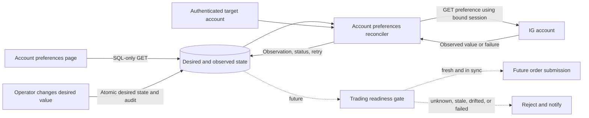

<!-- markdownlint-disable-file -->
# Task Research: Account Preferences State Verification

Research how account preferences should display the persisted database state, how trading startup should verify that state against IG, and how the UI should represent unsuccessful or mismatched verification.

## Executive Recommendation

Introduce a dedicated Account Preferences current-state aggregate and an account-bound reconciler. SQL owns durable operator intent; IG owns observed external fact. The page reads SQL only and labels these values separately as `Desired setting` and `Last observed at IG`.

New and migrated installations begin `Unconfigured`. Existing observations must not be promoted to desired intent because they are not account-bound and may be removed by retention. Verification observes and classifies drift by default. Applying a value to IG requires explicit, revision-bound operator authorization.

Verification should run best effort after a usable account-bound session is available, after desired-state changes, on manual retry, and through durable due-work processing. It must not block API startup. When order submission is implemented in the future, its application boundary should fail closed unless verification is fresh, in sync, and bound to the same desired revision, account, and session generation.

## Task Implementation Requests

* Diagnose why the account preferences page shows "Unable to load account preferences" after the latest update.
* Recommend a workflow in which the current preference is displayed from the database.
* Recommend a trading-start verification against the real state held by IG.
* Recommend how failed or mismatched verification should be shown alongside the database-derived display.

## Scope and Success Criteria

* Scope: Account-preference persistence and query paths, the Web and API display contract, trading startup orchestration, the IG integration boundary, and relevant tests and documentation.
* Assumptions: The database remains available independently of IG, and the stored value represents operator intent until verification proves whether IG matches it.
* Success Criteria:
  * Identify the concrete cause or most strongly evidenced cause of the current load failure.
  * Establish which value is authoritative for display and which value represents observed external state.
  * Define verification timing, state transitions, failure handling, and user-facing warning semantics.
  * Evaluate viable implementation alternatives and select one approach aligned with repository conventions.
  * Provide actionable implementation steps, examples, and exact source references.

## Outline

1. Trace the persisted account-preference model and read endpoint.
2. Trace the Web page request, response handling, and current error state.
3. Trace trading startup and the IG state observation capability.
4. Review tests, recent changes, and repository architecture constraints.
5. Evaluate verification workflow and data-model alternatives.
6. Select an approach and identify implementation and test impacts.

## Potential Next Research

* Confirm the operational meaning and account-type support of IG's `trailingStopsEnabled` field with IG support or a current account-specific schema.
  * Reasoning: The public reference confirms the field and endpoint but does not fully define how the setting affects later order behavior.
  * Reference: [IG account preferences reference](https://labs.ig.com/reference/accounts-preferences.html)
* Exercise two linked IG Demo accounts to prove account selection and account-switch behavior.
  * Reasoning: Preference verification must bind the provider value to the same account and session generation used for trading.
  * Reference: [IG REST Trading API guide](https://labs.ig.com/rest-trading-api-guide.html)
* Decide whether confirmed drift should block trading only or permit an explicitly authorized repair.
  * Reasoning: Automatic correction and warning-only behavior have materially different safety and operator-control implications.
  * Reference: `.copilot-tracking/research/subagents/2026-08-31/account-preferences-workflow-alternatives-research.md`

## Research Executed

### File Analysis

* `src/TNC.Trading.Platform.Web/Components/Pages/AccountPreferences/AccountPreferencesPagePresenter.cs:19-36`
  * Initial load performs the live current-preferences request and then the SQL history request under one catch block, so either failure produces the same message.
* `src/TNC.Trading.Platform.Application/Features/AccountPreferences/GetAccountPreferencesHandler.cs:13-39`
  * The current query calls IG and appends a successful observation. It does not read a database current-state record.
* `src/TNC.Trading.Platform.Application/Features/AccountPreferences/UpdateAccountPreferencesHandler.cs:21-60`
  * Updates use one `PUT` followed by an authoritative `GET`; the requested value is not persisted as durable desired state.
* `src/TNC.Trading.Platform.Infrastructure/Infrastructure/Persistence/EntityFramework/EfTrailingStopsPreferenceObservationStore.cs:10-61`
  * SQL stores append-only observations and queries history by platform and broker environment.
* `src/TNC.Trading.Platform.Infrastructure/Infrastructure/Persistence/EntityFramework/Entities/TrailingStopsPreferenceObservationEntity.cs:3-26`
  * The entity has nullable `AccountId`, but the mapper does not populate it.
* `src/TNC.Trading.Platform.Api/Program.cs:21-40`
  * Startup initializes SQL and executes blocking authentication reconciliation before serving requests.
* `src/TNC.Trading.Platform.Application/Features/ReconcilePlatformAuthentication/PlatformAuthenticationReconciler.cs:401-447`
  * Authentication becomes active after login evidence; account and position proof are not trade-readiness guarantees.
* `src/TNC.Trading.Platform.Infrastructure/Infrastructure/Integrations/Ig/IgBrokerAuthenticationGateway.cs:24-153`
  * Login supplies current account identity and tokens, while account and position reads provide optional proof.
* `src/TNC.Trading.Platform.Infrastructure/Infrastructure/Integrations/Ig/IgAccountPreferencesGateway.cs:20-89`
  * Each preference operation creates its own IG session, then reads or writes `/accounts/preferences` without returning account identity.
* `src/TNC.Trading.Platform.Application/Features/AccountDetails/GetAccountDetailsHandler.cs:6-39`
  * Account Details is the closest SQL-only query precedent.
* `src/TNC.Trading.Platform.Application/Features/AccountDetails/RefreshAccountDetailsHandler.cs:8-76`
  * External refresh is separate, coalesced, leased across replicas, and persisted independently from reads.

### Code Search Results

* `Unable to load account preferences.`
  * Found as a generic presenter message for both current-state and history request failures in `src/TNC.Trading.Platform.Web/Components/Pages/AccountPreferences/AccountPreferencesPagePresenter.cs:31-34`.
* `trailingStopsEnabled`
  * Found as an IG account-preference Boolean in `src/TNC.Trading.Platform.Infrastructure/Infrastructure/Integrations/Ig/IgAccountPreferencesGateway.cs:69-89`; no durable desired-state field exists in `PlatformConfigurationSnapshot` or `SqlPlatformConfigurationStore`.
* Order and position writes under `src/TNC.Trading.Platform.Infrastructure/Infrastructure/Integrations/Ig/`
  * No order-submission or position-write implementation exists. Current provider writes are session creation and preference update only.

### External Research

* IG REST API guide: account and session token semantics
  * `CST` identifies the client and `X-SECURITY-TOKEN` identifies the current account for v1/v2 authentication. Subsequent calls must remain bound to that context.
  * Source: [IG REST Trading API guide](https://labs.ig.com/rest-trading-api-guide.html)
* IG account preferences reference: `GET` and `PUT /accounts/preferences`
  * Confirms an account-preference resource with version 1 read and update operations.
  * Source: [IG account preferences reference](https://labs.ig.com/reference/accounts-preferences.html)
* IG positions reference: active-account exposure
  * `GET /positions` version 2 returns open positions for the active account.
  * Source: [IG positions reference](https://labs.ig.com/reference/positions.html)

### Project Conventions

* Standards referenced: `.github/copilot-instructions.md`, `.github/instructions/architecture.instructions.md`, `.github/instructions/configuration.instructions.md`, `.github/instructions/radzen-blazor.instructions.md`, `.github/instructions/tests.instructions.md`, `.github/instructions/playwright.instructions.md`, and `.github/instructions/aspire-tests.instructions.md`.
* Instructions followed: Application handlers own policy, reads remain pure where a persisted projection exists, provider effects sit behind inward-owned ports, operator-managed settings are durable and audited, and tests are unit-first with closed-box coverage at system boundaries.

### Delegated Evidence

* `.copilot-tracking/research/subagents/2026-08-31/account-preferences-load-failure-research.md`
  * Traces the generic error through both page requests and ranks the runtime hypotheses.
* `.copilot-tracking/research/subagents/2026-08-31/account-preferences-ig-verification-research.md`
  * Establishes account/session scope, startup behavior, IG capabilities, and future trading-safety requirements.
* `.copilot-tracking/research/subagents/2026-08-31/account-preferences-workflow-alternatives-research.md`
  * Evaluates persistence, reconciliation, UI, concurrency, and test alternatives against repository patterns.
* `.copilot-tracking/research/subagents/2026-08-31/account-preferences-final-alternatives-review.md`
  * Adversarially validates the selected approach and tightens bootstrap, remediation, session-binding, and future-trading semantics.

## Key Discoveries

### Project Structure

The current feature is a vertical slice across Web, API, Application, and Infrastructure. It already separates current read, update, and observed-history operations, but the current read remains provider-first. A redesign can preserve those boundaries while adding a reconciliation operation and a current-state persistence adapter.

There is no trading or order-placement implementation yet. The current startup sequence establishes authentication supervision, not trade readiness. This provides a clean opportunity to define preference verification as an explicit future trading gate rather than overloading authentication state.

### Implementation Patterns

The repository has a proven desired-state flow in platform configuration: validate, commit configuration and audit atomically, then reconcile. Account Details and Platform Status provide the matching query pattern: serve persisted projections without external calls and use separate commands or supervisors for refresh and reconciliation.

Account Preferences currently follows a different contract. Reads call IG, successful results become append-only observations, and the wiki explicitly prohibits using observations as a cache or fallback. The proposed database-first workflow is therefore an intentional API and documentation contract change, not a small presenter fix.

The database must distinguish three concepts and one bootstrap condition:

* Unconfigured state: no operator-approved desired value exists yet
* Desired state: the operator-approved Boolean and target IG account, retained durably until changed
* Observed state: the nullable Boolean read from IG for that account, with observation time and session/account evidence
* Reconciliation state: pending verification, in sync, drifted, verification failed, or unsupported, including retry and safe failure metadata

The latest observation cannot safely stand in for desired state because observations are retained history, can expire under retention, and are not currently account-bound.

### Complete Examples

The recommended inward-facing current-state contract is conceptually:

```csharp
public sealed record AccountPreferencesState(
    string? AccountId,
    bool? DesiredTrailingStopsEnabled,
    long? DesiredRevision,
    bool? ObservedTrailingStopsEnabled,
    DateTimeOffset? ObservedAtUtc,
    AccountPreferencesVerificationStatus VerificationStatus,
    DateTimeOffset? NextRetryAtUtc,
    string? FailureSummary);
```

The reconciliation flow is:

```text
Load desired state and revision
  -> establish one IG session for the configured account
  -> GET account preference
  -> equal: persist InSync observation
  -> mismatch: persist Drifted observation and warn the operator
  -> unavailable: persist VerificationFailed without inventing an observed value
  -> optional explicit, revision-bound remediation: one PUT, then authoritative GET in the same session context
  -> reject stale completion when desired revision changed during the attempt
```

### API and Schema Documentation

Recommended `GET /api/platform/account-preferences` projection:

```json
{
  "accountId": "ABC123",
  "desiredTrailingStopsEnabled": true,
  "observedTrailingStopsEnabled": true,
  "verificationStatus": "InSync",
  "desiredRevision": 7,
  "desiredChangedAtUtc": "2026-08-31T10:00:00Z",
  "lastVerifiedAtUtc": "2026-08-31T10:00:04Z",
  "nextRetryAtUtc": null,
  "failureSummary": null
}
```

Before configuration, `accountId`, desired value, and desired revision are nullable and status is `Unconfigured`. The corresponding current-state table should be keyed by the approved platform/broker partition and explicit IG account once selected. It should include desired revision or a row-version token so a late verifier cannot overwrite a newer operator decision. Append-only observations remain separate and gain a populated account identity.

### Configuration Examples

The target account and desired value should be operator-managed SQL state, not deployment configuration or an inferred latest observation:

```json
{
  "brokerEnvironment": "Demo",
  "accountId": "ABC123",
  "desiredTrailingStopsEnabled": true
}
```

Secret credentials remain protected through the existing credential service. Failure summaries must not contain credentials or provider payloads.

## Technical Scenarios

### Database-First Display with IG Verification

The database should be authoritative for operator intent and UI availability. IG should be authoritative for observed external state. The UI should never collapse these into one unlabeled Boolean.

**Requirements:**

* Display persisted operator intent even when IG is unavailable.
* Distinguish stored intent from externally observed state.
* Run verification at a safe point before trading begins.
* Preserve useful evidence for the operator when verification fails or detects a mismatch.

**Preferred Approach:**

* Add a dedicated current-state aggregate and Account Preferences reconciler.
* Make the page query SQL only and show desired state even when IG is unavailable.
* Show last observed IG state, verification time, and reconciliation status separately.
* Trigger verification after authentication/account selection, after desired-state changes, and through durable background due-work processing.
* When order submission exists in the future, require a fresh, matching, account-bound verification at its application boundary. Startup verification only primes persisted status.
* In the current product, present unknown, stale, or mismatched state as a warning because no order-producing workflow exists. A future order boundary must derive a fail-closed decision from preference, session, exposure, schedule, and risk facts.
* Do not automatically rewrite IG after observing drift. Require explicit, revision-bound remediation using one account/session context, with every attempt beginning with `GET`, at most one `PUT`, and an authoritative confirming `GET`.



**Implementation Details:**

1. Fix the current diagnostic ambiguity by loading current state independently from history and preserving per-request Problem Details. Also pass the injected event store to `GetAccountPreferencesHandler.RecordFailureAsync`; the current omission suppresses expected provider-failure telemetry.
2. Select and persist the explicit target IG account before treating any preference result as account-bound.
3. Introduce a current-state entity and migration distinct from retained observation history. Begin `Unconfigured`; do not backfill desired intent from observations. Persist account identity, nullable desired value, revision, nullable observed value, verification timestamps, factual status, retry metadata, actor, and correlation ID.
4. Change current-state `GET` to a pure SQL projection. Keep observed-history paging as a separate request whose failure does not erase the current-state display.
5. Change the update operation to commit desired state and audit before provider work. Whether this expands the current response or adopts `202 Accepted` requires API consumer review and a coordinated compatibility decision.
6. Implement an observe-only reconciliation handler that records equality, drift, or failure without fabricating state or writing to IG. Guard completion with desired revision and a SQL lease.
7. Add a separate explicit remediation command. Bind its initial `GET`, optional single `PUT`, and confirming `GET` to one target account/session context; reject stale authorizations after desired revision changes.
8. Keep API readiness independent of IG preference verification. When order submission is added in the future, implement its distinct trade-readiness policy there, rechecking or invalidating evidence on reauthentication, account switch, schedule exit, configuration change, or expiry.
9. Update the UI to present desired and observed values side by side. Use a warning for `Drifted`, `VerificationFailed`, `Unsupported`, or stale verification, and a non-urgent status for pending verification.
10. Update `docs/wiki/runtime-behavior.md`, `docs/wiki/api-reference.md`, `docs/wiki/operator-guide.md`, and testing guidance because current documentation defines IG live reads as the only current-state authority.

The minimum validation matrix covers application comparison and retry policy, IG request/token behavior, SQL restart and stale-writer concurrency, bUnit rendering for every status, and a small Aspire closed-box workflow proving SQL-only reads and eventual convergence without real IG.

#### Considered Alternatives

Alternative 1, selected: dedicated current-state aggregate and reconciler. It provides explicit desired and observed state, pure reads, durable retry, account identity, optimistic concurrency, and a separate trading gate. Its cost is a new entity, migration, operation, scheduler, and expanded API contract.

Alternative 2: derive current state from an expanded event log. This preserves chronology but complicates current-state queries, conflicts with retention, and still requires revision ordering or a materialized projection. It is rejected as the primary store.

Alternative 3: extend global platform configuration and authentication reconciliation. This reuses existing orchestration but couples account-specific broker state to authentication health, risks unnecessary one-second IG calls, and obscures failure ownership. It is rejected because authentication and preference convergence are separate responsibilities.

Alternative 4: persist desired state and synchronously perform `PUT -> GET` in the HTTP request. This minimizes visible change but retains provider latency and cancellation ambiguity and still needs background retry. It is suitable only as an optional fast path delegated to the selected reconciler.

## Failure Diagnosis

The screenshot alone cannot identify the failing request. The same message covers both the live preferences request and the history request. The strongest evidenced primary cause is a non-success response from mandatory IG access, commonly missing or undecryptable Demo credentials leading to `503`. If the confirmed editor appeared before the error, history persistence is the stronger cause.

The cheapest discriminating check is to inspect these browser requests in order:

1. `GET /api/platform/account-preferences`
2. `GET /api/platform/account-preferences/observations?pageSize=25`

The first response's Problem Details distinguishes rate limiting (`429`), malformed provider data (`502`), unavailable or rejected provider access (`503`), and timeout (`504`). If the first request is `200` and the second fails, the database/history path caused the generic message.

Focused current-checkout verification run by the delegated researcher passed 39 of 39 Web, IG gateway, and SQL integration tests. Historical test artifacts show an earlier EF pending-model migration failure, but repaired migration reruns and current tests disconfirm it as an active checkout defect. No retained request trace from the reported browser session was available, so the exact runtime response remains unproven.

## Open Product Decisions

* Select the explicit IG account ID that owns automated trading and durable preference intent.
* Define whether trailing stops must always be enabled or remain operator-configurable.
* Decide the future trading policy for confirmed drift and whether remediation is a separate operator action or part of `Save and apply`.
* Set verification freshness, retry exhaustion, manual retry, notification, and override policy.
* Define future position reconciliation at deal level before trading startup can be considered safe.

## Implementation Planning Addendum

Delegated implementation planning research is recorded in
`.copilot-tracking/research/subagents/2026-08-31/account-preferences-implementation-planning-research.md`.
It verified the concrete file inventory, existing SQL lease and background-service precedents,
account/session-binding gap, migration ownership, test baseline, and executable validation commands.

Planning adopts these defaults when product decisions remain deferred:

* The operator must explicitly configure the target IG account; no observation or authentication snapshot becomes intent implicitly.
* Trailing stops remain operator-configurable.
* `PUT /api/platform/account-preferences` remains `200 OK` and returns the committed SQL projection; verification is asynchronous.
* Manual retry and explicit, revision-bound remediation use separate `POST` operations.
* An IG login whose current account differs from the configured target is rejected for verification or remediation; account switching is not introduced.
* Public persisted statuses are `Unconfigured`, `PendingVerification`, `InSync`, `Drifted`, `VerificationFailed`, and `Unsupported`; staleness is derived from timestamps.
* Each provider operation records a non-secret generated attempt identifier as session-generation evidence.
* Verification freshness defaults to five minutes. Durable retries use bounded exponential delays of 5 seconds, 30 seconds, 2 minutes, and 10 minutes, then remain due for manual or scheduled retry without erasing the last observation.
* No override or future order-submission gate is implemented in this task. The future gate remains a documented fail-closed requirement.
