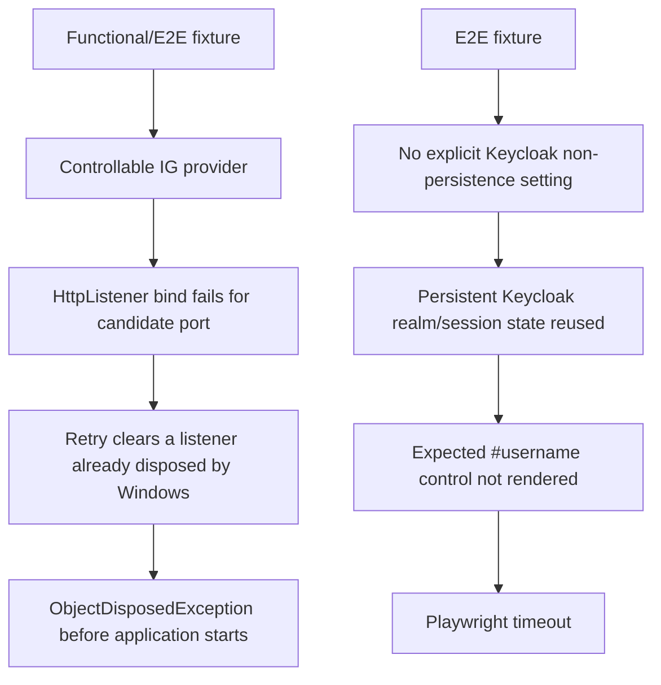

<!-- markdownlint-disable-file -->
# Task Research: Current Testing Strategy and Failing Tests

This research assesses the repository's current automated-testing strategy,
classifies the failing tests verified on 2026-09-15, and recommends targeted
repairs that preserve the intended test boundaries. It does not modify product
or test source.

## Task Implementation Requests

* Research the current project testing strategy after its recent instruction and documentation updates.
* Identify the current failing tests and distinguish test-harness failures from product regressions.
* Recommend a strategy-aligned resolution for the current issues.

## Scope and Success Criteria

* Scope: Current test instructions, test documentation, fixtures, retained results, focused test runs, and CI orchestration.
* Assumptions: Docker Desktop is available for the Aspire- and Testcontainers-backed suites; the workspace state examined on 2026-09-15 is the target state.
* Success Criteria:
  * Account for every currently verified failure.
  * Select a narrow durable remediation for each failure mechanism.
  * Preserve the repository's unit-first, fixture-owned testing model.
  * Specify focused validation before a complete quality-gate rerun.

## Outline

1. Establish the intended suite responsibilities and fixture model.
2. Classify the current results and identify the controlling fixtures.
3. Evaluate implementation and workaround alternatives.
4. Select the repair sequence and validation evidence needed for closure.

## Research Executed

### File Analysis

* `.github/instructions/tests.instructions.md:28-107`
  * Defines the unit-first pyramid, the distinct unit, integration, functional, and E2E tiers, fixture ownership, determinism, and feature-level functional traceability.
* `.github/instructions/aspire-tests.instructions.md:24-66`
  * Requires closed-box Aspire tests to use fixture-owned builders, named resources/endpoints, bounded readiness, randomized endpoints, and async cleanup.
* `.github/instructions/playwright.instructions.md:25-60`
  * Establishes Playwright `PageTest`, web-first assertions, and step conventions for browser coverage.
* `test/Shared/Authentication/ManagedAppHostFixture.cs:35-97`
  * Implements the intended real-AppHost lifecycle: create the distributed test builder, wait for named `keycloak`, `api`, and `web` resources, then dispose asynchronously.
* `test/Shared/AccountPreferences/ControllableIgProvider.cs:36-56`
  * Owns the dynamic-loopback external-provider fake used by the failing Web functional and E2E suites.
* `test/TNC.Trading.Platform.Web/TNC.Trading.Platform.Web.E2ETests/Authentication/RealAuthenticationE2ETestFixture.cs:15-24`
  * Configures the browser fixture but omits the Keycloak non-persistence setting supplied by the functional fixture.
* `src/TNC.Trading.Platform.AppHost/AppHostInfrastructureRegistration.cs:8-16,41-47`
  * Defaults Keycloak to persistent state unless `AppHost:UsePersistentKeycloakState` is explicitly `false`.
* `.github/workflows/ci.yml:35-168`
  * Runs fast suites, Docker-backed service/functional suites, browser/Keycloak tests, and a final solution-wide summary in separate stages.

### Command Evidence

| Command or suite | Verified result | Interpretation |
| --- | --- | --- |
| `dotnet build` | Passed, exit code 0 | The solution compiles; failures are runtime-test concerns. |
| Web unit project | 129 passed | Earlier bUnit/AngleSharp failures are resolved in the current workspace. |
| API integration project | 26 passed | Current named-resource Aspire fixture works for this slice. |
| Infrastructure SQL integration project | 29 passed | Fixture-owned Testcontainers SQL lifecycle is working. |
| Web functional project | 8 failed, 0 passed | Every test fails in shared fixture startup before an application assertion. |
| Web E2E project | 2 failed, 0 passed | Both tests time out waiting for Keycloak's `#username` control. |
| One filtered E2E smoke with `AppHost__UsePersistentKeycloakState=false` | 1 passed | Directly validates the suspected Keycloak state-isolation defect. |
| `dotnet test TNC.Trading.Platform.slnx --no-build --logger "console;verbosity=minimal"` | Host cancelled higher-level tasks after 23 seconds; 507 passed, 0 failed recorded | Not a valid aggregate result and not evidence that the ten failures are resolved. |

### Project Conventions

* Standards referenced: `.github/copilot-instructions.md`, `.github/instructions/tests.instructions.md`, `.github/instructions/aspire-tests.instructions.md`, `.github/instructions/playwright.instructions.md`, `.github/instructions/architecture.instructions.md`, and `.github/instructions/csharp.instructions.md`.
* The current strategy is an intentionally narrow real-auth matrix: broad deterministic coverage stays in xUnit/bUnit; real resource topology belongs to Aspire; browser-only behavior belongs to Playwright.

## Key Discoveries

### Current Testing Strategy

The repository has a sound, layered strategy and should retain it:

| Layer | Primary responsibility | Mechanism |
| --- | --- | --- |
| Unit | Domain policy, mappings, validation, request/state handling | xUnit with fakes |
| Component | Razor rendering, conditional markup, lifecycle, component events | bUnit |
| Service/functional | Requirement-driven HTTP behavior and controlled dependency interactions | xUnit plus fixture-owned real AppHost resources where necessary |
| Distributed E2E | OIDC redirects, browser cookies, JavaScript behavior, critical visible workflows | Playwright against Aspire-managed `web` |

The strategy's key operational rule is that any mutable dependency involved in a distributed test must be created, configured, readied, and disposed by the fixture that uses it. Randomized endpoints and named Aspire clients prevent parallel suites from discovering or colliding with unrelated processes. Global serialization, fixed-port leases, and environment cleanup are not valid substitutes for this ownership model.

### Current Failure Inventory

Ten current failures belong to two independent test-infrastructure defects. No failed execution reached a product behavior assertion.

| Test project | Failed tests | Root cause | Classification |
| --- | --- | --- | --- |
| `TNC.Trading.Platform.Web.FunctionalTests` | 8 authentication/account-preferences tests | `ControllableIgProvider.Start()` retries a listener instance Windows has disposed after a bind failure | Deterministic shared-fixture defect |
| `TNC.Trading.Platform.Web.E2ETests` | 2 browser tests | Fixture permits persistent Keycloak state, so browser automation does not receive the expected clean sign-in page | Test state-isolation defect |

The eight functional failures are:

* `PlatformAuthenticationFunctionalTests.SignOutEndpoint_ShouldReturnBadRequest_WhenAntiforgeryTokenIsMissing`
* `PlatformAuthenticationFunctionalTests.SignInEndpoint_ShouldRedirectToLandingPage_WhenExternalReturnUrlIsSupplied`
* `PlatformAuthenticationFunctionalTests.SignOutEndpoint_ShouldReturnNotFound_WhenBrowserUsesLegacyGetRequest`
* `PlatformAuthenticationFunctionalTests.RootRoute_ShouldRenderSignInPage_WhenAnonymousUserRequestsApplicationEntry`
* `PlatformAuthenticationFunctionalTests.ConfigurationRoute_ShouldRedirectToSignIn_WhenOperatorRequestsProtectedRouteAfterSignOut`
* `PlatformProtectedRouteFunctionalTests.ConfigurationRoute_ShouldRedirectToAccessDenied_WhenViewerRequestsOperatorRoute`
* `AccountPreferencesFunctionalTests.AccountPreferences_ShouldPersistAndConverge_WhenProviderRecovers`
* `AccountPreferencesFunctionalTests.AccountPreferences_ShouldReturnUnconfiguredWithoutProviderRead_WhenFreshInstallProviderIsUnavailable`

The two E2E failures are:

* `PlatformDashboardAuthenticationE2ETests.OperatorUi_ShouldRenderOperatorHome_WhenSeededViewerSignsInFromAspireDashboard`
* `AccountPreferencesE2ETests.AccountPreferences_ShouldShowDesiredAndObservedLabels_WhenProviderIsUnavailable`

### Root-Cause Flow



`ControllableIgProvider` selects a candidate port and calls `HttpListener.Start()`. If the bind fails, the Windows runtime leaves that listener disposed. The retry calls `listener.Prefixes.Clear()` rather than constructing a replacement listener, causing `ObjectDisposedException`. This violates repeatability but is localized to test setup; it does not demonstrate an application defect.

The E2E fixture has the configuration channel needed for the correct state boundary through `ManagedAppHostFixture`. The functional fixture already passes `AppHost:UsePersistentKeycloakState=false`; the E2E fixture does not. The passing controlled rerun with the equivalent process setting is a discriminating check: it changes Keycloak lifetime only and allows the previously failing sign-in smoke to pass.

### Historical Results That Are No Longer Current

The earlier `.copilot-tracking/research/2026-09-15/failing-tests-research.md` records 87 failures, including direct AngleSharp/bUnit incompatibility, process-based AppHost discovery, and unowned SQL Docker discovery. Those causes were valid at the time but conflict with the current focused results: the affected projects now pass after workspace changes moved to bUnit-compatible dependencies, a named-resource managed AppHost fixture, and a fixture-owned Testcontainers SQL lifecycle. They are not part of the current remediation scope.

## Technical Scenarios

### Recover HttpListener Retry Lifecycle

**Requirements:**

* Keep the controllable IG fake network-reachable from the separately hosted AppHost.
* Retain bounded retries under a dynamic-port bind race.
* Preserve the existing fake's stateful routes and base-URI configuration contract.

**Preferred Approach:**

Construct and configure a new `HttpListener` inside every bind attempt. Return it only after `Start()` succeeds; on `HttpListenerException`, close or dispose that attempt before continuing. Keep the existing attempt cap and final diagnostic exception. Add a focused deterministic regression test that occupies the first supplied candidate port, then confirms the provider starts and serves an existing route on the next candidate.

```csharp
for (var attempt = 0; attempt < maximumAttempts; attempt++)
{
    var listener = new HttpListener();
    listener.Prefixes.Add($"http://127.0.0.1:{candidatePort}/");

    try
    {
        listener.Start();
        return listener;
    }
    catch (HttpListenerException)
    {
        listener.Close();
    }
}
```

The final implementation should preserve local naming and the existing provider's ownership/disposal structure rather than copy this illustrative fragment verbatim.

#### Considered Alternatives

* Replace the fake with Kestrel bound to port `0`: Deferred. It atomically obtains an OS-assigned endpoint, but adds host, routing, address-discovery, and shutdown machinery to a small three-route test fake. Reconsider only if port flakes remain after the repair or the fake grows substantially.
* Use `TestServer` or `WebApplicationFactory`: Rejected. They are in-memory and cannot provide the network-reachable outbound HTTP dependency required by the separately hosted AppHost.
* Add WireMock.Net: Rejected. It adds a dependency and abstraction where the existing small stateful fake is adequate.
* Serialize tests, reintroduce a fixed-port lease, clear ports, or retry CI: Rejected. These conceal an ownership/lifecycle defect and conflict with current instructions.

### Isolate Browser Keycloak State

**Requirements:**

* Retain a real Keycloak OIDC browser journey.
* Keep persistent Keycloak as the normal interactive-local-development default.
* Ensure each E2E fixture uses a clean realm import and does not inherit browser-test state.

**Preferred Approach:**

Add `"AppHost:UsePersistentKeycloakState" = bool.FalseString` to the E2E fixture configuration dictionary next to its current IG endpoint and interactive-sign-in settings. Keep the setting fixture-scoped. Do not change the AppHost default or replace browser authentication with synthetic/in-memory authentication.

```csharp
var configuration = new Dictionary<string, string?>
{
    ["AppHost:UsePersistentKeycloakState"] = bool.FalseString,
    // Existing fixture-specific settings remain here.
};
```

#### Considered Alternatives

* Make `ManagedAppHostFixture` always disable Keycloak persistence: Deferred. It would alter every current and future caller; the present duplication is limited to a single missing E2E setting.
* Reset Keycloak through its Admin API: Rejected. It adds credentials, readiness handling, and cleanup paths when a session lifetime already creates the necessary clean boundary.
* Delete containers or volumes in CI, serialize browser tests, or rely on clean runners: Rejected. These environment-specific measures do not make the fixture self-contained and can disrupt development resources.
* Replace the real OIDC browser flow with `WebApplicationFactory` or synthetic authentication: Rejected. The E2E test's purpose is to exercise the actual identity redirect and browser session contract.

## Selected Resolution and Validation

1. Repair the `HttpListener` retry lifecycle in `ControllableIgProvider` and add one deterministic regression test that forces the first candidate port to be occupied.
2. Run that regression test, then run all Web functional tests. Any remaining failures after fixture startup are the first valid indicators of feature behavior needing investigation.
3. Add the explicit Keycloak non-persistence option to `RealAuthenticationE2ETestFixture`.
4. Run each currently failing E2E test, then repeat the E2E project run once to prove the realm does not leak across runs. Retain Playwright trace, screenshot, final URL, and resource logs on any residual failure.
5. Run the high-level projects independently and use the existing staged CI sequence for aggregate confirmation. Investigate the approximately 23-second solution-test host cancellation separately; do not report its partial 507-pass count as a completed quality gate.

Recommended focused commands:

```powershell
dotnet test test/TNC.Trading.Platform.Web/TNC.Trading.Platform.Web.FunctionalTests/TNC.Trading.Platform.Web.FunctionalTests.csproj --filter "FullyQualifiedName~ControllableIgProviderTests.Start_ShouldRetryWithFreshListener_WhenFirstCandidatePortIsOccupied"
dotnet test test/TNC.Trading.Platform.Web/TNC.Trading.Platform.Web.FunctionalTests/TNC.Trading.Platform.Web.FunctionalTests.csproj
dotnet test test/TNC.Trading.Platform.Web/TNC.Trading.Platform.Web.E2ETests/TNC.Trading.Platform.Web.E2ETests.csproj --filter "FullyQualifiedName~PlatformDashboardAuthenticationE2ETests"
dotnet test test/TNC.Trading.Platform.Web/TNC.Trading.Platform.Web.E2ETests/TNC.Trading.Platform.Web.E2ETests.csproj --filter "FullyQualifiedName~AccountPreferencesE2ETests"
dotnet test test/TNC.Trading.Platform.Web/TNC.Trading.Platform.Web.E2ETests/TNC.Trading.Platform.Web.E2ETests.csproj
```

No broad strategy rewrite is recommended. The instructions already prescribe fixture ownership, randomized endpoints, bounded readiness, asynchronous cleanup, and test isolation. The current defects are implementation drift from those rules. A small documentation clean-up remains worthwhile but is not required to resolve the failing tests: `docs/wiki/testing-and-quality.md:170-171` still describes obsolete Docker metadata discovery, and lines 517-523 still mention runtime-listener discovery.

## Potential Next Research

* Determine why solution-level `dotnet test` is cancelled by the host at approximately 23 seconds.
  * Reasoning: The cancellation prevents an authoritative local aggregate result but is distinct from the two current test defects.
  * Reference: `docs/wiki/local-development.md:217-241`.
* Decide whether browser E2E should explicitly disable persistent SQL state as well as Keycloak state.
  * Reasoning: Keycloak isolation is proven causal; SQL isolation would guard future write-oriented browser scenarios.
  * Reference: `test/TNC.Trading.Platform.Web/TNC.Trading.Platform.Web.E2ETests/Authentication/RealAuthenticationE2ETestFixture.cs:15-24`.
* Correct obsolete fixture narratives in the testing wiki.
  * Reasoning: Current code uses fixture-owned Testcontainers and named Aspire resources, not Docker metadata or listener discovery.
  * Reference: `docs/wiki/testing-and-quality.md:170-171,517-523`.

## Research Summary

The project testing approach is sound: retain broad deterministic xUnit/bUnit coverage and a deliberately small Aspire/Playwright real-auth matrix. The current 10 failures are test-fixture defects, not demonstrated product regressions. The selected resolution is a fresh `HttpListener` per bind attempt with regression coverage, plus fixture-scoped nonpersistent Keycloak state in the E2E fixture. This directly restores repeatability without masking defects through serialization, fixed ports, CI cleanup, or replacement of real OIDC coverage.

Supporting research:

* `.copilot-tracking/research/subagents/2026-09-15/current-testing-strategy.md`
* `.copilot-tracking/research/subagents/2026-09-15/failing-tests-diagnosis.md`
* `.copilot-tracking/research/subagents/2026-09-15/failing-tests-remediation-options.md`