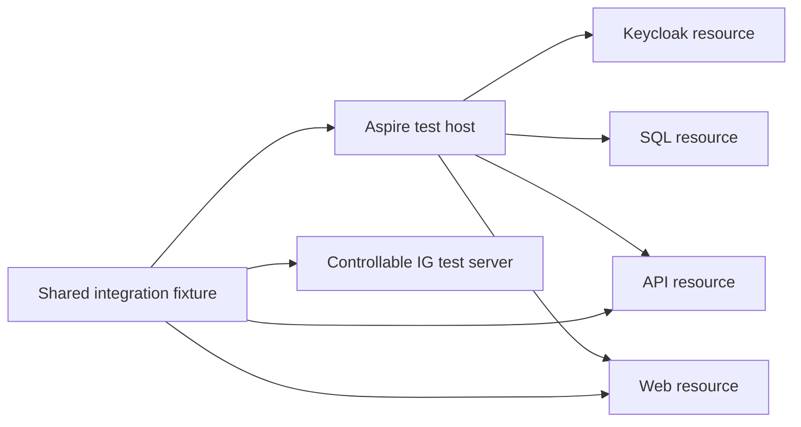

<!-- markdownlint-disable-file -->
---
title: Failing Tests Research
description: Evidence-led diagnosis and remediation plan for the failing automated test suite.
author: GitHub Copilot
ms.date: 2026-09-15
ms.topic: troubleshooting
keywords:
  - dotnet
  - testing
  - aspire
  - bunit
  - sql-server
---

## Task Implementation Requests

* Investigate why automated tests fail while `dotnet build` succeeds and the application runs.
* Identify the actual causes, separate product regressions from test-environment defects, and recommend the best resolution.
* Define a complete, official-source Aspire testing strategy and a consistent migration path for current tests.
* Identify updates to Copilot instructions and related artifacts that will keep subsequent test work aligned with that strategy.
* Assess alternatives to bUnit and direct AngleSharp, including coverage lost when UI testing is centered on xUnit, Aspire, and Playwright.
* Record the decision to retain bUnit and remove only the unused direct AngleSharp override.

## Scope and Success Criteria

* Scope: The current `dotnet test TNC.Trading.Platform.slnx --no-build` result, the code and retained quality-gate evidence that control the failing suites, and the current testing guidance from Aspire and Microsoft Learn.
* Assumptions: The reproduced result on 2026-09-15 reflects the user's reported state; Docker is available for Aspire-backed scenarios; no test or product code is changed by this research.
* Success criteria:
  * Account for every current failing test result with an evidence-backed classification.
  * Select one remediation strategy that restores test validity without hiding failures through global serialization.
  * Provide an implementation order and focused validation commands.
  * Establish a maintainable test pyramid and fixture model for future Aspire development.

## Outline

1. Reproduce and classify the failures by test project.
2. Trace each group to its owning dependency or fixture lifecycle.
3. Establish the official Aspire and Microsoft testing model.
4. Map retained coverage and migration candidates to that model.
5. Evaluate bUnit removal and its coverage consequences.
6. Select a staged remediation, governance, and validation plan.

## Research Executed

### File Analysis

* `global.json`
  * Uses .NET SDK `10.0.302` at line 3. The SDK differs from the August quality-gate environment, but it is not required to explain the reproduced failures.
* `test/TNC.Trading.Platform.Web/TNC.Trading.Platform.Web.UnitTests/TNC.Trading.Platform.Web.UnitTests.csproj`
  * Directly references `AngleSharp` `1.8.1` at line 15 and `bunit.web` `1.40.0` at line 16.
* `test/TNC.Trading.Platform.Api/TNC.Trading.Platform.Api.IntegrationTests/Authentication/SyntheticTokenIntegrationTestFixture.cs`
  * Uses `DistributedApplicationTestingBuilder.CreateAsync` at line 33 and `CreateHttpClient("api")` at line 89. All 14 tests using this fixture pass.
* `test/TNC.Trading.Platform.Api/TNC.Trading.Platform.Api.IntegrationTests/Authentication/RealAuthenticationIntegrationTestFixture.cs`
  * Acquires a Keycloak lease at line 20 and starts a process-based AppHost at line 26.
* `test/Shared/Authentication/AppHostProcessHandle.cs`
  * Polls inferred local ports from line 76 and times out at line 125. Candidate endpoint discovery depends on newly observed TCP listeners at lines 278 and 373.
* `src/TNC.Trading.Platform.AppHost/Properties/launchSettings.json`
  * Configures the AppHost process, including the Aspire dashboard HTTPS endpoint at line 8 and HTTP endpoint at line 21; these are not API resource endpoints.
* `test/Shared/AccountPreferences/ControllableIgProvider.cs`
  * Releases a `TcpListener` chosen at line 37 before binding `HttpListener` at lines 39-45, creating a time-of-check/time-of-use port race.
* `test/TNC.Trading.Platform.Infrastructure/TNC.Trading.Platform.Infrastructure.IntegrationTests/SqlServerDatabaseFixture.cs`
  * Searches for an arbitrary running SQL Server Docker image at line 18, resolves its mapped port at lines 22-26, connects at line 48, and resets/disposes through lines 70 and 99. The fixture does not own or await the database lifecycle.
* `test/Shared/Authentication/KeycloakPortLease.cs`
  * Coordinates a fixed Keycloak port through a lock file at lines 25 and 33. Historical artifacts demonstrate that this can independently time out under concurrent project execution.

### Code Search and History Results

* `52bfba4` (2026-09-14, `Update SDK versions and Keycloak URLs to use HTTPS`)
  * Added the explicit `AngleSharp` `1.8.1` reference that conflicts with the bUnit dependency graph.
* `f4b3b3b` (2026-08-30)
  * Added account-preferences tests and most recently changed `WaitForApiBaseUriAsync`.
* `artifacts/quality-gates/account-preferences-ui-clarity/20260831-124715/quality-gate.log`
  * Retains earlier failures caused by Keycloak port `8080` lease contention, a distinct historical failure mechanism.

### External Research

* Aspire testing documentation:
  * `DistributedApplicationTestingBuilder` creates an application test host and named resource clients, avoiding process-local port discovery.
  * Source: [Aspire testing overview](https://aspire.dev/testing/overview/)
  * Source: [Write your first Aspire test](https://aspire.dev/testing/write-your-first-test/)
* bUnit package metadata:
  * `bunit.web` `1.40.0` declares AngleSharp `1.2.0`; a direct `1.8.1` reference changes the runtime binary contract.
  * Source: [bUnit 1.40.0 package](https://www.nuget.org/packages/bunit.web/1.40.0)
* .NET testing guidance:
  * Test isolation and reliable infrastructure lifecycle management are prerequisites for repeatable integration results.
  * Source: [.NET testing documentation](https://learn.microsoft.com/dotnet/core/testing/)
* Aspire hosted testing guidance:
  * `DistributedApplicationTestingBuilder` starts and owns the AppHost lifecycle, randomizes proxied ports and disables the dashboard by default, supports named resource clients, and redirects resource logs to the distributed application.
  * Source: [Aspire testing overview](https://aspire.dev/testing/overview/)
  * Source: [Manage the AppHost in tests](https://aspire.dev/testing/manage-app-host/)
  * Source: [Access resources in tests](https://aspire.dev/testing/accessing-resources/)
* ASP.NET Core service integration guidance:
  * `WebApplicationFactory<TEntryPoint>` is the suitable in-process test host when a test must replace service registrations, configuration, or authentication handlers.
  * Source: [ASP.NET Core integration tests](https://learn.microsoft.com/en-us/aspnet/core/test/integration-tests?view=aspnetcore-10.0)
* EF Core testing and migration guidance:
  * Persistence-critical tests should run against the real production database provider with explicit write isolation; migrations must be tested and coordinated separately from application startup.
  * Source: [Testing against the production database system](https://learn.microsoft.com/en-us/ef/core/testing/testing-with-the-database)
  * Source: [Applying migrations](https://learn.microsoft.com/en-us/ef/core/managing-schemas/migrations/applying)

### Project Conventions

* Standards referenced: `.github/copilot-instructions.md`, `.github/instructions/folders.instructions.md`, `.github/instructions/aspire-tests.instructions.md`, and `.github/instructions/tests.instructions.md`.
* The repository already contains the correct Aspire-host pattern in the synthetic-token API fixture. Reuse it for real-auth flows rather than maintaining a parallel process-launch and port-scanning model.

## Key Discoveries

### Failure Inventory

The reproduced command completed in 62.9 seconds with 605 tests: 518 passed, 87 failed, and none skipped. The second TRX run, written outside the worktree, had the same totals.

| Test project or group | Result | Root cause | Classification |
|-----------------------|--------|------------|----------------|
| Web unit | 125 passed, 4 failed | bUnit binary executes against incompatible direct AngleSharp `1.8.1` rather than its declared `1.2.0` contract | Deterministic test dependency regression |
| API integration real-auth | 15 failed | Process-launched AppHost fixture probes newly opened local ports and mistakes dashboard process endpoints for resource discovery | Test-harness endpoint-discovery defect |
| API integration synthetic-token | 14 passed | Uses the named Aspire test-host resource client | Healthy control group |
| Web functional | 8 failed | `TcpListener` to `HttpListener` handoff loses the selected ephemeral port before binding | Test-harness port-allocation race |
| Web E2E | 2 failed | Same controllable IG provider race as Web functional | Test-harness port-allocation race |
| Infrastructure integration | 58 failed | 29 SQL connection failures plus 29 collection-cleanup failures after an unowned Docker SQL instance refuses connections | Test infrastructure ownership/readiness defect |

No captured failure reached a product-behavior assertion. The clean build and running application are therefore consistent with the test result: the failures are concentrated in test dependency and fixture infrastructure, not in a demonstrated application regression.

### Root-Cause Details

#### bUnit and AngleSharp Binary Incompatibility

The four Web-unit failures throw `MissingMethodException` for `AngleSharp.Dom.IHtmlCollection<T>.get_Item(Int32)` before their assertions execute. The direct AngleSharp package added by `52bfba4` overrides bUnit's declared package version. The failure is deterministic and will persist regardless of Docker, timing, or test ordering.

The safe immediate correction is to remove the direct AngleSharp override so NuGet resolves bUnit's supported version. An alternative is upgrading bUnit only after confirming a release that explicitly supports both AngleSharp `1.8.1` and the solution target framework.

#### Invalid API Endpoint Discovery Contract

The process-based real-auth fixture starts an AppHost and scans locally opened ports. An AppHost endpoint is its dashboard endpoint, whereas the `api` resource is separately managed and its binding is not a reliable result of host-port enumeration. This makes the discovery algorithm invalid even when the child process has started correctly.

The passing synthetic-token suite supplies a direct control: a named `api` client from `DistributedApplicationTestingBuilder` needs neither port inference nor dashboard probing. It should become the shared fixture mechanism, extended with the real Keycloak authentication flow.

#### HTTP Listener Port Race

`ControllableIgProvider` asks the OS for an available port by opening a TCP listener, closes it, then creates a separate HTTP listener on the same port. Another process can bind in the interval, which matches every Web functional and E2E error: `HttpListenerException` reports that the address is already in use. The retained test results do not identify the winning process, but the race exists independently of its identity.

The durable change is an endpoint-owning test server that exposes its assigned URI after binding. A bind-and-retry loop is an acceptable fallback only when the listener API cannot bind to port `0` and reveal its assigned endpoint.

#### SQL Lifecycle Is Unowned

The SQL integration fixture finds any Docker container whose image matches SQL Server. It can attach to an unrelated, stopped, or concurrently replaced container and then attempts database reset and cleanup. The 29 test failures and their matching 29 cleanup failures are the same lifecycle problem expressed twice, not 58 independent product failures.

The fixture must provision and await a dedicated SQL resource under its own lifecycle. An Aspire-managed SQL resource is the preferred match for this repository because the suite already uses Aspire; a dedicated Testcontainers fixture is a viable alternative only if the SQL tests must run without AppHost/Aspire.

#### Historical Keycloak Lease Contention

Retained quality-gate TRX files show earlier `Keycloak port 8080 lease timed out` failures. That signature did not occur in the current reproduction, but the fixed host port and cross-project lock remain a scheduling hazard. The selected approach removes fixed host-port dependence by letting the owned Aspire resource publish its endpoint, then removes the lease.

## Technical Scenarios

### Restore Deterministic Web Unit Tests

**Requirements:**

* Preserve bUnit's runtime dependency contract.
* Validate the Web-unit suite independently before any fixture work.

**Preferred approach:** Remove the direct `AngleSharp` `1.8.1` reference, then use bUnit's transitive supported version.

```xml
<!-- test/TNC.Trading.Platform.Web/TNC.Trading.Platform.Web.UnitTests/TNC.Trading.Platform.Web.UnitTests.csproj -->
<ItemGroup>
  <PackageReference Include="bunit.web" Version="1.40.0" />
</ItemGroup>
```

Validation:

```powershell
dotnet test test/TNC.Trading.Platform.Web/TNC.Trading.Platform.Web.UnitTests/TNC.Trading.Platform.Web.UnitTests.csproj --no-restore
```

#### Considered Alternatives

* Upgrade bUnit and retain AngleSharp `1.8.1`: Rejected as the first move because compatibility has not been verified, expands the change surface, and the current direct override is proven incompatible.
* Disable the four failing tests: Rejected because they test active UI behavior and fail before assertions rather than exposing a product defect.

### Replace Process Scanning with Named Aspire Resources

**Requirements:**

* Test the real Keycloak authentication path.
* Obtain the API endpoint through a stable resource contract.
* Avoid a fixed Keycloak host port and process-local listener inference.

**Preferred approach:** Convert the real-auth API, functional, and E2E fixtures to a shared Aspire test-host fixture. Start the AppHost with `DistributedApplicationTestingBuilder`, await `api`, `web`, `keycloak`, and `sql` resource readiness as required, and use `CreateHttpClient("api")` and `CreateHttpClient("web")` for all requests.

```csharp
var appHost = await DistributedApplicationTestingBuilder
    .CreateAsync<Projects.TNC_Trading_Platform_AppHost>();

appHost.Services.ConfigureHttpClientDefaults(clientBuilder =>
{
    clientBuilder.AddStandardResilienceHandler();
});

await using var app = await appHost.BuildAsync();
await app.StartAsync();

var api = app.CreateHttpClient("api");
```

The exact readiness APIs and configuration injection should follow the existing `SyntheticTokenIntegrationTestFixture` rather than duplicating an independent host model.

#### Considered Alternatives

* Patch `AppHostProcessHandle` to ignore the dashboard port: Rejected because it still infers resource identity from process-local sockets, which Aspire does not promise to expose that way.
* Globally serialize all test projects: Rejected because it conceals ownership and port-allocation defects, adds unnecessary suite time, and does not repair the endpoint-discovery flaw.

### Make Test Resources Fixture-Owned

**Requirements:**

* Ensure Web higher-level tests can start a controllable IG endpoint without port races.
* Ensure SQL tests use a known, ready SQL Server instance and deterministic cleanup.
* Allow solution-level test execution without collision with other test projects.

**Preferred approach:** Use fixture-owned endpoint and database resources. Replace `ControllableIgProvider` with an endpoint-owning test server whose base URI is available after binding. For SQL, launch an Aspire SQL resource from the integration fixture and wait until it is ready before database initialization; dispose it after test completion.

```text
Test fixture
  -> starts named Aspire resources
  -> awaits readiness
  -> receives named API/Web clients and SQL connection details
  -> initializes test data
  -> executes tests
  -> disposes owned resources
```



#### Considered Alternatives

* Keep Docker image discovery and add connection retries: Rejected because retries cannot establish ownership or prevent attachment to an unrelated container.
* Retain the TCP reservation and add a sleep before `HttpListener` binds: Rejected because it enlarges the race window rather than closing it.
* Use Testcontainers for SQL immediately: Viable, but not selected because an Aspire-owned SQL resource aligns with the existing application topology and eliminates a second container lifecycle system. Use it only if the SQL integration project must remain independent of AppHost.

## Selected Approach and Delivery Order

1. Remove the direct Web-unit AngleSharp override and run the Web-unit project. This produces a fast, deterministic recovery of four failures.
2. Extract the established Aspire test-host lifecycle from `SyntheticTokenIntegrationTestFixture` into a shared real-auth fixture. Inject only the configuration necessary to exercise the Keycloak path, then migrate the 15 real-auth API tests.
3. Migrate Web functional and E2E fixtures to the same shared host and replace `ControllableIgProvider` with an endpoint-owning test server. Remove `AppHostProcessHandle`, `RealAppHostProcessFactory`, and the fixed Keycloak lease only after all consumers are migrated.
4. Replace Docker-image SQL discovery with a fixture-owned, readiness-checked SQL resource. Keep database reset inside that fixture so setup and cleanup share the same owned connection contract.
5. Run each affected project in isolation, then run the solution test command with its normal concurrency. Do not add solution-wide serial execution.

## Validation Plan

```powershell
dotnet test test/TNC.Trading.Platform.Web/TNC.Trading.Platform.Web.UnitTests/TNC.Trading.Platform.Web.UnitTests.csproj --no-restore
dotnet test test/TNC.Trading.Platform.Api/TNC.Trading.Platform.Api.IntegrationTests/TNC.Trading.Platform.Api.IntegrationTests.csproj --no-restore
dotnet test test/TNC.Trading.Platform.Web/TNC.Trading.Platform.Web.FunctionalTests/TNC.Trading.Platform.Web.FunctionalTests.csproj --no-restore
dotnet test test/TNC.Trading.Platform.Web/TNC.Trading.Platform.Web.E2ETests/TNC.Trading.Platform.Web.E2ETests.csproj --no-restore
dotnet test test/TNC.Trading.Platform.Infrastructure/TNC.Trading.Platform.Infrastructure.IntegrationTests/TNC.Trading.Platform.Infrastructure.IntegrationTests.csproj --no-restore
dotnet test TNC.Trading.Platform.slnx --no-build --logger "console;verbosity=minimal"
```

Record TRX results outside the worktree during diagnosis so generated output does not obscure code changes. During the fixture migrations, run each affected project twice to detect resource leaks or lifecycle races; then confirm the full solution remains stable across repeated runs.

## Potential Next Research

* Confirm the latest bUnit version that explicitly supports AngleSharp `1.8.1` before deciding whether an intentional bUnit upgrade belongs in future dependency maintenance.
  * Reasoning: The immediate removal of the unsafe override is proven; a package upgrade needs its own compatibility assessment.
  * Reference: https://www.nuget.org/packages/bunit.web/
* Identify the process that won the port race when it recurs.
  * Reasoning: It is not necessary to fix the demonstrated race, but it may expose a separate fixture leak worth resolving.
  * Reference: `test/Shared/AccountPreferences/ControllableIgProvider.cs`

## Research Summary

The failing tests do not contradict the clean build or an apparently healthy running application. All 87 current failures occur in test setup, teardown, or incompatible test-only binary loading. The first repair is a one-line dependency correction. The durable repair is to make integration fixtures own their Aspire resources and endpoints, reusing the repository's working named-resource pattern instead of scanning sockets or discovering arbitrary Docker containers.

Subagent evidence: `.copilot-tracking/research/subagents/2026-09-15/failing-tests-investigation.md`

## Aspire Testing Strategy

### Principles Established by Official Guidance

Aspire-hosted testing is closed-box integration testing. `Aspire.Hosting.Testing` starts the AppHost and resources as separate processes, so a hosted test must assert observable contracts such as HTTP, browser behavior, resource health, messaging, and database state. It cannot replace an application's dependency-injection registrations from the test process.

Consequently, a resilient suite uses distinct layers with distinct jobs. Tests should not start Aspire merely to validate code that can be exercised faster and more deterministically in process. Conversely, tests that must prove service discovery, container configuration, resource wiring, OIDC redirects, migrations, or the deployed HTTP boundary must not fake those properties behind an in-process server.

| Layer | Responsibility | Primary mechanism | Dependencies |
|-------|----------------|-------------------|--------------|
| Unit and component | Domain rules, mappings, validation, rendering, adapter error translation | Focused test projects with fakes | None |
| Service integration | One service's HTTP pipeline, registration, authorization policy branches, and controllable outbound adapters | `WebApplicationFactory<TEntryPoint>` | Replaceable test services |
| Distributed integration | AppHost topology, service discovery, real resource wiring, migration path, Web-to-API-to-SQL behavior | `Aspire.Hosting.Testing` | Real test-owned resources |
| Browser end-to-end | OIDC redirects, cookies, JavaScript rendering, user-visible protected workflows | Playwright against a managed Aspire `web` resource | Real resources, selectively |

This project should keep the majority of its tests in the first two layers. Aspire-hosted and browser tests should be narrow, workflow-oriented proofs rather than a replacement for unit or service integration coverage.

### Managed Aspire Fixture Contract

The shared fixture contract should be resource-oriented. It creates an AppHost with `DistributedApplicationTestingBuilder.CreateAsync<Projects.TNC_Trading_Platform_AppHost>()`, starts it with a bounded cancellation token, awaits named resource health, and exposes only the observable interfaces a suite needs:

```csharp
using var timeout = new CancellationTokenSource(TimeSpan.FromSeconds(30));
var builder = await DistributedApplicationTestingBuilder
  .CreateAsync<Projects.TNC_Trading_Platform_AppHost>(timeout.Token);

await using var app = await builder.BuildAsync(timeout.Token);
await app.StartAsync(timeout.Token);

await app.ResourceNotifications.WaitForResourceHealthyAsync("api", timeout.Token);
using var api = app.CreateHttpClient("api");
```

The fixture may expose `CreateApiClient()`, `CreateWebClient()`, `WebBaseUri`, a bounded `WaitForResourceHealthyAsync(resourceName)`, and `GetConnectionString("platformdb")` when direct persistence verification is necessary. It must not expose a child-process abstraction, a scanned port list, a dashboard URI used as an application URI, or process-global configuration switches.

Aspire's default randomized proxy ports must remain enabled. Fixed ports, `DcpPublisher:RandomizePorts=false`, socket scans, launch-profile assumptions, and machine-wide port leases are incompatible with concurrent distributed test instances. Each fixture must dispose the distributed application and builder with `await using`.

### Isolation, Readiness, and Configuration

Every resource mutation needs a defined owner and reset boundary:

* Wait for `WaitForResourceHealthyAsync` before the test calls an externally exercised resource. Protocol-specific probes remain useful additional assertions, for example validating Keycloak's discovery issuer, but they do not replace health readiness.
* Scope AppHost test configuration to builder arguments or a managed fixture lifecycle. Do not set process-wide environment variables, static application configuration, or temporary machine-wide locks to configure a particular test instance.
* Keep random ports enabled. Tests that share a writable SQL database, Keycloak realm, users, client, or externally controlled endpoint must have an explicit reset mechanism and xUnit collection boundary. Do not disable parallelism globally to make unowned state appear stable.
* Use real SQL Server behavior for SQL Server persistence tests. For committed writes, assign each concurrent test an isolated database or reset its database deterministically; transaction rollback is suitable only where product behavior does not commit independently.
* Use a dedicated realm, client, roles, users, redirect origins, and reset process for real Keycloak tests. Exercise authorization policy and claims interpretation with an in-process test authentication handler; reserve live OIDC token, redirect, role mapping, and sign-out proof for a small serial Aspire/Playwright suite.
* Keep test configuration non-secret by default. Supply opt-in external credentials from CI/local secret stores, use dedicated least-privilege accounts, and never record secret values in failure logs or artifacts.

### Observability and Continuous Integration

Use resource logs redirected by the testing builder, structured request correlation identifiers, and explicit test-host logging filters to diagnose distributed failures. Preserve TRX results, AppHost/resource logs, traces, database diagnostic output, and Playwright trace/screenshot/video artifacts on failure. The dashboard remains disabled by default and should be enabled only in a dedicated diagnostic profile.

CI should split execution into restore/build, fast unit and service tests, Docker-backed Aspire distributed tests, and the narrow browser/real-Keycloak suite. Pin and pre-pull required container images, but do not reuse mutable SQL or Keycloak test state across CI runs. Live external-provider checks must be opt-in and excluded from pull-request validation unless safely emulated.

## Current-Test Migration

### Coverage to Retain

The project does not need a wholesale rewrite. Keep the Application, API, Infrastructure, and Web unit projects; they are the fast foundation of the test pyramid. Retain the AppHost composition tests that inspect named resource composition without launching containers. Keep the API authorization contracts, Web security/redirect contracts, Playwright sign-in smoke, and account-preferences workflow scenarios because they all provide meaningful external-boundary coverage.

`SyntheticTokenIntegrationTestFixture` is the immediate implementation template: it already uses `DistributedApplicationTestingBuilder` and `CreateHttpClient("api")`, and its 14 tests pass. Preserve its behavioral scenarios while removing its fixed-port lease and any process-global configuration mutation.

### Migration Stages

1. Remove the direct AngleSharp override while retaining bUnit, then run the Web unit project. This is independent of the Aspire strategy and restores four deterministic tests first.
2. Establish one shared managed AppHost fixture for a single configuration/state-isolation boundary. It must use named clients/endpoints, bounded readiness, randomized ports, fixture-scoped configuration, and async disposal. Start with an API health assertion and a Web anonymous redirect assertion.
3. Migrate `RealAuthenticationIntegrationTestFixture` onto the managed fixture. Keep the existing real Keycloak token and public HTTP assertions. Await Keycloak health, verify its dynamically obtained discovery endpoint and issuer, acquire a token, and call the named `api` client. Delete the API forwarding wrapper after its callers move.
4. Migrate Web functional and E2E fixtures to thin wrappers over the shared managed fixture. Pass the fixture-provided `web` endpoint to Playwright and remove localhost-port regular expressions and Web endpoint discovery.
5. Rework `ControllableIgProvider` before migrating account-preferences high-level tests. Preserve its deterministic ledger and controlled response behavior, but run it as an endpoint-owning server or an equivalent host that reports the URI after successful binding. Feed that URI through builder-scoped AppHost configuration before building the AppHost.
6. Once all consumers have moved, retire `AppHostProcessHandle`, both process-launcher paths and forwarding wrappers, `KeycloakPortLease`, fixed-port configuration, and socket/dashboard probing. Run the API, Web functional, and Web E2E projects concurrently to prove the new isolation model.
7. Retain Infrastructure SQL integration as service-local provider testing, but replace `SqlServerDatabaseFixture` image discovery with a test-owned, readiness-checked SQL Server resource. Prefer a dedicated test container/resource when that project need not prove AppHost behavior; use a minimal Aspire-managed SQL fixture only when it supplies the cleanest owned lifecycle. Do not start API and Web merely for SQL adapter tests.

### Migration Preconditions and Risks

Before retiring the Keycloak lease, prove a real OIDC authorization-code flow with a randomized HTTPS Web endpoint. The current realm import, redirect URI policy, Web origins, authority endpoint, test-client configuration, and realm reset process must allow that topology. This is a focused exploratory implementation check, not a reason to retain the fixed port indefinitely.

The SQL migration decision requires one architectural choice: use a dedicated test-owned SQL lifecycle for provider-adapter tests, or an Aspire resource only if the fixture needs AppHost semantics. Either choice is valid if it owns creation, readiness, connection information, reset, and disposal. Docker image discovery and opaque container-password extraction are not valid contracts.

## Proposed Copilot Artifact Updates

The following are recommendations for the next implementation work package. They are not edits made by this research task.

| Artifact | Proposed addition or correction |
|----------|--------------------------------|
| `.github/instructions/aspire-tests.instructions.md` | `MUST obtain HTTP resource clients through DistributedApplication.CreateHttpClient(resourceName[, endpointName]) and resource URIs through GetEndpoint(resourceName, endpointName). MUST NOT discover resources by parsing AppHost output, scanning local TCP listeners, probing launch-profile ports, or inspecting Aspire dashboard endpoints.` |
| `.github/instructions/aspire-tests.instructions.md` | `MUST keep test configuration scoped to the testing builder or managed fixture lifecycle. MUST NOT use process-wide environment variables, static configuration mutation, or machine-wide locks to configure an AppHost test instance.` |
| `.github/instructions/aspire-tests.instructions.md` | `When health checks exist, MUST await WaitForResourceHealthyAsync with a caller-owned bounded cancellation token before exercising an external resource contract. Protocol probes are additional assertions, not substitutes for readiness.` |
| `.github/instructions/aspire-tests.instructions.md` | `MUST retain randomized proxy ports. Fixed endpoints require a documented unavoidable protocol constraint and concurrent-run validation; remove the exception when that constraint is resolved.` |
| `.github/instructions/tests.instructions.md` | `Integration tests for a service adapter MUST own or explicitly provision each mutable dependency and await readiness. MUST NOT discover arbitrary Docker containers by image, inspect their credentials, or depend on unrelated AppHost sessions.` |
| `.github/instructions/tests.instructions.md` | `Use an xUnit collection fixture to share a managed AppHost only within a suite with identical configuration and data-isolation requirements. MUST NOT serialize unrelated assemblies globally to compensate for port, configuration, or resource-ownership defects.` |
| `.github/AGENTS.md` | Add: `For Aspire test changes, use resource-oriented fixtures with named clients/endpoints, bounded readiness, fixture-scoped configuration, and async disposal.` |
| `.github/lessons.md` | Add: `For AppHost-backed tests, use Aspire resource names rather than socket scanning, dashboard-port assumptions, fixed-port leases, or process-global environment overrides.` |
| `docs/wiki/testing-and-quality.md` | Replace listener-discovery and intentional fixed-port guidance with the named-resource, randomized-port, bounded-readiness fixture model. |
| `docs/wiki/local-development.md` | Distinguish stable endpoints for manual local development from randomized endpoints required by automated AppHost tests. |

## Updated Validation Sequence

```powershell
dotnet test test/TNC.Trading.Platform.Web/TNC.Trading.Platform.Web.UnitTests/TNC.Trading.Platform.Web.UnitTests.csproj --no-restore
dotnet test test/TNC.Trading.Platform.AppHost/TNC.Trading.Platform.AppHost.UnitTests/TNC.Trading.Platform.AppHost.UnitTests.csproj
dotnet test test/TNC.Trading.Platform.Api/TNC.Trading.Platform.Api.IntegrationTests/TNC.Trading.Platform.Api.IntegrationTests.csproj --filter "FullyQualifiedName~PlatformAuthenticationIntegrationTests"
dotnet test test/TNC.Trading.Platform.Web/TNC.Trading.Platform.Web.FunctionalTests/TNC.Trading.Platform.Web.FunctionalTests.csproj --filter "FullyQualifiedName~Authentication"
dotnet test test/TNC.Trading.Platform.Web/TNC.Trading.Platform.Web.E2ETests/TNC.Trading.Platform.Web.E2ETests.csproj --filter "FullyQualifiedName~Authentication"
dotnet test test/TNC.Trading.Platform.Infrastructure/TNC.Trading.Platform.Infrastructure.IntegrationTests/TNC.Trading.Platform.Infrastructure.IntegrationTests.csproj
dotnet test TNC.Trading.Platform.slnx --no-build --logger "console;verbosity=minimal"
```

During fixture migration, run each affected project twice and then run the API integration, Web functional, and Web E2E projects concurrently. That proves resource lifecycle cleanup and randomized-port isolation rather than merely achieving a one-off green run.

## Additional Evidence

* Official-source strategy research: `.copilot-tracking/research/subagents/2026-09-15/aspire-and-microsoft-testing-strategy.md`
* Current fixture inventory and migration evidence: `.copilot-tracking/research/subagents/2026-09-15/current-tests-to-aspire-migration.md`

## bUnit and AngleSharp Alternatives

### Dependency Finding

AngleSharp is not used directly by production or test source. Its only direct reference is `AngleSharp` `1.8.1` in `test/TNC.Trading.Platform.Web/TNC.Trading.Platform.Web.UnitTests/TNC.Trading.Platform.Web.UnitTests.csproj:15`, beside `bunit.web` `1.40.0` at line 16. It was introduced as a test dependency override and is the cause of the four deterministic failures. Removing the direct AngleSharp reference is therefore correct regardless of whether bUnit remains.

bUnit is the current component-test renderer. It appears only in the Web unit-test project and its shared `PlatformComponentTestContext`. There are no direct AngleSharp APIs to replace. Microsoft describes bUnit as a third-party Blazor component-test library and treats component testing and browser end-to-end testing as complementary rather than interchangeable.

Sources: [Test Razor components in ASP.NET Core Blazor](https://learn.microsoft.com/aspnet/core/blazor/test?view=aspnetcore-10.0) and [ASP.NET Core integration tests](https://learn.microsoft.com/aspnet/core/test/integration-tests?view=aspnetcore-10.0#anglesharp-vs-application-parts-for-antiforgery-checks).

### Available Models

| Model | Result | Appropriate responsibilities | Limitations |
|-------|--------|------------------------------|-------------|
| Retain bUnit, remove direct AngleSharp | Recommended for fastest feedback | Razor rendering, component events, lifecycle, mock JS interop, markup and conditional-control checks | Retains one extra testing library and its transitive dependency graph |
| Remove bUnit and use xUnit, Aspire, and Playwright | Viable when dependency minimization is a firm project decision | xUnit for state/policy logic; Aspire for real service workflows; Playwright for browser-visible component behavior | Replaces roughly 49 fast component checks with slower browser tests and loses direct component-instance assertions |
| Add `WebApplicationFactory` | Optional supplement, not a replacement | In-process HTTP pipeline, redirects, headers, antiforgery, route availability, and fake authentication | Cannot exercise interactive Blazor browser events, JavaScript, focus, or CSS; adds a fourth testing mechanism |

`Aspire.Hosting.Testing` is not a component-test replacement. It is the right tool for closed-box distributed scenarios and should not be used to test every conditional Razor state. `WebApplicationFactory` is useful only where a focused server HTTP assertion is cheaper than a browser or distributed test; it is not required to meet a strategy centered on xUnit, Aspire, and Playwright.

### Selected Decision

Retain bUnit as the fast Blazor component-test layer and remove the direct `AngleSharp` `1.8.1` override. This is the selected repository strategy.

The direct AngleSharp reference has no source-level purpose and overrides bUnit's compatible dependency contract. Its removal restores the current Web-unit tests without adding browser fixture cost or discarding useful component coverage. bUnit remains responsible for rendering, lifecycle, markup, and component-event checks; plain xUnit remains responsible for presenter/view-model state and policy logic; Aspire-hosted tests prove distributed behavior; Playwright proves a small number of browser-visible journeys.

Do not use browser tests to re-test every state combination already covered by bUnit or presenter/view-model tests. For each feature, retain broad state combinations in xUnit/bUnit and choose representative Playwright paths: initial load, successful action, user-visible validation/error, authorization-dependent visibility, and navigation where browser semantics matter.

### Coverage Holes After bUnit Removal

Removing bUnit leaves meaningful gaps unless the affected tests migrate:

* No millisecond-scale rendered Razor checks for loading, empty, error, and conditional states, semantic attributes, or markup structure.
* No direct component-instance or lifecycle inspection. For example, a rendered component disposal/cancellation test cannot be observed with the same precision from a browser.
* Slower feedback and more infrastructure-dependent failure modes for UI variations. Current higher-level failures already show that an unhealthy fixture can block a browser assertion before application behavior is reached.
* Less economical coverage of identity, failure, paging, and response-order permutations unless the underlying presenter/state logic is extracted and covered in direct xUnit tests.

These are not gaps in CSS, JavaScript, focus, real accessibility trees, cookies, or cross-page navigation. bUnit does not fully prove those behaviors; targeted Playwright tests should cover them whether bUnit is retained or removed.

### bUnit Retention and UI Test Boundaries

No bUnit test-class migration is required. Retain the seven existing component suites and their `PlatformComponentTestContext` rendering support. Continue to move only non-rendering presenter/view-model cases toward plain xUnit when that produces a clearer test boundary, but this is incremental cleanup, not a prerequisite for the Aspire fixture migration.

Use the following stable responsibility split:

| Test type | Retained responsibility |
|-----------|-------------------------|
| Plain xUnit | State transitions, mappings, validation, cancellation, request construction, retry policy, and adapter error classification |
| bUnit | Razor rendering, conditional markup, component event handlers, lifecycle behavior, mock JS interop, and fast accessibility-oriented semantic checks |
| Aspire-hosted xUnit | AppHost wiring, named API/Web resource behavior, SQL/Keycloak resource integration, and configured external dependency boundaries |
| Playwright | Browser redirects, cookies, focus, JavaScript, CSS-dependent interactions, and critical end-to-end workflows |

### Deferred Migration Map if bUnit Is Reconsidered

| Existing bUnit suite | xUnit retained or expanded | Playwright migration needed |
|----------------------|----------------------------|----------------------------|
| `AccountDetailsTests` | Data selection and pagination state | Empty state, type-tab selection, refresh error, older/newer navigation, and selected-detail retention |
| `AccountPreferencesTests` | Preference state, cancellation, save request policy, and paging state | Radio selection, disabled/enabled controls, save/dismiss feedback, history rendering, and focus behavior |
| `ConfigurationTests` | `LoadAsync` and `SaveAsync` behavior | Default accordion state, validation retention, restart feedback, and credential re-entry UI |
| `HomeTests` | Alert calculation and presenter mapping | Anonymous landing and role-dependent navigation |
| `IgLoginHistoryTests` | Any extracted view-state mapping | Empty, data, error, and details surfaces |
| `MainLayoutTests` | Navigation-model calculation | Authenticated shell, protected links, and sidebar interaction |
| `StatusTests` | Status mapping and retry policy | Warning rendering, role visibility, disabled retry, retry feedback, and details |

This migration is not selected. If bUnit removal is reconsidered, split `PlatformComponentTestContext` into a plain xUnit service/provider fixture and a bUnit rendering fixture first. Move non-rendering cases to the plain fixture, stabilize the Aspire-managed Web/Keycloak fixture and `ControllableIgProvider` endpoint, then introduce Playwright equivalents before deleting bUnit.

### Immediate bUnit-Compatible Package Correction

1. Remove `AngleSharp` `1.8.1` from `test/TNC.Trading.Platform.Web/TNC.Trading.Platform.Web.UnitTests/TNC.Trading.Platform.Web.UnitTests.csproj`.
2. Retain `bunit.web` `1.40.0` and allow it to restore its compatible transitive AngleSharp dependency.
3. Run the Web unit-test project to confirm the four `MissingMethodException` failures are resolved.
4. Continue the managed Aspire fixture migration independently. Do not replace stable bUnit coverage with Playwright during that work.

### Proposed Guidance Addition

Add this rule to `.github/instructions/tests.instructions.md` in the implementation work package:

`For Blazor UI coverage, use plain xUnit for presentation/state logic, bUnit for fast component rendering and lifecycle coverage, and Playwright against an Aspire-managed Web resource for browser-only behavior. Do not add direct DOM-parser dependencies unless a documented test scenario needs them independently of the selected component-test framework.`

Also update `.github/instructions/aspire-tests.instructions.md` to require that Playwright obtains the Web URI from the managed Aspire resource and never from a port scan, launch profile, fixed localhost port, or Aspire dashboard endpoint.

## Updated Research Summary

Direct AngleSharp should be removed now because it has no source-level purpose and conflicts with bUnit. The selected strategy retains bUnit for fast component feedback and uses it alongside plain xUnit, Aspire-hosted xUnit, and Playwright at their distinct test boundaries. No bUnit removal migration is planned. The selected Aspire fixture strategy remains unchanged.

Subagent evidence: `.copilot-tracking/research/subagents/2026-09-15/bunit-removal-alternatives.md`