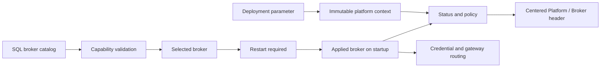

<!-- markdownlint-disable-file -->
# Task Research: Environment Model Rationalisation

Research the platform and broker environment model for the Trading application,
compare it with the current implementation, and recommend the configuration,
data, UI, Wiki, and Copilot-artifact changes needed to support it.

## Task Implementation Requests

* Distinguish the runtime-derived platform environment from an operator-selected
  broker environment.
* Determine the required UI behaviour for the centred `Platform / Broker`
  environment indicator and broker-environment switching.
* Identify the changes needed for persistent broker environments, credentials,
  and environment-scoped account data.
* Support administrator-created, uniquely named broker environments, including
  multiple Training environments, with server-owned defaults matching the
  current supported bootstrap behavior.
* Support deliberate broker-environment removal, including related mutable data
  and settings, with server-bound confirmation and runtime-safety checks.
* Plan Wiki updates and determine whether Copilot artifacts should require the
  Wiki to be consulted during new-work planning.

## Scope and Success Criteria

* Scope: Current application code, tests, configuration, documentation, and
  relevant official platform guidance. This document recommends work; it does
  not modify product code or Wiki content.
* Assumptions:
  * Desktop is the sole currently deployed platform environment.
  * Demo is the sole currently available broker environment.
  * Training, Development, Test, and Live are planned rather than implemented
    unless repository evidence proves otherwise.
* Success criteria:
  * Establish one authoritative model and ownership boundary for both kinds of
    environment.
  * Compare each recommendation with current evidence, including exact source
    references.
  * Provide one selected implementation approach, evaluated alternatives,
    concrete Wiki and Copilot-artifact updates, and feature impact.
  * Define creation, naming, retirement, data-retention, and accidental-delete
    behavior for broker environments.

## Outline

1. Current implementation and its safety gap
2. Selected ownership model and runtime flow
3. Data, API, UI, and integration changes
4. Migration and test strategy
5. Wiki and Copilot-artifact updates

## Approved Delivery Decisions

* Every application environment has its own database. Desktop and Development
  may use containerized SQL Server; Test and Live may use Azure SQL Database.
  Catalog IDs partition broker data within that database but do not replace
  database isolation between application environments.
* Administrators may create catalog records for every supported broker/trading
  environment kind. Creation is independent of availability; unavailable
  records cannot be selected or perform broker work.
* `IG Demo` is the one bootstrap-seeded broker environment. Every later broker
  environment is named by its creator and must have a uniquely normalized name.
* Azure Container Apps is the preferred first cloud host. The deployment
  contract remains portable to Kubernetes: container image, immutable
  `Platform__Environment`, external SQL connection, secret references,
  standards-based health endpoints, and environment-based configuration must
  not depend on Azure Container Apps-specific runtime APIs.
* Schedule, retry, and notification profiles are scoped to `BrokerEnvironmentId`.
  Creation initializes them from a server-owned versioned default profile;
  normal deletion removes their mutable instances.
* Normal deletion is *retire and purge*: remove credentials, mutable settings,
  and current projections, retain audit/history records under ordinary
  retention, and mark the catalog record `Retired`.
* Only application administrators can create, edit, or normally delete broker
  environments. Catalog credentials remain administrator-managed.
* Operators and administrators, but never viewers, can request a broker
  selection from Settings. Settings must prominently warn that the target
  applies only after successful restart, does not alter the current process,
  and can change the account or endpoint used by later broker work.
* The EF migration creates the first fixed, versioned
  `BrokerEnvironmentDefaults` template, seeds/backfills `IG Demo`, and inserts
  its broker-scoped profile snapshot. Every later catalog creation atomically
  copies the active defaults template into that environment's schedule, retry,
  and notification profiles.
* `Desktop` is a distinct platform-environment value alongside future
  Development, Test, and Live values. AppHost supplies `Desktop` locally and
  the allow-listed immutable platform options must include it.
* Broker switching belongs on the existing `/configuration` page, which is the
  operator Settings surface after its current platform/broker selector is
  replaced.
* A new broker environment starts with notifications disabled. This is the
  deterministic notification value in the first defaults template and all
  later template snapshots.
* Test and Live deploy migrations through a versioned EF migration bundle run
  once with a deployment identity. Generated SQL scripts are not a supported
  primary deployment path for those environments.

The remaining delivery design work is the broker-kind vocabulary/provider
compatibility, database provisioning conventions, portable Kubernetes packaging,
and a table-by-table mutable-data purge inventory.

## Research Executed

### File Analysis

* src/TNC.Trading.Platform.Infrastructure/Infrastructure/Configuration/SqlServer/SqlPlatformConfigurationStore.cs:17-190
  * Owns the current singleton SQL configuration, including mutable platform
    and broker enum values, bootstrap seeding, audit, and restart state.
* src/TNC.Trading.Platform.AppHost/AppHostInfrastructureRegistration.cs:5-58
  * Composes local SQL Server, Mailpit, and Keycloak containers.
* src/TNC.Trading.Platform.AppHost/AppHostEnvironmentWiring.cs:5-202
  * Injects local service settings but not a platform-environment parameter.
* src/TNC.Trading.Platform.Infrastructure/Infrastructure/Integrations/Ig/IgBrokerAuthenticationGateway.cs:17-31
  * Rejects Live before network activity; the registered IG client is Demo.
* src/TNC.Trading.Platform.Infrastructure/Infrastructure/Integrations/Ig/IgAccountDetailsGateway.cs:17-32
  * Always resolves Demo credentials and the Demo IG endpoint.
* src/TNC.Trading.Platform.Web/Components/Layout/PlatformHeader.razor:3-68
  * Renders the centered environment indicator, but does not provide selection.
* src/TNC.Trading.Platform.Web/Components/Layout/PlatformEnvironmentBadge.razor:1-18
  * Is display-only.
* src/TNC.Trading.Platform.Infrastructure/Infrastructure/Startup/PlatformStartupInitializer.cs:28-56
  * Runs EF migrations before startup configuration and retention processing.
* src/TNC.Trading.Platform.Infrastructure/Infrastructure/Configuration/SqlServer/PlatformConfigurationBootstrapParser.cs:8-44
  * Defines the supported code bootstrap path and defaults. There is no
    checked-in production SQL load or seed script.
* src/TNC.Trading.Platform.Infrastructure/Infrastructure/Operations/Retention/OperationalRecordRetentionProcessor.cs:17-58
  * Retains audit and operational evidence for the configured retention period.

### Code Search Results

* `PlatformEnvironment|BrokerEnvironment` identifies independent two-value
  enums in src/TNC.Trading.Platform.Application/Configuration/PlatformEnvironmentKind.cs:3-7
  and src/TNC.Trading.Platform.Application/Configuration/BrokerEnvironmentKind.cs:3-7.
* `Bootstrap:PlatformEnvironment|Bootstrap:BrokerEnvironment` identifies the
  initial defaults in src/TNC.Trading.Platform.Api/appsettings.json:45-48 and
  parsing in src/TNC.Trading.Platform.Infrastructure/Infrastructure/Configuration/SqlServer/PlatformConfigurationBootstrapParser.cs:8-24.
* Migration-script inspection confirms that
  artifacts/quality-gates/phase-8-account-preferences-migration.sql:1-218 and
  artifacts/quality-gates/phase-3-3-account-preferences-migration.sql:1-218
  are generated schema scripts, not supported data-load scripts.
* Header and configuration searches identify display-only shell state and the
  current operator page selection controls in src/TNC.Trading.Platform.Web/Components/Pages/Configuration/Configuration.razor:40-62 and :176-219.

### External Research

* Microsoft Learn: [ASP.NET Core runtime environments](https://learn.microsoft.com/aspnet/core/fundamentals/environments?view=aspnetcore-10.0)
  * `IHostEnvironment.EnvironmentName` is startup-fixed. For `WebApplication`,
    `DOTNET_ENVIRONMENT` takes precedence over `ASPNETCORE_ENVIRONMENT`.
* Microsoft Learn: [Options pattern](https://learn.microsoft.com/dotnet/core/extensions/options)
  * `ValidateOnStart` validates configuration during startup. Use it for the
    immutable platform classification rather than a refreshable option.
* Microsoft Learn: [Configuration providers](https://learn.microsoft.com/dotnet/core/extensions/configuration-providers)
  * Later providers override earlier values; environment variables use `__` for
    hierarchical keys.
* Aspire: [What is the AppHost?](https://aspire.dev/get-started/app-host/)
  * The AppHost composes dependencies and injects connection details. Resource
    names must not be used to infer a safety classification.
* Microsoft Learn: [Azure App Configuration best practices](https://learn.microsoft.com/azure/azure-app-configuration/howto-best-practices)
  * Use managed identity and keep secrets in Key Vault; do not refresh a
    safety-critical platform classification.
* Microsoft Learn: [Data Seeding - EF Core](https://learn.microsoft.com/ef/core/modeling/data-seeding)
  * `UseSeeding` and `UseAsyncSeeding` do not execute when deployments apply a
    generated SQL script. Model-managed data is limited to fixed deterministic
    data, not mutable templates or user-created profile snapshots.
* Microsoft Learn: [Applying Migrations - EF Core](https://learn.microsoft.com/ef/core/managing-schemas/migrations/applying)
  * Shared container deployments should use a migration bundle or one-shot job
    with a separate deployment identity rather than migrate from every replica.
* Microsoft Learn: [Transactions - EF Core](https://learn.microsoft.com/ef/core/saving/transactions)
  * A relational `SaveChanges` operation is transactional; multi-operation
    creation requires an explicit transaction or a single unit of work.
* Microsoft Learn: [Policy-based authorization in ASP.NET Core](https://learn.microsoft.com/aspnet/core/security/authorization/policies?view=aspnetcore-10.0)
  * Named policies apply consistently to endpoints and Razor components, and
    every requirement in a policy must succeed.

### Project Conventions

* .github/copilot-instructions.md:32-35 requires Aspire-managed Keycloak
  locally and Microsoft Entra ID in Azure.
* .github/copilot-instructions.md:49-50 makes docs/wiki the implementation
  documentation source of truth and requires updates before a plan completes.
* .github/instructions/configuration.instructions.md:23-38 requires SQL-backed
  operator settings, Blazor operator flows, and write-only secrets.
* .github/instructions/work-packages.instructions.md:57-58 requires affected
  Wiki updates before numbered plans complete, but does not require a
  planning-time Wiki assessment.

## Key Discoveries

### Project Structure

* AppHost is the correct local-composition boundary. It currently starts API
  and Web with SQL Server, Keycloak, and Mailpit, and connects projects to those
  resources in src/TNC.Trading.Platform.AppHost/AppHostProjectRegistration.cs:7-49.
* SQL Server already contains operator configuration, protected credentials,
  runtime/auth records, and account-preference partitions in
  src/TNC.Trading.Platform.Infrastructure/Infrastructure/Persistence/EntityFramework/PlatformDbContext.cs:7-199.
* The existing Wiki documents the local Docker/Aspire topology at
  docs/wiki/local-development.md:3-27 and the current environment selection
  page at docs/wiki/operator-guide.md:255-330.

### Implementation Patterns

* Current selection is restart-applied: a persisted change sets
  `RestartRequired`, whereas startup reconciliation operates from the
  start-applied configuration. This is encoded by
  src/TNC.Trading.Platform.Application/Configuration/PlatformConfigurationRestartPolicy.cs
  and described in docs/wiki/runtime-behavior.md under `Startup-fixed changes`.
* Protected credentials use Data Protection and are keyed by broker environment
  and credential type. See
  src/TNC.Trading.Platform.Infrastructure/Infrastructure/Credentials/DataProtection/ProtectedCredentialService.cs
  and src/TNC.Trading.Platform.Infrastructure/Infrastructure/Persistence/EntityFramework/Entities/ProtectedCredentialEntity.cs.
* Existing account-preference records already partition by the platform and
  broker pair, but broker-only information uses the broker enum. This supports
  migration to a catalog identifier without changing the broader ownership
  model.
* Fourteen tables currently use a scalar broker-environment value and none has
  a catalog foreign key. In particular, protected credentials use a unique
  `(BrokerEnvironment, CredentialType)` key and account preferences, snapshots,
  runtime state, retries, proof data, events, notifications, retrievals, and
  operations retain broker context. See
  src/TNC.Trading.Platform.Infrastructure/Infrastructure/Persistence/EntityFramework/PlatformDbContext.cs:39-220.

### Complete Examples

The selected platform environment contract is deployment-owned and immutable:

```text
Local Aspire:  Platform__Environment=Desktop
Azure Container Apps Test: Platform__Environment=Test
Azure Container Apps Live: Platform__Environment=Live
```

At startup, API and Web bind `Platform:Environment` to a dedicated options
type, allow-list it, validate it with `ValidateOnStart`, and expose a single
`IPlatformEnvironmentContext`. The deployment host environment can remain
`Development`, `Staging`, or `Production`; it is not a substitute for the
domain safety value. The same container and configuration contract must be
usable by a future Kubernetes deployment without relying on Azure Container
Apps-specific resource names or runtime APIs.

### API and Schema Documentation

The present `GET /api/platform/configuration`, operator-only
`PUT /api/platform/configuration`, and `GET /status` endpoints are registered
in src/TNC.Trading.Platform.Api/Features/Platform/PlatformEndpoints.cs:28-67.
They must be replaced or narrowed so a generic configuration update cannot
change the platform environment.

The proposed bounded surface is:

| Surface | Required result |
| --- | --- |
| Status | Immutable platform, applied broker summary, optional pending broker summary, restart state, and availability; no secret or endpoint URL |
| Catalog list | Identifier, name, provider, kind, lifecycle, availability reason, and credential-presence state |
| Catalog command | Application-administrator-only create/update using provider, kind, display name, and an approved endpoint-profile key; no arbitrary URL |
| Credential command | Administrator-only write-only secret save scoped to a catalog ID and allowed only for authentication-capable environments |
| Selection command | Operator-or-administrator catalog ID, concurrency token, and explicit warning acknowledgement; viewers are forbidden and the server verifies lifecycle, availability, capability, and restart safety |
| Delete preview | Application-administrator-only target inspection returning identity, selected/applied state, removable-data counts, retained-history counts, rowversion, and a short-lived confirmation token |
| Retire command | Application-administrator-only command requiring target rowversion, server-bound confirmation token, and exact typed name; purges credentials and mutable state before marking the catalog record retired |

### Configuration Examples

The deployment parameter is non-secret. Azure configuration may use App
Configuration for non-secret values and Key Vault plus managed identity for
secrets, but `Platform:Environment` must be pinned rather than refreshed.

```json
{
  "Platform": {
    "Environment": "Test"
  }
}
```

## Technical Scenarios

### Environment Ownership and Switching

**Current behavior and mismatch**

The current SQL singleton stores both platform and broker values. Its defaults
are `Test` and `Demo`, but the UI allows a persisted `Live` broker choice when
the platform is Live. That state is non-executable: authentication rejects
Live, while account-details and account-preferences gateways always use Demo.
The UI can therefore display a selected state that the integration cannot run.

No functional or end-to-end test currently saves a selection and verifies
status/header refresh or outbound routing. Existing coverage validates the
Demo path, persistent configuration, and display of `Test / Demo`, including
test/TNC.Trading.Platform.Web/TNC.Trading.Platform.Web.UnitTests/MainLayoutTests.cs:23-58.

**Selected approach**

Adopt three independently owned concerns:

| Concern | Owner | Mutability | Source of truth |
| --- | --- | --- | --- |
| Platform environment | Deployment composition | Immutable for the process lifetime | Required `Platform:Environment`, validated at startup |
| Broker catalog | Operator control plane | Persistent and versioned | SQL Server |
| Broker selection | Operator control plane | Persistent, restart-applied | SQL Server selection row referencing the catalog |

The platform environment is never selectable in the UI or persisted as
operator configuration. For Desktop, AppHost supplies `Platform__Environment`
as the distinct `Desktop` platform-domain value. Platform options allow-list
`Desktop`, `Development`, `Test`, and `Live`; the display value is the same
deployment-owned value and is not derived from broker state.

The catalog uses a stable `BrokerEnvironmentId` (`Guid`) instead of the current
enum as the durable foreign key. A broker record has non-secret metadata:
provider, a required uniquely normalized name, display name, kind (`Demo`,
`Live`, `Training`), lifecycle (`Draft`, `Available`, `Unavailable`,
`Retired`), approved endpoint-profile key, availability reason, audit columns,
and a concurrency token. The `Guid`, not the name or kind, partitions data.
Kind expresses policy and adapter eligibility, so multiple named Training
environments such as `Training Alpha` and `Training Regression` are supported.
The server derives capabilities from registered adapters and policy; the browser
cannot set them.

Seed a single available `IG Demo` record. Represent IG Live as unavailable
until its adapter and credentials are genuinely supported. Training is also
unavailable/planned until a distinct offline-data adapter is designed. Neither
can be selected as the applied environment or invoke gateway/credential calls.
The `IG Demo` name is not a naming convention: users provide the unique names
for every catalog record they create, regardless of kind. Creation permits all
defined kinds; lifecycle and capabilities govern later selection and use.

The selection row contains `SelectedBrokerEnvironmentId`,
`AppliedBrokerEnvironmentId`, `Revision`, `RestartRequired`, and audit fields.
Selection means intended next-start state; applied means the current process
state. This preserves the current restart safety boundary.



**Runtime and safety flow**

1. The deployment supplies and both API/Web validate `Platform__Environment`.
2. Migrations create or backfill the Demo catalog record and a selection row.
3. Status returns the immutable platform and applied broker. When selected and
   applied differ, it also returns the pending broker and restart requirement.
4. Every internal broker operation resolves the applied catalog ID, verifies
   required capability against platform policy and registered adapters, then,
   and only then, retrieves credentials and dispatches a gateway request.
5. After a restart, initialization validates and copies selected to applied,
   clears restart state, then runs reconciliation. If no safe applied identity
   can be recovered, it fails closed and performs no broker work.

**User experience**

Retain the centered header indicator on every page, exactly as requested:
`Desktop / IG Demo` today, evolving to a platform display value plus the
applied broker name. The centered header is display-only for every role; the
platform portion is never interactive. Viewers have neither a broker selector
nor selection API permission.

The existing `/configuration` page is the sole broker-selection Settings
surface for operators and administrators.
Before an operator confirms an available target, it prominently identifies the
current applied environment and selected target, warns that the current process
is unchanged, states that the selection becomes effective only after successful
restart, and warns that later broker work can use a different account or
endpoint. The command includes an acknowledgement which the server validates;
the warning is not a UI-only safeguard. Settings shows unavailable entries and
their reasons, but they cannot be selected.

Place catalog creation, metadata editing, and write-only credentials on a
dedicated administrator Broker Environments page, rather than expanding the
header into a configuration form. This is the required option to create
environments and subsequently add credentials. The creation form accepts the
unique name, display name, provider, kind, and approved endpoint-profile key;
it neither accepts arbitrary endpoint URLs nor clones an existing environment.

There is no supported SQL loading script to copy. The effective current SQL
setup is EF migration followed by the bootstrap parser and
src/TNC.Trading.Platform.Api/appsettings.json:45-74. Introduce a server-owned,
versioned `BrokerEnvironmentDefaults` template with deterministic schedule,
retry, notification-policy, and no-credential values. The migration creates
the template table, inserts the first fixed version, seeds/backfills `IG Demo`,
and inserts its matching broker-scoped schedule, retry, and notification
snapshot. Each later administrator-created environment atomically copies the
active template into its own scoped profiles, recording the template version
and source. Changing a template affects only later creations unless an explicit
audited apply-defaults action is introduced. The create response reports the
defaults version; it creates no selection or applied-runtime change.
Notifications are disabled in the initial template and in later snapshots until
an administrator deliberately enables/configures them.

**Deletion and retention**

The requested removal must not be a database cascade. The current model has no
broker catalog foreign keys, and operational events, configuration audits,
notifications, snapshots, and account history have a documented retention role.
Instead, normal deletion is a two-stage *retire and purge* operation:

1. A deletion-preview request returns the identity, name, selected/applied
  state, lifecycle, removal counts, retained-history counts, rowversion, and a
  short-lived single-use confirmation token bound to administrator, target,
  rowversion, and preview values.
2. The final request requires that token, current rowversion, and exact typed
  normalized environment name. It deletes protected credentials, mutable
  broker-scoped schedule/retry/notification profiles, and current projections;
  writes a retirement audit; and marks the catalog record `Retired`.

The Broker Environments page shows the preview counts and requires typing the
exact name before enabling the destructive control. A browser-only confirmation
is insufficient because it is not bound to the current server-observed target
or concurrency state.

Reject preview and retirement if the target is the applied environment. Also
reject a selected-but-not-applied target until another available selection has
been restarted and applied. Retired environments cannot be selected or receive
credentials. Retain audit, event, notification, and historical account records
under the existing retention process; do not add catalog-to-history cascade
deletes. A force purge, if later required, must be an offline audited procedure
that stops all replicas, confirms no selected/applied reference, and follows an
approved retention policy.

**Required feature changes**

* Startup and configuration: add immutable options/context; have AppHost inject
  the Desktop value; remove platform environment from the mutable configuration
  request, parser, store, and page.
* Persistence: add catalog and selection entities and migrations; migrate
  protected credentials, login/auth snapshots, proof data, account details,
  account preferences, audits, and operations to catalog IDs. Retain platform
  in audit/policy partitions. Provision one isolated database for every
  application environment, with catalog IDs partitioning broker data inside it.
* API: replace generic environment mutation with catalog, credentials, and
  selection features; scope profiles to the catalog ID; apply application-
  administrator authorization to catalog lifecycle, credentials, deletion
  preview, and normal deletion; apply operator-or-administrator authorization
  only to selection; and enforce concurrency, no-secret projections, warning
  acknowledgement, and structured availability failures.
* IG integration: route by approved endpoint profile and registered capability,
  not an enum or user URL. Keep Live blocked until authentication, account
  details, and preferences all select Live credentials and endpoints and have
  explicit tests.
* UI: evolve PlatformShellContextProvider, PlatformHeader, and
  PlatformEnvironmentBadge into applied/pending-aware display-only state;
  refresh status after a successful selection; add the broker catalog page for
  administrators; and add the selector plus prominent warning confirmation to
  Settings for operators and administrators. Remove viewer selection controls
  and retire the current platform/broker selection controls from Configuration.
* Tests: add startup validation, migration/backfill, foreign-key isolation,
  capability-before-credential/network, API authorization/concurrency,
  component header, selection pending-restart, normal deletion, Azure Container
  Apps-portable configuration, and functional/E2E coverage.

Likely product touch points are listed in the evidence-based inventory:
src/TNC.Trading.Platform.Api/Program.cs,
src/TNC.Trading.Platform.AppHost/AppHostEnvironmentWiring.cs,
src/TNC.Trading.Platform.Infrastructure/Infrastructure/Persistence/EntityFramework/PlatformDbContext.cs,
src/TNC.Trading.Platform.Infrastructure/Infrastructure/Configuration/SqlServer/SqlPlatformConfigurationStore.cs,
src/TNC.Trading.Platform.Infrastructure/Infrastructure/Credentials/DataProtection/ProtectedCredentialService.cs,
the three IG gateway classes, src/TNC.Trading.Platform.Api/Features/Platform/PlatformEndpoints.cs,
src/TNC.Trading.Platform.Web/PlatformApiClient.cs, and the layout components.

#### Migration Strategy

1. Add immutable platform options/context and deployment wiring first.
2. Add the defaults-template table, catalog/selection tables, scoped profile
  tables, and nullable catalog foreign keys beside legacy enum columns.
3. In the migration `Up`, insert one fixed deterministic defaults-template
  version, create/backfill `IG Demo`, and copy that version into `IG Demo`'s
  schedule, retry, and notification profiles. Map legacy Live records to an
  unavailable `IG Live` record without inventing credentials or capability.
4. Preserve any pending restart as selected versus applied state; fail closed
   when the old applied pair cannot be recovered.
5. Make the administrator catalog-create handler copy the active
  defaults-template version into complete scoped profiles in the same database
  transaction as the catalog insert. Enforce the unique normalized name in the
  database and return the defaults version in the response.
6. Convert reads, indexes, projections, and gateways to catalog IDs. Validate
  record counts and foreign keys before deleting legacy columns in a later
  migration.

Do not add cascade deletes from the catalog to audit/history tables. Preserve
legacy labels and, where useful, a name-at-event snapshot for historical
readability. Preserve the existing account-details parent/child cascade without
making it a catalog-wide cascade.

Use fixed migration data operations for the required first template, seed, and
backfill. Do not depend solely on EF `UseSeeding`/`UseAsyncSeeding`. Do not use
model-managed `HasData` for mutable default templates or copied profiles. Test
and Live apply the versioned migration bundle once through a deployment identity
rather than from every application replica.

#### Acceptance Tests

* Startup fails for missing, unknown, or policy-invalid platform values.
* Fresh state creates and applies only `IG Demo`, displaying `Desktop / IG Demo`.
* Administrators can create any defined broker/trading kind with a unique
  normalized name. A Live or Training record remains visible with an
  unavailable reason, never reads credentials, and never sends an HTTP request
  until capable.
* An operator can select an available broker only through Settings after the
  required acknowledgement; a viewer receives `403`, and an operator receives
  `403` for catalog creation and retirement.
* Selecting an available broker changes selected only, retains applied until
  restart, shows restart-pending state in the display-only header, and cannot
  bypass lifecycle or capability checks.
* Restart applies exactly one validated selection and clears pending state only
  after successful validation.
* Credentials and all account data are isolated by catalog ID; APIs never
  return secret material; concurrent selection updates conflict cleanly.
* Creation rejects duplicate normalized names and creates the exact versioned
  defaults snapshot, with no credentials and no selection change.
* A newly provisioned database contains exactly one active defaults-template
  version, `IG Demo`, and profiles copied from that version. Existing profiles
  are never overwritten by backfill or later template changes.
* Every successful administrator creation atomically produces a complete,
  version-stamped profile set; a concurrent duplicate leaves neither an orphan
  catalog row nor a partial profile.
* Multiple named Training records can exist but remain unavailable until an
  adapter defines supported capability.
* Retirement rejects applied and selected records, rejects stale/replayed
  preview confirmation, requires the exact typed name, purges credentials and
  broker-scoped profiles/current mutable data, and retains audit/history for
  normal retention.
* Every application environment uses a distinct database; catalog IDs isolate
  broker records only within its own application-environment database.
* Azure Container Apps supplies the documented container contract without
  Azure Container Apps-specific behavior entering platform classification or
  broker routing, allowing a future Kubernetes host to supply the same inputs.

#### Considered Alternatives

* Extend the singleton and enum: rejected because it cannot represent multiple
  named environments, lifecycle/capability state, or a durable selection ID.
* Keep platform environment operator-selectable: rejected because deployment
  safety classification must not change through SQL or differ between replicas.
* Switch broker environment immediately: rejected because existing operations,
  reconciliation, credentials, and gateway clients assume a start-applied
  identity. Restart-applied selection is safer and preserves existing intent.
* Mark Live available on a Live platform now: rejected because the current IG
  gateway set is Demo-only. Permission is not implementation capability.
* Implement Training as IG now: rejected because no endpoint, credential, or
  adapter contract exists.
* Hard-delete catalog rows with cascading history removal: rejected because it
  bypasses the documented retention policy and destroys the audit evidence that
  explains lifecycle and operator actions.

## Wiki and Copilot Changes

Update the following Wiki pages during delivery:

* docs/wiki/application-overview.md:9-32: explain the two environment
  concepts and correct the stale statement that presents in-memory persistence
  as a supported runtime alternative; it is test-only.
* docs/wiki/architecture.md:239-248: document deployment-owned platform
  context, SQL broker catalog/selection ownership, and catalog-ID partitioning.
* docs/wiki/runtime-behavior.md:301-303 and its startup-fixed configuration
  content: document selected versus applied broker semantics and fail-closed
  capability behavior.
* docs/wiki/operator-guide.md:255-330: replace platform selection guidance
  with the immutable indicator, broker menu, catalog lifecycle, credentials,
  administrator-only named creation/defaults and deletion, operator Settings
  selection warnings, unavailable entries, restart workflow, deletion preview,
  typed confirmation, retirement, credential purge, and retained data.
* docs/wiki/api-reference.md:21-36: replace the generic update contract with
  catalog, migration-seeded creation defaults, credential, selection, status,
  deletion-preview, retirement, distinct role authorization, conflict, warning
  acknowledgement, and no-secret rules.
* docs/wiki/local-development.md:3-27 and :112-151: identify Desktop as the
  local display environment, its explicit platform parameter, Demo bootstrap,
  local resource topology, and the bootstrap-default source of truth.
* docs/wiki/runtime-behavior.md:11-27 and :163-178: document lifecycle audit,
  retirement versus history retention, and the explicit force-purge boundary.
* docs/wiki/architecture.md:105-125 and :239-278: document non-cascading
  catalog relationships, credential purging, catalog-ID partitioning, and
  defaults-template snapshot initialization.

For durable Copilot planning behavior, make these minimal updates:

1. Add a scoped planning-time Wiki-assessment rule to
   .github/instructions/work-packages.instructions.md for plans touching
   environment, auth, configuration, accounts, runtime topology, operator
   workflow, local development, or testing. Require assessed Wiki pages and a
  change/no-change decision in the plan. Require lifecycle plans to explicitly
  assess retention and audit consequences.
2. Operationalize it in .github/prompts/generate-delivery-plan.prompt.md by
   making relevant Wiki pages required inputs before drafting and requiring a
   per-work-item Wiki impact.
3. Add a concise Wiki-impact assessment section to
   .github/templates/delivery-plan.template.md.
4. Reconcile .github/work-package-workflow-usage.md:36-47, which references
   unavailable .github/agents artifacts, independently of this feature.

Do not duplicate the new policy in .github/copilot-instructions.md,
.github/AGENTS.md, or .github/lessons.md: the existing source-of-truth rule is
already there, while the scoped instruction is the right enforcement point.

## Evidence Log

* Current implementation: .copilot-tracking/research/subagents/2026-09-20/current-environment-implementation-research.md
* Documentation and governance: .copilot-tracking/research/subagents/2026-09-20/wiki-and-copilot-governance-research.md
* External configuration guidance: .copilot-tracking/research/subagents/2026-09-20/platform-environment-guidance-research.md
* Alternative evaluation: .copilot-tracking/research/subagents/2026-09-20/environment-model-alternatives-research.md
* Named creation and safe retirement: .copilot-tracking/research/subagents/2026-09-21/broker-environment-create-delete-research.md
* Authority, Settings switching, defaults, and best practice: .copilot-tracking/research/subagents/2026-09-21/authority-switching-defaults-best-practice-research.md

