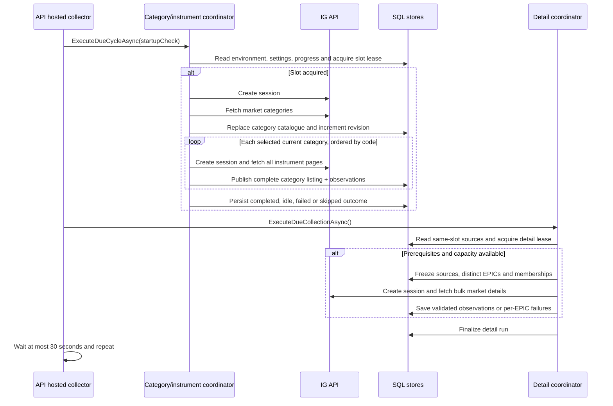

# Scheduled market-data processes: source-code investigation

**Scope and method:** This describes the checked-out application code as inspected on 2026-09-26, including the working-tree changes present at inspection time. The source code, not existing documentation, is the evidence. This is a static analysis of implemented behavior, not a claim that a particular production run succeeded. Source links below point to code lines in the repository.

## Executive model

There are **three stages, but not three independent schedulers**. The API registers a single `MarketCategoryInstrumentCollector` hosted service. Each tick calls the category/instrument cycle coordinator in one DI scope, then calls the market-detail coordinator in a second scope, even when the first call returns a non-success result or throws a logged exception. The cycle coordinator itself refreshes categories *before* collecting instruments; the detail coordinator later checks SQL prerequisites rather than trusting the earlier call's return value. The host sleeps for at most 30 seconds, using the **instrument** coordinator's next wake-up, not the detail coordinator's next check. [Program.cs](../../src/TNC.Trading.Platform.Api/Program.cs#L40), [MarketCategoryInstrumentCollector.cs](../../src/TNC.Trading.Platform.Api/Hosting/MarketCategoryInstrumentCollector.cs#L15), [MarketCategoryInstrumentCollector.cs](../../src/TNC.Trading.Platform.Api/Hosting/MarketCategoryInstrumentCollector.cs#L43), [MarketCategoryInstrumentCollector.cs](../../src/TNC.Trading.Platform.Api/Hosting/MarketCategoryInstrumentCollector.cs#L96)

The diagram depicts the successful route, with the detail-stage conditional paths expanded below. No API read endpoint triggers this scheduled chain; the GET endpoints read saved SQL snapshots. A separate operator POST refreshes **categories only** during an active schedule; it does not launch the instrument/detail cycle. [MarketCategoryInstrumentEndpoints.cs](../../src/TNC.Trading.Platform.Api/Features/Platform/MarketCategoryInstrumentEndpoints.cs#L19), [RefreshMarketCategoriesManuallyHandler.cs](../../src/TNC.Trading.Platform.Application/Features/MarketCategories/RefreshMarketCategoriesManuallyHandler.cs#L16)

## Common scheduling, environment and allowance

1. The applied broker environment must be executable IG market data with a matching Demo/`IgDemo` or Live/`IgLive` endpoint profile; otherwise the upstream cycle polls as `PausedUnsupportedEnvironment` and details report `Blocked/UnsupportedAppliedEnvironment`. The two coordinators independently resolve the environment and runtime schedule/frequency each invocation. Invalid/missing upstream frequency pauses the upstream cycle (`PausedConfiguration`); the detail coordinator reads frequency without that local catch, so an exception reaches the host's detail-tick logger. [MarketCategoryInstrumentCycleCoordinator.cs](../../src/TNC.Trading.Platform.Application/Features/MarketCategoryInstruments/MarketCategoryInstrumentCycleCoordinator.cs#L31), [MarketCategoryInstrumentCycleCoordinator.cs](../../src/TNC.Trading.Platform.Application/Features/MarketCategoryInstruments/MarketCategoryInstrumentCycleCoordinator.cs#L441), [MarketDetailCollectionCoordinator.cs](../../src/TNC.Trading.Platform.Application/Features/MarketDetails/MarketDetailCollectionCoordinator.cs#L27), [MarketCategoryInstrumentCollector.cs](../../src/TNC.Trading.Platform.Api/Hosting/MarketCategoryInstrumentCollector.cs#L55)
2. The trading schedule is interpreted in its configured time zone via `TradingScheduleGate`. Active local `StartOfDay` to `EndOfDay` is divided into 1–4 equal slots (`CurrentUpdatesPerDay`, or a pending value effective on its configured trading day). The default initialized frequency is 1. Invalid time zone/window/frequency blocks scheduling. The policy finds the current slot by elapsed local-window fraction and computes the next boundary or next trading day's start; it handles invalid/ambiguous local clock times when converting boundaries to UTC. [MarketCategoryInstrumentSchedulePolicy.cs](../../src/TNC.Trading.Platform.Application/Features/MarketCategoryInstruments/MarketCategoryInstrumentSchedulePolicy.cs#L14), [MarketCategoryInstrumentSchedulePolicy.cs](../../src/TNC.Trading.Platform.Application/Features/MarketCategoryInstruments/MarketCategoryInstrumentSchedulePolicy.cs#L19), [MarketCategoryInstrumentSchedulePolicy.cs](../../src/TNC.Trading.Platform.Application/Features/MarketCategoryInstruments/MarketCategoryInstrumentSchedulePolicy.cs#L116), [EfMarketCategoryInstrumentFrequencyStore.cs](../../src/TNC.Trading.Platform.Infrastructure/Infrastructure/Persistence/EntityFramework/EfMarketCategoryInstrumentFrequencyStore.cs#L72)
3. Upstream progress is the latest persisted environment/day/slot cycle. Normally an observed slot is not due again, and intervening missed slots are recorded as `Skipped`; the first check after process startup may reacquire even an already observed slot once its previous lease has expired. The store resets prerequisite/category attempts on that startup reacquisition (or a schedule-revision change), allowing a repeated category/listing collection in the same slot. A live lease prevents competing collectors; ownership is fenced and renewed against a two-minute duration. [MarketCategoryInstrumentSchedulePolicy.cs](../../src/TNC.Trading.Platform.Application/Features/MarketCategoryInstruments/MarketCategoryInstrumentSchedulePolicy.cs#L75), [EfMarketCategoryInstrumentCycleStore.cs](../../src/TNC.Trading.Platform.Infrastructure/Infrastructure/Persistence/EntityFramework/EfMarketCategoryInstrumentCycleStore.cs#L23), [EfMarketCategoryInstrumentCycleStore.cs](../../src/TNC.Trading.Platform.Infrastructure/Infrastructure/Persistence/EntityFramework/EfMarketCategoryInstrumentCycleStore.cs#L163), [EfMarketCategoryInstrumentCycleStore.cs](../../src/TNC.Trading.Platform.Infrastructure/Infrastructure/Persistence/EntityFramework/EfMarketCategoryInstrumentCycleStore.cs#L207)
4. Both processes stop making provider calls when the schedule/slot, frequency, endpoint profile, environment, lease or window is no longer valid. The budget is a **shared per-environment, per-trading-day** approved non-trading request allowance: category sessions/requests, listing sessions/pages and detail sessions/batches reserve individual requests against summed `UsedRequestBudget` across that day's cycle rows. IG request throttling also paces calls. The initialized settings leave the approved allowance `null`; until an allowance is set, scheduled provider request reservation fails. The detail collector additionally estimates whether *all remaining retryable targets* fit both the allowance and window before fetching its next batch. [MarketCategoryInstrumentScheduleGuard.cs](../../src/TNC.Trading.Platform.Application/Features/MarketCategoryInstruments/MarketCategoryInstrumentScheduleGuard.cs#L14), [EfMarketCategoryInstrumentFrequencyStore.cs](../../src/TNC.Trading.Platform.Infrastructure/Infrastructure/Persistence/EntityFramework/EfMarketCategoryInstrumentFrequencyStore.cs#L72), [EfMarketCategoryInstrumentCycleStore.cs](../../src/TNC.Trading.Platform.Infrastructure/Infrastructure/Persistence/EntityFramework/EfMarketCategoryInstrumentCycleStore.cs#L410), [EfMarketCategoryInstrumentCycleStore.cs](../../src/TNC.Trading.Platform.Infrastructure/Infrastructure/Persistence/EntityFramework/EfMarketCategoryInstrumentCycleStore.cs#L511), [EfMarketCategoryInstrumentRequestBudget.cs](../../src/TNC.Trading.Platform.Infrastructure/Infrastructure/Persistence/EntityFramework/EfMarketCategoryInstrumentRequestBudget.cs#L30), [EfMarketDetailRequestBudget.cs](../../src/TNC.Trading.Platform.Infrastructure/Infrastructure/Persistence/EntityFramework/EfMarketDetailRequestBudget.cs#L9), [IgProviderRequestThrottle.cs](../../src/TNC.Trading.Platform.Infrastructure/Infrastructure/Integrations/Ig/IgProviderRequestThrottle.cs#L42)

## Stage 1 — refresh market categories

**Entry and sequencing.** Only after the upstream coordinator determines a due slot, records missed slots and acquires its fenced lease does it run `RefreshCategoryPrerequisiteAsync`. For each attempt it checks schedule/lease/environment, reserves a prerequisite attempt, and invokes `RefreshMarketCategoriesHandler` with the lease and deadline token. Successful persistence must be followed by a further active-context check and a persisted `CategoryPrerequisite = Succeeded` transition. Failure completes the prerequisite as failed and prevents instrument collection for this cycle; the coordinator returns `CategoryPrerequisiteFailed`. Up to three attempts total are possible **only** for retryable failures while schedule, allowance, lease and environment remain valid, with 2-second then 5-second backoff. [MarketCategoryInstrumentCycleCoordinator.cs](../../src/TNC.Trading.Platform.Application/Features/MarketCategoryInstruments/MarketCategoryInstrumentCycleCoordinator.cs#L98), [MarketCategoryInstrumentCycleCoordinator.cs](../../src/TNC.Trading.Platform.Application/Features/MarketCategoryInstruments/MarketCategoryInstrumentCycleCoordinator.cs#L228), [MarketCategoryInstrumentRetryPolicy.cs](../../src/TNC.Trading.Platform.Application/Features/MarketCategoryInstruments/MarketCategoryInstrumentRetryPolicy.cs#L3)

**Provider and validation.** The IG gateway resolves the applied endpoint and protected credentials, creates a v2 IG session, then calls `GET categories` with API key, CST and security token (`Version: 1`); on a 401 from categories it authenticates once again and retries. It rejects a missing/empty category array, duplicate/blank/overlong codes or missing `nonTradeable` and maps each accepted category to code plus non-tradeable flag. Session and category calls are throttled and budgeted; failures become typed categories such as timeout, unavailable, rate-limited, malformed data or unsupported environment. [IgMarketCategoriesGateway.cs](../../src/TNC.Trading.Platform.Infrastructure/Infrastructure/Integrations/Ig/IgMarketCategoriesGateway.cs#L28), [IgMarketCategoriesGateway.cs](../../src/TNC.Trading.Platform.Infrastructure/Infrastructure/Integrations/Ig/IgMarketCategoriesGateway.cs#L101), [IgMarketCategoriesGateway.cs](../../src/TNC.Trading.Platform.Infrastructure/Infrastructure/Integrations/Ig/IgMarketCategoriesGateway.cs#L149)

**Publication.** The handler constructs a timestamped snapshot and calls `ReplaceScheduledAsync`. Inside a serializable transaction with SQL application locks, the store checks the active prerequisite lease, replaces category membership for the applied environment (remove vanished categories and their *current* instrument rows/catalogue states; update existing flags; add new categories), and increments the catalogue revision **on each successful refresh**, even if the categories are unchanged. It verifies the window and applied environment before commit. The handler then maps the saved outcome; a successful HTTP fetch alone is not a successful prerequisite. [RefreshMarketCategoriesHandler.cs](../../src/TNC.Trading.Platform.Application/Features/MarketCategories/RefreshMarketCategoriesHandler.cs#L11), [EfMarketCategorySnapshotStore.cs](../../src/TNC.Trading.Platform.Infrastructure/Infrastructure/Persistence/EntityFramework/EfMarketCategorySnapshotStore.cs#L51), [EfMarketCategorySnapshotStore.cs](../../src/TNC.Trading.Platform.Infrastructure/Infrastructure/Persistence/EntityFramework/EfMarketCategorySnapshotStore.cs#L99), [EfMarketCategorySnapshotStore.cs](../../src/TNC.Trading.Platform.Infrastructure/Infrastructure/Persistence/EntityFramework/EfMarketCategorySnapshotStore.cs#L143)

**Manual exception to the chain.** The operator's `/market-categories/refresh` POST independently checks applied environment, current active slot, frequency and window, uses a manual budget context and the same refresh handler, then replaces the category catalogue. It does **not** mark a scheduled cycle prerequisite as succeeded or collect listings/details. Its catalogue revision can therefore invalidate the source revisions of an in-progress detail run. [MarketCategoryInstrumentEndpoints.cs](../../src/TNC.Trading.Platform.Api/Features/Platform/MarketCategoryInstrumentEndpoints.cs#L26), [RefreshMarketCategoriesManuallyHandler.cs](../../src/TNC.Trading.Platform.Application/Features/MarketCategories/RefreshMarketCategoriesManuallyHandler.cs#L21), [RefreshMarketCategoriesHandler.cs](../../src/TNC.Trading.Platform.Application/Features/MarketCategories/RefreshMarketCategoriesHandler.cs#L69)

## Stage 2 — refresh market-category instrument listings

**Selection.** Only after the successful category prerequisite does the coordinator reload the saved catalogue and environment-wide operator interests. It intersects selected category codes with **current** category codes, sorts them ordinally, and collects them sequentially. Selected codes no longer present are dormant, not fetched; no active selections yields an `Idle` cycle and no listing requests. Interest is a separate revisioned SQL set; updating it does not itself fetch provider data. [MarketCategoryInstrumentCycleCoordinator.cs](../../src/TNC.Trading.Platform.Application/Features/MarketCategoryInstruments/MarketCategoryInstrumentCycleCoordinator.cs#L120), [MarketCategoryInstrumentCyclePolicy.cs](../../src/TNC.Trading.Platform.Application/Features/MarketCategoryInstruments/MarketCategoryInstrumentCyclePolicy.cs#L8), [EfMarketCategoryInstrumentInterestStore.cs](../../src/TNC.Trading.Platform.Infrastructure/Infrastructure/Persistence/EntityFramework/EfMarketCategoryInstrumentInterestStore.cs#L14), [UpdateMarketCategoryInterestHandler.cs](../../src/TNC.Trading.Platform.Application/Features/MarketCategoryInstruments/UpdateMarketCategoryInterestHandler.cs#L17)

**Each category.** It renews/checks the schedule lease, reserves a category attempt (maximum three), creates a budget context, and asks the IG gateway for a *complete* listing. The gateway authenticates and fetches page 0 then remaining pages of `GET categories/{code}/instruments?pageNumber=...&pageSize=150` (IG `Version: 1`). One 401 may cause reauthentication/replay; page metadata must agree across pages, expected page counts/results must agree, and instruments must map and have unique EPICs/names. Maximums are 100 pages and 15,000 results; empty but valid collections are permitted. A partial/malformed collection is not published. Transient eligible failures may retry after 2/5 seconds while budget/window/lease allow; non-retryable failures do not. [MarketCategoryInstrumentCycleCoordinator.cs](../../src/TNC.Trading.Platform.Application/Features/MarketCategoryInstruments/MarketCategoryInstrumentCycleCoordinator.cs#L287), [IgMarketCategoryInstrumentsGateway.cs](../../src/TNC.Trading.Platform.Infrastructure/Infrastructure/Integrations/Ig/IgMarketCategoryInstrumentsGateway.cs#L20), [IgMarketCategoryInstrumentsGateway.cs](../../src/TNC.Trading.Platform.Infrastructure/Infrastructure/Integrations/Ig/IgMarketCategoryInstrumentsGateway.cs#L26), [IgMarketCategoryInstrumentsGateway.cs](../../src/TNC.Trading.Platform.Infrastructure/Infrastructure/Integrations/Ig/IgMarketCategoryInstrumentsGateway.cs#L146), [IgMarketCategoryInstrumentsGateway.cs](../../src/TNC.Trading.Platform.Infrastructure/Infrastructure/Integrations/Ig/IgMarketCategoryInstrumentsGateway.cs#L301)

**Atomic publication and cycle outcome.** For each valid collection the coordinator supplies a new collection ID, category-catalogue revision, trading day/slot, endpoint, retrieved time and data-quality evidence; missing optional fields are recorded but still allow a validated-complete listing. In a serializable transaction the writer checks that the category still exists, catalogue revision and fenced category attempt still match, then inserts the versioned run and its observations, **replaces only that category's current instrument rows**, updates its current collection ID/version and marks the attempt succeeded. Failure leaves the previous current snapshot for that category; other categories proceed independently. At loop end the cycle is `Completed` even with failed category attempts (the returned tick status is `CompletedWithCategoryFailures`); interruption produces `Skipped`. This difference matters to detail prerequisites. [MarketCategoryInstrumentCycleCoordinator.cs](../../src/TNC.Trading.Platform.Application/Features/MarketCategoryInstruments/MarketCategoryInstrumentCycleCoordinator.cs#L155), [MarketCategoryInstrumentCycleCoordinator.cs](../../src/TNC.Trading.Platform.Application/Features/MarketCategoryInstruments/MarketCategoryInstrumentCycleCoordinator.cs#L301), [EfMarketCategoryInstrumentSnapshotStore.cs](../../src/TNC.Trading.Platform.Infrastructure/Infrastructure/Persistence/EntityFramework/EfMarketCategoryInstrumentSnapshotStore.cs#L35), [EfMarketCategoryInstrumentSnapshotStore.cs](../../src/TNC.Trading.Platform.Infrastructure/Infrastructure/Persistence/EntityFramework/EfMarketCategoryInstrumentSnapshotStore.cs#L110), [EfMarketCategoryInstrumentCycleStore.cs](../../src/TNC.Trading.Platform.Infrastructure/Infrastructure/Persistence/EntityFramework/EfMarketCategoryInstrumentCycleStore.cs#L777)

## Stage 3 — collect details for listed instruments

**When it starts.** After the upstream tick, the detail coordinator independently evaluates the *current* active slot using the same schedule policy but `PreviousProgress: null`, so an active slot is eligible to be checked again on subsequent host ticks. It reads a serializable source snapshot for that environment/day/slot: a saved category catalogue and interest revision, category prerequisite succeeded, and upstream cycle `Completed` (or `Idle` if there are no selected current categories). For **every selected current category**, its current listing must point to a complete validated run from that *same day/slot*, *current category revision* and *applied endpoint profile*, with observation count equal to reported result count. A cycle marked `CompletedWithCategoryFailures` is **not sufficient** if even one selected category lacks such a run; a previous slot's still-visible listing cannot substitute. [MarketDetailCollectionCoordinator.cs](../../src/TNC.Trading.Platform.Application/Features/MarketDetails/MarketDetailCollectionCoordinator.cs#L24), [EfMarketDetailListingSourceReader.cs](../../src/TNC.Trading.Platform.Infrastructure/Infrastructure/Persistence/EntityFramework/EfMarketDetailListingSourceReader.cs#L12), [EfMarketDetailListingSourceReader.cs](../../src/TNC.Trading.Platform.Infrastructure/Infrastructure/Persistence/EntityFramework/EfMarketDetailListingSourceReader.cs#L52)

**Freezing and capacity.** The detail store acquires a separate fenced two-minute run lease keyed by environment/day/slot. If absent it creates a run; it can resume an incomplete/blocked run when its lease is released/expired, but a completed or superseded run is not acquired again. A provenance mismatch marks an existing run `Superseded` and returns no lease; the same key does not create a replacement run in that call. Once prerequisites are valid, the universe policy validates sources, deduplicates EPICs across categories (preserving per-category memberships), sorts them and caps distinct targets at 15,000. The store stages source/target/membership rows once, verifying source revisions. Before each next batch it estimates the worst-case HTTP requests for **all outstanding retryable targets** (up to three attempts, authentication/replay and URI splitting) and checks both remaining daily allowance and time using 2 seconds per worst-case request. Insufficient capacity leads to `Blocked`, not a best-effort batch. A valid empty selected set stages an empty universe and can complete without provider calls. [EfMarketDetailRunStore.cs](../../src/TNC.Trading.Platform.Infrastructure/Infrastructure/Persistence/EntityFramework/EfMarketDetailRunStore.cs#L24), [MarketDetailUniversePolicy.cs](../../src/TNC.Trading.Platform.Application/Features/MarketDetails/MarketDetailUniversePolicy.cs#L5), [EfMarketDetailRunStore.cs](../../src/TNC.Trading.Platform.Infrastructure/Infrastructure/Persistence/EntityFramework/EfMarketDetailRunStore.cs#L128), [MarketDetailCollectionCoordinator.cs](../../src/TNC.Trading.Platform.Application/Features/MarketDetails/MarketDetailCollectionCoordinator.cs#L105), [MarketDetailCapacityPolicy.cs](../../src/TNC.Trading.Platform.Application/Features/MarketDetails/MarketDetailCapacityPolicy.cs#L5)

**Fetching and recording.** Each detail invocation reads at most **50** outstanding `Pending`/`Failed` targets with fewer than three recorded attempts. The IG gateway authenticates, splits requested EPICs into bulk `GET markets?epics=...&filter=ALL` batches of at most 50 and URL length at most 1,800, and sends `Version: 2`; a 401 permits one reauthentication replay per operation. It validates bounded JSON rows (`instrument`, `dealingRules`, `snapshot`) and creates a per-EPIC validated observation with retrieval timestamp, source endpoint and provider update-time text. Missing/duplicate/unexpected/malformed market rows produce failures rather than fabricated details. Before each result is saved the coordinator rereads source revisions and execution context. A successful result writes a historical detail observation, marks its run target `Completed`, updates eligibility, and moves the environment+EPIC current-detail pointer only if this observation is not older. A failed result increments target attempts, retains last good observation, and marks `Excluded` only for a provider-confirmed EPIC-specific unavailable response (a single-EPIC 404 with the recognized IG error code); generic 404, malformed data and transient errors do not imply exclusion. [EfMarketDetailRunStore.cs](../../src/TNC.Trading.Platform.Infrastructure/Infrastructure/Persistence/EntityFramework/EfMarketDetailRunStore.cs#L230), [MarketDetailCollectionCoordinator.cs](../../src/TNC.Trading.Platform.Application/Features/MarketDetails/MarketDetailCollectionCoordinator.cs#L151), [IgMarketDetailsGateway.cs](../../src/TNC.Trading.Platform.Infrastructure/Infrastructure/Integrations/Ig/IgMarketDetailsGateway.cs#L40), [IgMarketDetailsGateway.cs](../../src/TNC.Trading.Platform.Infrastructure/Infrastructure/Integrations/Ig/IgMarketDetailsGateway.cs#L245), [IgMarketDetailsGateway.cs](../../src/TNC.Trading.Platform.Infrastructure/Infrastructure/Integrations/Ig/IgMarketDetailsGateway.cs#L543), [IgMarketDetailsGateway.cs](../../src/TNC.Trading.Platform.Infrastructure/Infrastructure/Integrations/Ig/IgMarketDetailsGateway.cs#L653), [EfMarketDetailRunStore.cs](../../src/TNC.Trading.Platform.Infrastructure/Infrastructure/Persistence/EntityFramework/EfMarketDetailRunStore.cs#L295), [EfMarketDetailRunStore.cs](../../src/TNC.Trading.Platform.Infrastructure/Infrastructure/Persistence/EntityFramework/EfMarketDetailRunStore.cs#L447)

**Completion/rechecks.** A detail run is `Complete` when every non-excluded target is complete; otherwise, after the invocation it is `Incomplete` if prerequisites and capacity remain valid, `Blocked` if they do not, or `Superseded` on changed revisions. An incomplete/blocked run can resume at a later host tick; attempts already recorded persist. The coordinator calculates a next check as the earliest of 30 seconds, window end and next schedule wake, but the host does not use this value for its actual sleep. Run counts use `ExpectedCount = total - excluded`, plus completed and excluded counts. [MarketDetailCollectionStatePolicy.cs](../../src/TNC.Trading.Platform.Application/Features/MarketDetails/MarketDetailCollectionStatePolicy.cs#L5), [EfMarketDetailRunStore.cs](../../src/TNC.Trading.Platform.Infrastructure/Infrastructure/Persistence/EntityFramework/EfMarketDetailRunStore.cs#L360), [EfMarketDetailRunStore.cs](../../src/TNC.Trading.Platform.Infrastructure/Infrastructure/Persistence/EntityFramework/EfMarketDetailRunStore.cs#L379), [MarketDetailCollectionCoordinator.cs](../../src/TNC.Trading.Platform.Application/Features/MarketDetails/MarketDetailCollectionCoordinator.cs#L243), [MarketCategoryInstrumentCollector.cs](../../src/TNC.Trading.Platform.Api/Hosting/MarketCategoryInstrumentCollector.cs#L96)

## Cross-stage consequences and edge cases

| Condition | Implemented consequence | Code evidence |
| --- | --- | --- |
| No current selected categories | Upstream still refreshes categories and completes `Idle`; details can accept an idle prerequisite with zero sources and complete an empty run **if a persisted interest-state row exists**. The source reader otherwise sets `PrerequisitesValidated = false`, even though the interest reader represents missing state as revision zero. | [Cycle policy](../../src/TNC.Trading.Platform.Application/Features/MarketCategoryInstruments/MarketCategoryInstrumentCyclePolicy.cs#L26), [source reader](../../src/TNC.Trading.Platform.Infrastructure/Infrastructure/Persistence/EntityFramework/EfMarketDetailListingSourceReader.cs#L27), [interest reader](../../src/TNC.Trading.Platform.Infrastructure/Infrastructure/Persistence/EntityFramework/EfMarketCategoryInstrumentInterestStore.cs#L14), [detail universe](../../src/TNC.Trading.Platform.Application/Features/MarketDetails/MarketDetailUniversePolicy.cs#L14) |
| One selected category fails its listing | Upstream may persist `Completed` and keep that category's previous current listing; details reject the slot because the missing same-slot source invalidates prerequisites. | [cycle](../../src/TNC.Trading.Platform.Application/Features/MarketCategoryInstruments/MarketCategoryInstrumentCycleCoordinator.cs#L180), [source reader](../../src/TNC.Trading.Platform.Infrastructure/Infrastructure/Persistence/EntityFramework/EfMarketDetailListingSourceReader.cs#L68) |
| Category catalogue or operator interest changes during details | Catalogue/interest revision mismatch invalidates the frozen universe; source checks and budget guards prevent further detail writes and may supersede the run. Even a successful *manual* category refresh increments the catalogue revision. | [category store](../../src/TNC.Trading.Platform.Infrastructure/Infrastructure/Persistence/EntityFramework/EfMarketCategorySnapshotStore.cs#L143), [source revision guard](../../src/TNC.Trading.Platform.Infrastructure/Infrastructure/Persistence/EntityFramework/EfMarketDetailSourceRevisionGuard.cs#L12), [detail store](../../src/TNC.Trading.Platform.Infrastructure/Infrastructure/Persistence/EntityFramework/EfMarketDetailRunStore.cs#L560) |
| Restart in the active slot | First upstream check is explicitly allowed to reacquire/recollect after the old lease expires. This can replace the listing/version and increment the catalogue revision; an already complete detail run for that same slot will not be recollected, and a mismatched existing detail run becomes superseded. | [host](../../src/TNC.Trading.Platform.Api/Hosting/MarketCategoryInstrumentCollector.cs#L20), [schedule](../../src/TNC.Trading.Platform.Application/Features/MarketCategoryInstruments/MarketCategoryInstrumentSchedulePolicy.cs#L82), [cycle store](../../src/TNC.Trading.Platform.Infrastructure/Infrastructure/Persistence/EntityFramework/EfMarketCategoryInstrumentCycleStore.cs#L229), [detail store](../../src/TNC.Trading.Platform.Infrastructure/Infrastructure/Persistence/EntityFramework/EfMarketDetailRunStore.cs#L56) |
| Window closes, budget exhausts or applied profile changes | Request/lease guards stop subsequent calls/publication; partial committed category snapshots and previously validated detail observations remain in SQL, while the cycle/detail run is skipped, blocked, incomplete or superseded according to which guard failed. | [upstream coordinator](../../src/TNC.Trading.Platform.Application/Features/MarketCategoryInstruments/MarketCategoryInstrumentCycleCoordinator.cs#L192), [detail coordinator](../../src/TNC.Trading.Platform.Application/Features/MarketDetails/MarketDetailCollectionCoordinator.cs#L125), [detail request budget](../../src/TNC.Trading.Platform.Infrastructure/Infrastructure/Persistence/EntityFramework/EfMarketDetailRequestBudget.cs#L11), [detail state](../../src/TNC.Trading.Platform.Application/Features/MarketDetails/MarketDetailCollectionStatePolicy.cs#L5) |

**Read-side distinction:** An instrument-list GET reads the saved versioned listing; the detail GET checks current category/EPIC membership and the expected listing version, then reads saved current-detail observations/coverage. A last-good detail can therefore exist while the newest run reports `OutOfDate` or incomplete; these endpoints do not call IG or launch a collection. [MarketCategoryInstrumentEndpoints.cs](../../src/TNC.Trading.Platform.Api/Features/Platform/MarketCategoryInstrumentEndpoints.cs#L33), [GetMarketDetailHandler.cs](../../src/TNC.Trading.Platform.Application/Features/MarketDetails/GetMarketDetailHandler.cs#L22), [EfMarketDetailReadStore.cs](../../src/TNC.Trading.Platform.Infrastructure/Infrastructure/Persistence/EntityFramework/EfMarketDetailReadStore.cs#L20), [MarketDetailCollectionStatePolicy.cs](../../src/TNC.Trading.Platform.Application/Features/MarketDetails/MarketDetailCollectionStatePolicy.cs#L30)
