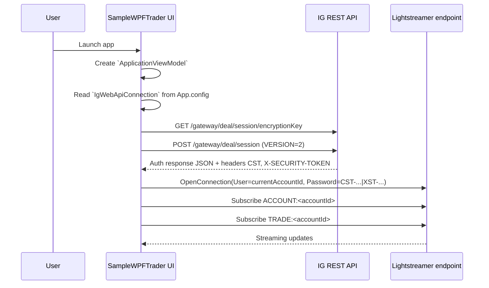

# User workflows

## Purpose
Describe the primary workflows and state transitions observable from the WPF UI and view models.

## Key points (TL;DR)
- Startup shows `MainWindow` with tabs; most tabs require the user to be logged in.
- Login is triggered when the Home tab is selected and `LoggedIn == false`.
- After successful login:
  - the app connects to Lightstreamer
  - subscribes to account updates and trade updates
  - other tabs load data via REST and subscribe to relevant streaming topics

## Details
## Workflow: start + login + streaming session

State notes:
- `LoggedIn` is a static boolean on `ViewModelBase`.
- On exit, the app unsubscribes streaming subscriptions and calls REST logout.

## Workflow: view open positions
- Trigger: user selects the **Positions** tab.
- If logged in:
  1. call REST `GET /gateway/deal/positions` (VERSION=2)
  2. populate `Positions` collection
  3. subscribe to streaming `L1:<epic>` for unique epics where streaming is available

## Workflow: view working orders
- Trigger: user selects the **Working Orders** tab.
- If logged in:
  1. call REST `GET /gateway/deal/workingorders` (VERSION=2)
  2. populate `Orders` collection
  3. subscribe to streaming `L1:<epic>` for unique epics where streaming is available

## Workflow: view watchlists + charts
- Trigger: user selects the **Watchlists** tab.
- If logged in:
  1. call REST `GET /gateway/deal/watchlists`
  2. when a watchlist is selected, call REST `GET /gateway/deal/watchlists/{id}`
  3. subscribe to streaming `L1:<epic>` for unique epics where streaming is available
  4. subscribe to streaming candle data `CHART:<epic>:1MINUTE` (implemented as `ChartScale.OneMinute`)

## Workflow: browse markets
- Trigger: user selects the **Browse** tab.
- If logged in:
  1. call REST `GET /gateway/deal/marketnavigation` to load top-level nodes
  2. user selects a node and clicks “Drill down” -> call `GET /gateway/deal/marketnavigation/{nodeId}`
  3. if the response has leaf markets, subscribe to their streaming `L1:<epic>`

## Evidence (repo references)
- `SampleWPFTrader/MainWindow.xaml` (lines 51–294): tab selection bindings and commands for Browse (`Root`, `Drill down`).
- `SampleWPFTrader/ViewModel/ApplicationViewModel.cs` (lines 151–176, 229–326, 199–221): login, subscribe/unsubscribe behavior, and exit flow.
- `SampleWPFTrader/ViewModel/PositionsViewModel.cs` (lines 21–50, 125–176): positions tab loads positions and subscribes/unsubscribes.
- `SampleWPFTrader/ViewModel/OrdersViewModel.cs` (lines 98–149, 210–242): orders tab loads orders and subscribes/unsubscribes.
- `SampleWPFTrader/ViewModel/WatchlistsViewModel.cs` (lines 249–265, 348–425, 463–509): watchlists tab loads data and subscribes to L1 and charts.
- `SampleWPFTrader/ViewModel/BrowseViewModel.cs` (lines 35–56, 278–321, 182–251): browse tab loads root, drills down, and subscribes to L1.

## Open questions / assumptions (if any)
- Assumption: Streaming subscriptions are safe to hold for the lifetime of a tab selection and do not require periodic refresh.
  - Missing evidence: No retry/backoff logic is present for REST or Lightstreamer.
  - Risk/impact: A robust reimplementation may need reconnection behavior and subscription resync.