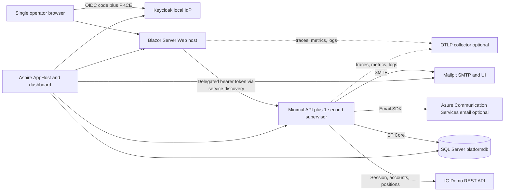

## Research Scope

Research the TNC.Trading.Platform runtime topology, purpose, technologies, integrations, testing posture, and quality attributes using current implementation documentation and representative source and test evidence.

Questions:

* What business and technical purpose does the application serve?
* What processes, services, dependencies, and external integrations form the runtime topology?
* Which technologies and configuration patterns implement the system?
* What testing posture and deployment or infrastructure evidence exists?
* What evidence supports assessments of modularity, maintainability, testability, scalability, ease of understanding, ease of feature addition, and likely team or complexity fit?
* Which architectural strengths, gaps, assumptions, and unresolved questions remain?

## Status

Complete as a source-and-documentation research pass. No production files were modified and no runtime or test suite was executed.

## Assumptions

* "Current implementation" means checked-in source and the implementation wiki as of 2026-07-26. Draft business and systems-analysis documents describe intended outcomes, not proof of delivered behavior.
* The supported local topology is a single AppHost-managed API process and Web process. This follows the checked-in composition; no production deployment manifest proves a horizontally scaled topology.
* Quality assessments use qualitative ratings because repository-wide complexity, coverage, load, reliability, and operational measurements were not generated during this research pass.
* External service behavior is inferred only where request construction, configuration, tests, or current documentation provide evidence. No real IG, Keycloak, SMTP, Azure Communication Services, or SQL Server call was made.
* "Team fit" is assessed against the documented single-user, part-time personal-project context, not an assumed commercial team structure.

## Findings

### Purpose and delivered boundary

The product goal is an internal, profit-generating algorithmic trading platform against IG. The business scope ultimately includes market data, strategies, orders, risk controls, run controls, monitoring, and auditability, while the initial release excludes IG live trade execution (docs/business-requirements.md:10-47). The documented user is one project owner and the project is part-time and personal/internal (docs/business-requirements.md:49-62, docs/business-requirements.md:112-119).

The delivered application is narrower. It is an operator control-plane and IG Demo authentication foundation that provides:

* Keycloak-backed operator sign-in and Viewer, Operator, and Administrator authorization
* Operator-managed environment, schedule, retry, notification, and credential configuration
* A supervised IG Demo authentication loop with retry, blocked-live safeguards, events, notifications, and retained login snapshots
* Read-only IG Demo account and open-position proof queries after authentication
* A Blazor operator UI and protected Minimal API

README.md:3-30 explicitly distinguishes those delivered capabilities from unimplemented live trading, market discovery/pricing, order lifecycle, strategy execution, and risk controls. Source verifies real IG Demo REST integration through a typed adapter, not simulated-only connectivity (src/TNC.Trading.Platform.Infrastructure/Infrastructure/Platform/Ig/IgSessionClient.cs:9-112).

The implementation wiki is internally inconsistent. It says real IG Demo authentication and read-only proof queries are delivered (docs/wiki/application-overview.md:29-55), then later says real IG session establishment is not implemented and that broker selection does not connect to IG (docs/wiki/application-overview.md:95-100, docs/wiki/application-overview.md:143-154). README, runtime documentation, the adapter, and tests support the former statement; the latter passages are stale.

### Runtime topology

AppHost is a thin local composition root that creates infrastructure, registers API and Web projects, wires provider settings, then runs the distributed application (src/TNC.Trading.Platform.AppHost/AppHost.cs:1-13).

The supported local resource graph is:

* Persistent SQL Server container with a `platformdb` database
* Persistent Mailpit container with HTTP and SMTP endpoints
* Keycloak on local port 8080, with imported realm configuration and persistent state by default
* Externally reachable API process that waits for SQL Server, Mailpit, and normally Keycloak
* Externally reachable Blazor Server Web process that references and waits for the API and Keycloak

Evidence: src/TNC.Trading.Platform.AppHost/AppHostInfrastructureRegistration.cs:7-43 and src/TNC.Trading.Platform.AppHost/AppHostProjectRegistration.cs:5-42. The AppHost composition test asserts all six resources, wait dependencies, endpoints, and dashboard links (test/TNC.Trading.Platform.AppHost/TNC.Trading.Platform.AppHost.UnitTests/AppHostCompositionTests.cs:15-98).

The Web host is a server-side UI/BFF-style boundary. It uses Aspire service discovery at `https+http://api`, authenticates operators with a local cookie plus OIDC authorization-code flow and PKCE, saves delegated tokens, and forwards bearer tokens through its API clients (src/TNC.Trading.Platform.Web/Program.cs:8-25; src/TNC.Trading.Platform.Web/Authentication/PlatformWebAuthenticationServiceCollectionExtensions.cs:48-102). The API separately validates JWT issuer, audience, signing material, name claim, and role claim (src/TNC.Trading.Platform.Api/Authentication/PlatformApiAuthenticationServiceCollectionExtensions.cs:12-70).

The API is both HTTP control plane and background worker. Startup creates the database schema, applies startup configuration and retention, and performs an initial coordinator tick before mapping endpoints (src/TNC.Trading.Platform.Api/Program.cs:10-54). A hosted supervisor then creates a scope and invokes the coordinator once per second, logging and continuing after non-cancellation exceptions (src/TNC.Trading.Platform.Application/Services/PlatformAuthSupervisor.cs:7-43; src/TNC.Trading.Platform.Application/Services/PlatformAuthSupervisorRunner.cs:11-50).

### Technologies

* .NET 10 pinned to SDK `10.0.200` with latest-feature roll-forward (global.json:1-6)
* ASP.NET Core Minimal API, OpenAPI, and Scalar (src/TNC.Trading.Platform.Api/TNC.Trading.Platform.Api.csproj:1-26)
* Blazor Server interactive components and Radzen Blazor (src/TNC.Trading.Platform.Web/TNC.Trading.Platform.Web.csproj:1-20; src/TNC.Trading.Platform.Web/Program.cs:10-13)
* .NET Aspire 13.2.3 for orchestration, SQL Server resources, service discovery, resilience, health, and telemetry; the Keycloak hosting package is `13.2.3-preview.1.26217.6` (src/TNC.Trading.Platform.AppHost/TNC.Trading.Platform.AppHost.csproj:1-22)
* Entity Framework Core 10.0.5 with SQL Server; EF in-memory is limited by runtime guards to isolated synthetic-auth tests (src/TNC.Trading.Platform.Infrastructure/Infrastructure/Platform/PlatformInfrastructureServiceCollectionExtensions.cs:18-46)
* ASP.NET Core Data Protection for protected IG credentials (src/TNC.Trading.Platform.Infrastructure/Infrastructure/Platform/ProtectedCredentialService.cs:8-67)
* OIDC/OAuth 2.0 through Keycloak locally, with Entra configuration models present; JWT bearer protection on the API (src/TNC.Trading.Platform.Api/appsettings.json:2-30)
* OpenTelemetry logging, ASP.NET Core tracing, outbound HTTP tracing, runtime metrics, and optional OTLP export (src/TNC.Trading.Platform.ServiceDefaults/Extensions.cs:44-105)
* xUnit, Aspire distributed testing, bUnit, and Playwright across unit, integration, functional, and E2E suites, as catalogued in docs/wiki/testing-and-quality.md:9-22

### External integrations

#### IG Demo REST API

The infrastructure client targets `https://demo-api.ig.com/gateway/deal/` (src/TNC.Trading.Platform.Infrastructure/Infrastructure/Platform/PlatformInfrastructureServiceCollectionExtensions.cs:60-65). It issues:

* `POST session`, API version 3, with API key, identifier, and password
* `GET accounts`, API version 1, with CST, security token, and API key
* `GET positions`, API version 2, with CST, security token, and API key

The adapter implementation is at src/TNC.Trading.Platform.Infrastructure/Infrastructure/Platform/Ig/IgSessionClient.cs:20-144. There is no market discovery, streaming client, order submission, or trade lifecycle adapter in the reviewed source, consistent with README.md:25-30.

Authentication tokens are returned in memory and used for immediate proof queries. Login snapshots sanitize persisted fields through a mapper, while proof snapshots contain account name/ID, balance, open-position count, and retrieval time. The proof-data store is currently singleton process memory, not SQL-backed (src/TNC.Trading.Platform.Infrastructure/Infrastructure/Platform/PlatformInfrastructureServiceCollectionExtensions.cs:58-65; src/TNC.Trading.Platform.Application/Services/PlatformIgProofDataEnricher.cs:12-62).

#### Identity providers

Keycloak is the implemented and tested local identity provider. AppHost imports a repeatable realm and wires clients, scopes, role claims, and authority (src/TNC.Trading.Platform.AppHost/AppHostInfrastructureRegistration.cs:27-40; src/TNC.Trading.Platform.AppHost/AppHostEnvironmentWiring.cs:7-74). The API-only Test provider is an explicit testing branch; Web remains Keycloak-backed (src/TNC.Trading.Platform.AppHost/AppHostEnvironmentWiring.cs:45-96, src/TNC.Trading.Platform.AppHost/AppHostEnvironmentWiring.cs:148-179).

Microsoft Entra ID has configuration and shared resolver support, but no reviewed AppHost resource or deployment evidence proves a running Entra-integrated environment. Treat Entra as designed/configurable rather than operationally verified.

#### SQL Server and persistence

`PlatformDbContext` contains configuration, protected credentials, auth runtime state, retry cycles, IG login snapshots, operational events, configuration audits, and notification records (src/TNC.Trading.Platform.Infrastructure/Infrastructure/Persistence/PlatformDbContext.cs:5-113). SQL Server is mandatory unless both in-memory persistence and Test authentication are explicitly enabled (src/TNC.Trading.Platform.Infrastructure/Infrastructure/Platform/PlatformInfrastructureServiceCollectionExtensions.cs:20-46).

There are no EF migration files in the reviewed inventory. Startup uses `EnsureCreatedAsync`; in Development with SQL Server it first calls `EnsureDeletedAsync` (src/TNC.Trading.Platform.Api/Program.cs:24-41). This destroys local SQL data on each API restart and contradicts claims of durable local configuration across restarts in docs/wiki/local-development.md:180-186. It also makes the AppHost persistent SQL volume less useful for application data during Development.

#### Notifications

The API registers RecordedOnly, SMTP, and Azure Communication Services email providers (src/TNC.Trading.Platform.Infrastructure/Infrastructure/Platform/PlatformInfrastructureServiceCollectionExtensions.cs:47-57). AppHost wires Mailpit SMTP locally and passes optional ACS endpoint, sender, and connection-string settings (src/TNC.Trading.Platform.AppHost/AppHostEnvironmentWiring.cs:98-144). No external delivery was exercised during this pass.

### Security and authorization

The shared role matrix allows Viewer, Operator, and Administrator to read viewer surfaces; Operator and Administrator to change configuration or retry; and only Administrator to use the admin surface (src/TNC.Trading.Platform.Application/Authentication/PlatformAuthorizationPolicyRegistration.cs:13-31). API routes apply those policies explicitly (src/TNC.Trading.Platform.Api/Features/Platform/PlatformEndpoints.cs:22-43).

Credential writes are partial/write-only. Values are protected with a purpose-specific Data Protector and only presence is queried for normal configuration views (src/TNC.Trading.Platform.Infrastructure/Infrastructure/Platform/ProtectedCredentialService.cs:8-67). Tests cover protected storage, rotation, redaction, and secret-safe API/UI contracts according to docs/wiki/testing-and-quality.md:80-119.

Security caveats:

* Local seeded passwords and synthetic signing material are checked into appsettings/AppHost wiring for development and tests (src/TNC.Trading.Platform.Web/appsettings.json:2-32; src/TNC.Trading.Platform.AppHost/AppHostEnvironmentWiring.cs:18-31). Their scope is local/test, but environment isolation must remain strict.
* `AllowedHosts` is `*` in API and Web configuration (src/TNC.Trading.Platform.Api/appsettings.json:64-64; src/TNC.Trading.Platform.Web/appsettings.json:35-35).
* Data Protection key persistence and production key protection were not found in the reviewed startup. Without an external key ring, protected credentials may become unreadable after host replacement or multi-instance deployment. This is an inference from absent configuration, not a runtime test result.

### Observability and health

Shared defaults add structured OpenTelemetry logging with scopes, ASP.NET Core and outbound HTTP tracing, runtime and HTTP metrics, service discovery, and standard HTTP resilience (src/TNC.Trading.Platform.ServiceDefaults/Extensions.cs:21-84). OTLP export activates only when `OTEL_EXPORTER_OTLP_ENDPOINT` is configured; Azure Monitor code is commented out (src/TNC.Trading.Platform.ServiceDefaults/Extensions.cs:86-105).

The API adds service, environment, and trace identifiers to request log scopes and warns on protected-route 401/403 responses (src/TNC.Trading.Platform.Api/Program.cs:56-85). Operational auth/configuration/notification records provide application-level audit history in SQL.

Health coverage is shallow. The only default registered check is a self liveness check; readiness executes all registered checks, but no SQL, Keycloak, IG, or notification dependency check was found in ServiceDefaults or API startup (src/TNC.Trading.Platform.ServiceDefaults/Extensions.cs:111-156). A healthy readiness response therefore proves process-level responsiveness, not dependency readiness.

### Deployment and infrastructure evidence

Checked-in evidence supports local development through Aspire and Docker. No `infra/` files, Dockerfiles, Compose manifests, Bicep, Terraform, Kubernetes manifests, or CI workflow YAML were found by targeted workspace searches. The repository guidance prefers Azure Container Apps, and Entra/ACS configuration exists, but there is no reviewed artifact proving a production deployment topology, secret store, database migration process, backup/restore, scaling policy, ingress, TLS termination, or disaster recovery.

### Testing posture

The suite is intentionally pyramid-shaped:

* Application unit tests exercise schedule, retry, state transitions, IG proof projection, and supervisor behavior
* Infrastructure unit tests exercise SQL stores, Data Protection, redaction, retention, notifications, and HTTP request/response mapping for IG
* AppHost unit tests inspect the Aspire resource model and environment wiring
* API integration tests use a shared real AppHost plus Keycloak runtime for valid-token authorization and retain isolated synthetic JWT tests for malformed-token conditions
* Web unit tests cover clients, auth helpers, presenters, and bUnit rendering
* Web functional tests retain focused sign-out, role-denial, and CSRF paths
* One Playwright E2E smoke signs a seeded viewer into real local Keycloak and reaches protected UI content

Representative evidence:

* AppHost topology assertions: test/TNC.Trading.Platform.AppHost/TNC.Trading.Platform.AppHost.UnitTests/AppHostCompositionTests.cs:15-98
* Successful and non-fatal proof-data paths: test/TNC.Trading.Platform.Application/TNC.Trading.Platform.Application.UnitTests/IgProofDataTests.cs:13-169
* IG request method, version, API-key, token, and failure mapping: test/TNC.Trading.Platform.Infrastructure/TNC.Trading.Platform.Infrastructure.UnitTests/Infrastructure/Platform/Ig/IgSessionClientTests.cs:10-180
* Real-Keycloak API health, 401, 403, role, write, and audit behavior: test/TNC.Trading.Platform.Api/TNC.Trading.Platform.Api.IntegrationTests/Authentication/PlatformAuthenticationIntegrationTests.cs:7-218
* Browser-level Keycloak sign-in: test/TNC.Trading.Platform.Web/TNC.Trading.Platform.Web.E2ETests/Authentication/PlatformDashboardAuthenticationE2ETests.cs:6-55

The wiki records recent line/branch and mutation evidence. AppHost unit tests are strongest; API line coverage is `5.87%`, Infrastructure `36.51%`, Web `34.17%`, Application `55.11%`; Application mutation score is `18.80%`, and Web mutation execution is blocked (docs/wiki/testing-and-quality.md:147-177). These figures are historical repository evidence and were not regenerated in this pass.

Two test gaps are especially material:

1. Real proof-data path mismatch. `PlatformIgProofDataEnricher` reads the API key from `authResponse.Headers` (src/TNC.Trading.Platform.Application/Services/PlatformIgProofDataEnricher.cs:12-18). `IgSessionClient.AuthenticateAsync` copies response headers but does not place the request API key into them (src/TNC.Trading.Platform.Infrastructure/Infrastructure/Platform/Ig/IgSessionClient.cs:48-64). The application proof tests inject `X-IG-API-KEY` into the fake response (test/TNC.Trading.Platform.Application/TNC.Trading.Platform.Application.UnitTests/IgProofDataTests.cs:300-309), while infrastructure tests pass an API key directly to account/position methods. Unless IG echoes the request API key, real proof calls use an empty key and likely fail. The session remains Active because proof failure is deliberately non-fatal, so the issue can be masked.
2. Development persistence contradiction. Tests cover SQL store behavior, but no representative test in this pass proves data survives API restart under Development, where startup explicitly deletes the database.

## Runtime and Integration Diagram

The diagram shows implemented local edges as solid lines and optional telemetry export as dotted lines. ACS is registered and configuration-driven but is not an AppHost resource.

## Quality Attribute Assessment

| Attribute | Assessment | Evidence-based interpretation |
|-----------|------------|-------------------------------|
| Modularity | Good for the delivered scope | Six production projects separate composition, hosts, application behavior, infrastructure, and shared defaults. Feature handlers and ports isolate many concerns. The API still owns both HTTP and perpetual broker supervision, and the coordinator remains a central integration point with 13 constructor dependencies (src/TNC.Trading.Platform.Application/Services/PlatformStateCoordinator.cs:10-30). |
| Maintainability | Moderate to good | Thin startup/composition files, one-type-per-file organization, explicit mappings, shared auth policy registration, and focused tests aid change. Stale contradictory wiki text, no migrations, preview Keycloak hosting dependency, and the proof-data API-key mismatch lower confidence. |
| Testability | Good, with important integration blind spots | Interfaces for stores, notifications, time, delays, and IG enable deterministic tests. Real Keycloak distributed tests validate the delivered auth topology. Real IG is opt-in/manual, and fake response construction masks a proof-data defect. Historical mutation scores show weak behavioral sensitivity in Application/API/Infrastructure areas. |
| Scalability | Suitable for one API instance; weak for horizontal scale | Stateless HTTP surfaces and SQL persistence can evolve, but each API replica would run its own one-second supervisor. Runtime state has no visible concurrency token or distributed lock (src/TNC.Trading.Platform.Infrastructure/Infrastructure/Platform/EfPlatformRuntimeStateStore.cs:8-73), and proof data is process-local. Multiple replicas could duplicate IG calls, events, and notifications or overwrite state. |
| Ease of understanding | Moderate | Wiki pages, project naming, diagrams, requirement-linked tests, thin endpoints, and explicit state names are helpful. Understanding actual behavior still requires crossing AppHost, API startup, application coordinator, EF stores, auth wiring, and Web BFF code. Documentation contradictions create avoidable uncertainty. |
| Ease of feature addition | Good for adjacent control-plane features; uncertain for trading-domain expansion | Vertical feature folders, handler contracts, application ports, and infrastructure adapters support status/configuration/history additions. Market streaming, strategies, orders, risk, reconciliation, and idempotency will introduce different throughput and consistency needs; the current central coordinator and database model should not be assumed to scale unchanged to those domains. |
| Reliability and recoverability | Moderate for local control-plane behavior | Retry/backoff, schedule gating, failure classification, retention, durable event records, and non-fatal proof enrichment are strengths. Readiness lacks dependency checks, Development deletes SQL state, proof data is volatile, and no backup/restore or production deployment evidence exists. |
| Security | Good local foundation, incomplete production posture | OIDC/PKCE, JWT validation, role policies, write-only protected credentials, token non-persistence intent, and redaction tests are strong. Production Data Protection key management, external secret storage, host restrictions, Entra deployment, and infrastructure hardening are not evidenced. |
| Observability | Good instrumentation foundation, moderate operational readiness | OpenTelemetry, trace-scoped logs, audit events, health endpoints, retries, notifications, and status projections exist. No dependency health checks, dashboard/alert definitions, SLOs, or verified exporter/deployment configuration were found. |
| Team and complexity fit | Technically disciplined but somewhat heavy for the documented single part-time owner | Aspire, Keycloak, SQL Server, six production projects, eight test projects, and distributed auth tests impose meaningful setup and cognitive cost. That cost buys safety, auditability, and future boundaries appropriate to financial automation. It fits best if the owner values controlled evolution over minimal operations; it would be excessive for a disposable prototype but defensible for a safety-sensitive system intended to grow. |

## Architectural Strengths

* Clear delivered boundary and safety-first Test/Demo defaults
* Thin AppHost composition with resource-model tests that detect topology drift cheaply
* Explicit Application abstractions around storage, credentials, notifications, time, and IG sessions
* Shared authorization policy matrix used by Web and API, with fail-closed integration coverage
* Server-side Web host keeps delegated tokens out of browser-delivered code
* Secret write-only behavior, Data Protection storage, response/event redaction, and token non-persistence design
* State-transition, retry, retention, event, notification, and operator-audit behavior designed for operational review
* Read-only IG proof queries establish a low-risk integration step before market/trading capabilities
* Test pyramid includes both low-cost deterministic tests and a deliberately narrow real AppHost plus Keycloak path
* OpenTelemetry, service discovery, standard HTTP resilience, health routes, OpenAPI, and Scalar are consistently composed

## Architectural Gaps and Risks

### High priority

* Real proof-data queries likely omit `X-IG-API-KEY` because the application obtains it from response headers rather than retaining the authentication request credential. Existing fake-based tests mask the mismatch.
* Development API startup deletes the SQL database before recreating it, defeating documented local persistence and risking unexpected local data loss.
* No evidence supports safe multi-replica supervision. The one-second hosted loop, single-row runtime state, process-local deduplication, and process-local proof store need an explicit single-active-worker or distributed coordination design before horizontal scaling.

### Medium priority

* Readiness does not verify SQL Server, Keycloak, or other critical dependencies.
* No production deployment, migration, backup, restore, secret-store, ingress, TLS, scaling, or disaster-recovery artifacts were found.
* Data Protection key-ring persistence and cross-instance sharing are not configured in reviewed startup.
* The implementation wiki contradicts itself about real IG connectivity and contradicts startup behavior about local durability.
* The Keycloak Aspire hosting package is a preview dependency.
* IG proof data is volatile process memory despite being presented as current status data.
* `AllowedHosts` is unrestricted in checked-in host configuration.

### Evolution risks

* API and broker supervisor share a process and failure/scaling boundary. This is simple now but may become costly when market data, strategy, and order workloads arrive.
* `PlatformStateCoordinator` has substantial orchestration responsibility. Extracted transition, side-effect, and proof collaborators help, but future trading domains should use separate cohesive slices rather than extending this coordinator indefinitely.
* `EnsureCreatedAsync` without migrations is unsuitable for controlled production schema evolution.
* Current tests prove request semantics and auth topology better than sustained operation, restart recovery, concurrency, load, rate-limit behavior, or external delivery.

## Evidence Log

| Topic | Evidence | Finding |
|-------|----------|---------|
| Business purpose | docs/business-requirements.md:10-47 | Internal algorithmic trading against IG is the target; current delivery is not the full trading product. |
| User/team context | docs/business-requirements.md:49-62, docs/business-requirements.md:112-119 | One internal owner; part-time personal project. |
| Delivered scope | README.md:3-30 | Auth/configuration/status/IG login foundation delivered; trading features not delivered. |
| Local composition | src/TNC.Trading.Platform.AppHost/AppHost.cs:1-13; src/TNC.Trading.Platform.AppHost/AppHostInfrastructureRegistration.cs:7-43 | AppHost owns SQL, Mailpit, Keycloak, API, and Web composition. |
| Dependency ordering | src/TNC.Trading.Platform.AppHost/AppHostProjectRegistration.cs:5-42; src/TNC.Trading.Platform.AppHost/AppHostEnvironmentWiring.cs:148-179 | API waits for database/Mailpit/Keycloak; Web waits for API/Keycloak. |
| API runtime | src/TNC.Trading.Platform.Api/Program.cs:10-100 | Startup initialization, auth middleware, endpoints, telemetry scope, OpenAPI/Scalar, and health mapping. |
| Web runtime | src/TNC.Trading.Platform.Web/Program.cs:8-73 | Blazor Server, service-discovered API clients, auth, antiforgery, and protected entry behavior. |
| Auth protocol | src/TNC.Trading.Platform.Web/Authentication/PlatformWebAuthenticationServiceCollectionExtensions.cs:48-173 | Cookie plus OIDC code flow, PKCE, saved tokens, scopes, and audit callback. |
| API authorization | src/TNC.Trading.Platform.Api/Features/Platform/PlatformEndpoints.cs:22-43 | Explicit Viewer/Operator/Administrator route boundaries. |
| Background loop | src/TNC.Trading.Platform.Application/Services/PlatformAuthSupervisor.cs:7-43; src/TNC.Trading.Platform.Application/Services/PlatformAuthSupervisorRunner.cs:11-50 | Coordinator ticks every second and catches tick failures. |
| State decision | src/TNC.Trading.Platform.Application/Services/PlatformStateTransitionEngine.cs:5-48 | Schedule, blocked-live, expiry, retry wait, active, and degraded decisions are explicit. |
| SQL model | src/TNC.Trading.Platform.Infrastructure/Infrastructure/Persistence/PlatformDbContext.cs:5-113 | Eight persisted entity sets cover control-plane state and audit records. |
| Persistence mode | src/TNC.Trading.Platform.Infrastructure/Infrastructure/Platform/PlatformInfrastructureServiceCollectionExtensions.cs:18-46 | SQL required outside isolated Test-auth in-memory mode. |
| Credential protection | src/TNC.Trading.Platform.Infrastructure/Infrastructure/Platform/ProtectedCredentialService.cs:8-67 | Purpose-specific Data Protection and presence-only reads. |
| IG endpoint | src/TNC.Trading.Platform.Infrastructure/Infrastructure/Platform/PlatformInfrastructureServiceCollectionExtensions.cs:60-65 | Real IG Demo gateway is configured. |
| IG calls | src/TNC.Trading.Platform.Infrastructure/Infrastructure/Platform/Ig/IgSessionClient.cs:20-144 | Session, accounts, and positions REST requests are implemented. |
| Telemetry | src/TNC.Trading.Platform.ServiceDefaults/Extensions.cs:44-105 | Logging, metrics, tracing, and optional OTLP export. |
| Health | src/TNC.Trading.Platform.ServiceDefaults/Extensions.cs:111-156 | Self liveness and generic readiness endpoints; no reviewed dependency checks. |
| Test topology | test/TNC.Trading.Platform.AppHost/TNC.Trading.Platform.AppHost.UnitTests/AppHostCompositionTests.cs:15-98 | Resource graph and wait relationships are asserted. |
| Auth integration | test/TNC.Trading.Platform.Api/TNC.Trading.Platform.Api.IntegrationTests/Authentication/PlatformAuthenticationIntegrationTests.cs:20-218 | Real-Keycloak health, role, denial, update, and audit paths. |
| Browser integration | test/TNC.Trading.Platform.Web/TNC.Trading.Platform.Web.E2ETests/Authentication/PlatformDashboardAuthenticationE2ETests.cs:20-55 | Seeded viewer completes a real local Keycloak sign-in. |
| Historical quality metrics | docs/wiki/testing-and-quality.md:147-177 | Coverage and mutation evidence identify weaker API/Application/Infrastructure/Web signals. |
| Documentation drift | docs/wiki/application-overview.md:29-55, docs/wiki/application-overview.md:95-100, docs/wiki/application-overview.md:143-154 | Real IG connectivity is simultaneously described as implemented and absent. |
| Local durability defect | src/TNC.Trading.Platform.Api/Program.cs:24-41; docs/wiki/local-development.md:180-186 | Development startup deletes SQL despite persistence guidance. |
| Proof-data defect | src/TNC.Trading.Platform.Application/Services/PlatformIgProofDataEnricher.cs:12-18; src/TNC.Trading.Platform.Infrastructure/Infrastructure/Platform/Ig/IgSessionClient.cs:48-64; test/TNC.Trading.Platform.Application/TNC.Trading.Platform.Application.UnitTests/IgProofDataTests.cs:300-309 | Fake response supplies an API key that the real adapter does not place in response headers. |

## Recommended Next Research

* Reproduce the real IG Demo proof-data path with opt-in credentials and capture sanitized outbound headers to confirm the API-key defect before changing code.
* Run a restart-persistence experiment through AppHost in Development and document exactly which SQL records are lost.
* Run the current build and focused test projects, then regenerate coverage and mutation results to validate the wiki's historical figures.
* Inspect Data Protection key-ring behavior across API restart and multiple instances; identify the intended production key store.
* Model or test two API instances against one SQL database to measure duplicate ticks, IG calls, event/notification duplication, and state conflicts.
* Define dependency readiness semantics and test SQL unavailable, Keycloak unavailable, and IG unavailable scenarios.
* Locate or design the intended Azure deployment architecture, including Entra, Azure SQL, ACS, secret management, OTLP/Azure Monitor, migrations, backups, and rollback.
* Reconcile implementation wiki contradictions and distinguish durable SQL login snapshots from volatile proof-data snapshots.
* Assess upcoming market-data, strategy, order, and risk requirements before assigning them to the current API/coordinator process; include throughput, idempotency, event ordering, and recovery requirements.

## Clarifying Questions

* Is the Development database deletion intentional during the current schema-prototyping phase, or should local AppHost restarts preserve operator configuration and history now?
* Is production expected to run exactly one API/supervisor replica, or is horizontal API scaling a target?
* Which production deployment target and managed services are approved? Repository guidance mentions Azure Container Apps, Entra ID, and Azure Communication Services, but implementation evidence is absent.
* Should IG proof data be durable and shared across instances, or is best-effort process-local visibility the intended contract?
* Is the checked-in local seeded password acceptable under the repository's threat model, or should realm import use generated/test-secret injection?
