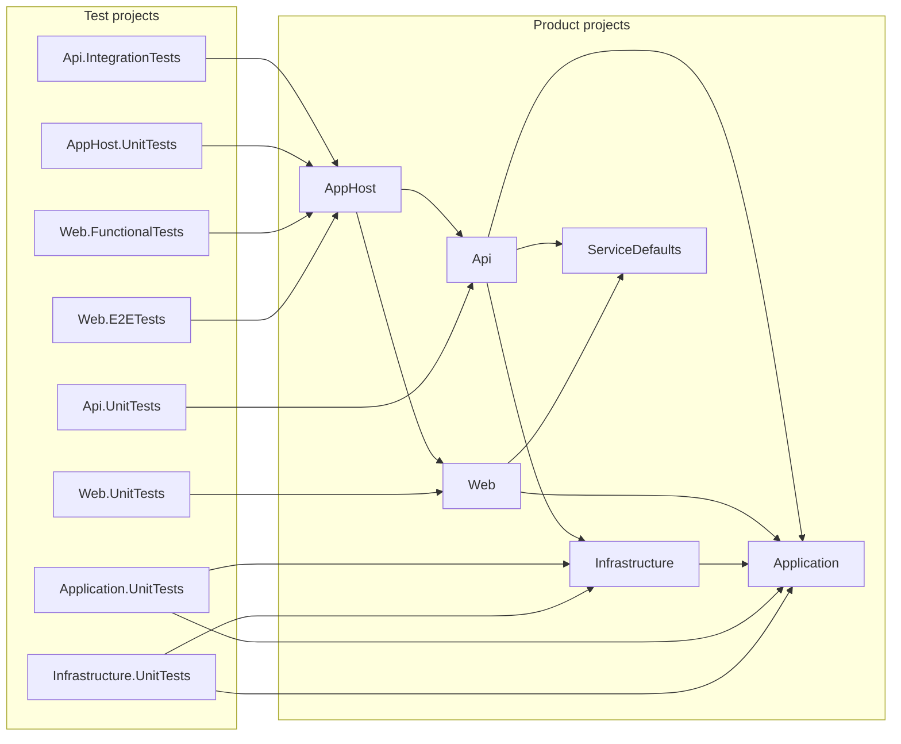

## Research scope

* Determine the responsibilities of each solution project.
* Reconstruct compile-time project and package dependency direction.
* Identify dependency cycles, reverse references, forbidden references, and material coupling.
* Assess whether the verified graph supports Layered, Clean, Onion, Hexagonal,
  Vertical Slice, or Modular Monolith architecture classifications.
* Record uncertainties and the smallest useful follow-on research.

## Status

Complete.

## Evidence method

The investigation read the solution, SDK pin, all six source project files, all
eight test project files, and representative composition, boundary, feature,
and adapter files. Generated `bin/` and `obj/` files were excluded as source
evidence.

Repository intent was treated separately from compiled structure. The relevant
rules require feature-oriented Vertical Slice organization with CQRS-style
request/response contracts and thin endpoints, while the general .NET rules
prefer Minimal APIs, Blazor, SQL Server, Aspire, and explicit service
boundaries. Evidence:
`.github/instructions/architecture.instructions.md:1-56`;
`.github/instructions/dotnet-stack.instructions.md:1-67`;
`.github/copilot-instructions.md:13-46`.

The requested repository operating documents were also inspected. AGENTS and
lessons require concise, file-and-line evidence and do not define product
dependencies; C# rules define source conventions rather than project direction;
test rules define the unit, integration, functional, and E2E boundaries used to
interpret test references. Evidence: `.github/AGENTS.md:13-35`;
`.github/lessons.md:1-9`; `.github/instructions/csharp.instructions.md:13-66`;
`.github/instructions/tests.instructions.md:13-67`.

Commands and tool evidence:

* Workspace file search found 6 `src/**/*.csproj` files and 8
    `test/**/*.csproj` files, matching all 14 projects listed in the solution.
* A PowerShell XML traversal of every project file found 18 direct
    `ProjectReference` edges and, after depth-first traversal, zero cycles.
* The first graph script was discarded because Windows PowerShell's host did
    not provide `System.IO.Path.GetRelativePath`; its zero-edge result was
    invalid. A second script found all 18 edges but reported a path ending in an
    empty node; that result was also discarded. The corrected traversal guarded
    null adjacency and reported `PROJECT_COUNT=14`,
    `PROJECT_REFERENCE_EDGES=18`, and `CYCLE_COUNT=0`.
* `dotnet build TNC.Trading.Platform.slnx --no-restore` completed successfully
    in 9.4 seconds with 73 warnings and no errors. Warning categories included
    preview-SDK notice `NETSDK1057`, NuGet vulnerability notices for transitive
    `MessagePack`, `Microsoft.OpenApi`, and `AngleSharp`, plus nullable warnings
    in tests. The build establishes compilability, not warning-free dependency
    health.

## Verified solution structure

`TNC.Trading.Platform.slnx` contains six product projects and eight test
projects, grouped under `src` and service-specific test folders. Evidence:
`TNC.Trading.Platform.slnx:1-29`. The repository pins SDK `10.0.200` with
`latestFeature` roll-forward, and every project targets `net10.0`. Evidence:
`global.json:1-6`; source project target declarations at
`src/TNC.Trading.Platform.Application/TNC.Trading.Platform.Application.csproj:3-7`,
`src/TNC.Trading.Platform.Infrastructure/TNC.Trading.Platform.Infrastructure.csproj:3-7`,
`src/TNC.Trading.Platform.Api/TNC.Trading.Platform.Api.csproj:19-23`,
`src/TNC.Trading.Platform.Web/TNC.Trading.Platform.Web.csproj:13-17`,
`src/TNC.Trading.Platform.AppHost/TNC.Trading.Platform.AppHost.csproj:9-15`, and
`src/TNC.Trading.Platform.ServiceDefaults/TNC.Trading.Platform.ServiceDefaults.csproj:3-8`.

The six source project responsibilities are:

* `Application` is the application core. It has no project or package
    references, only the ASP.NET Core shared framework, and registers use-case
    handlers, orchestration services, and a hosted supervisor. Evidence:
    `src/TNC.Trading.Platform.Application/TNC.Trading.Platform.Application.csproj:1-13`;
    `src/TNC.Trading.Platform.Application/Services/PlatformApplicationServiceCollectionExtensions.cs:1-28`.
* `Infrastructure` is the outbound adapter and persistence project. It depends
    on Application and owns Azure Email, Azure Identity, EF Core InMemory, and EF
    Core SQL Server packages. Its registration maps Application-owned ports to
    concrete EF, notification, credential, and IG HTTP adapters. Evidence:
    `src/TNC.Trading.Platform.Infrastructure/TNC.Trading.Platform.Infrastructure.csproj:9-23`;
    `src/TNC.Trading.Platform.Infrastructure/Infrastructure/Platform/PlatformInfrastructureServiceCollectionExtensions.cs:1-68`.
* `Api` is the Minimal API process and backend composition root. It directly
    references Application, Infrastructure, and ServiceDefaults, registers both
    core and adapters, performs concrete database startup work, and maps HTTP
    endpoints. Evidence:
    `src/TNC.Trading.Platform.Api/TNC.Trading.Platform.Api.csproj:1-23`;
    `src/TNC.Trading.Platform.Api/Program.cs:1-51`;
    `src/TNC.Trading.Platform.Api/Program.cs:82-99`.
* `Web` is the Blazor server operator process. It references Application for
    shared authentication behavior and ServiceDefaults for host concerns, while
    communicating with API through service-discovered HTTP clients. Evidence:
    `src/TNC.Trading.Platform.Web/TNC.Trading.Platform.Web.csproj:1-17`;
    `src/TNC.Trading.Platform.Web/Program.cs:1-22`;
    `src/TNC.Trading.Platform.Web/Program.cs:24-67`.
* `ServiceDefaults` is a shared hosting adapter for resilience, service
    discovery, OpenAPI, and OpenTelemetry. It has package/framework references
    but no source-project dependency. Evidence:
    `src/TNC.Trading.Platform.ServiceDefaults/TNC.Trading.Platform.ServiceDefaults.csproj:1-23`.
* `AppHost` is the Aspire orchestration composition root. It references only
    the two deployable processes, API and Web, and adds SQL Server and Keycloak
    hosting integrations. Evidence:
    `src/TNC.Trading.Platform.AppHost/TNC.Trading.Platform.AppHost.csproj:1-21`;
    `src/TNC.Trading.Platform.AppHost/AppHost.cs:1-14`;
    `src/TNC.Trading.Platform.AppHost/AppHostProjectRegistration.cs:1-50`.

The test projects mirror runtime surfaces but differ by boundary:

* API, AppHost, Infrastructure, and Web unit tests reference their systems
    under test. Evidence:
    `test/TNC.Trading.Platform.Api/TNC.Trading.Platform.Api.UnitTests/TNC.Trading.Platform.Api.UnitTests.csproj:18-22`;
    `test/TNC.Trading.Platform.AppHost/TNC.Trading.Platform.AppHost.UnitTests/TNC.Trading.Platform.AppHost.UnitTests.csproj:22-31`;
    `test/TNC.Trading.Platform.Infrastructure/TNC.Trading.Platform.Infrastructure.UnitTests/TNC.Trading.Platform.Infrastructure.UnitTests.csproj:18-26`;
    `test/TNC.Trading.Platform.Web/TNC.Trading.Platform.Web.UnitTests/TNC.Trading.Platform.Web.UnitTests.csproj:23-27`.
* Application unit tests reference both Application and Infrastructure. This
    lets tests instantiate EF and adapter implementations inside the nominal
    application unit suite. Evidence:
    `test/TNC.Trading.Platform.Application/TNC.Trading.Platform.Application.UnitTests/TNC.Trading.Platform.Application.UnitTests.csproj:18-25`;
    `test/TNC.Trading.Platform.Application/TNC.Trading.Platform.Application.UnitTests/AuthRetryCycleTests.cs:1-46`.
* API integration, Web functional, and Web E2E tests reference AppHost rather
    than API or Web directly, supporting closed-box distributed-system tests.
    Evidence:
    `test/TNC.Trading.Platform.Api/TNC.Trading.Platform.Api.IntegrationTests/TNC.Trading.Platform.Api.IntegrationTests.csproj:22-32`;
    `test/TNC.Trading.Platform.Web/TNC.Trading.Platform.Web.FunctionalTests/TNC.Trading.Platform.Web.FunctionalTests.csproj:20-34`;
    `test/TNC.Trading.Platform.Web/TNC.Trading.Platform.Web.E2ETests/TNC.Trading.Platform.Web.E2ETests.csproj:20-30`.

## Compile-time dependency graph

An arrow means the project at the tail contains a direct `ProjectReference` to
the project at the head. Package references are omitted from the diagram and
listed under coupling findings.

Production-edge evidence is complete in:
`src/TNC.Trading.Platform.Api/TNC.Trading.Platform.Api.csproj:3-7`;
`src/TNC.Trading.Platform.AppHost/TNC.Trading.Platform.AppHost.csproj:3-8`;
`src/TNC.Trading.Platform.Infrastructure/TNC.Trading.Platform.Infrastructure.csproj:13-15`;
`src/TNC.Trading.Platform.Web/TNC.Trading.Platform.Web.csproj:3-6`. Application
and ServiceDefaults have no `ProjectReference` elements. Evidence:
`src/TNC.Trading.Platform.Application/TNC.Trading.Platform.Application.csproj:1-13`;
`src/TNC.Trading.Platform.ServiceDefaults/TNC.Trading.Platform.ServiceDefaults.csproj:1-23`.

## Project responsibilities and coupling

The strongest boundary is Application-to-Infrastructure dependency inversion.
Application declares internal ports such as `IPlatformEventStore`, and
Infrastructure implements those ports using EF Core. Evidence:
`src/TNC.Trading.Platform.Application/Services/IPlatformEventStore.cs:1-10`;
`src/TNC.Trading.Platform.Infrastructure/Infrastructure/Platform/EfPlatformEventStore.cs:1-50`.
The infrastructure registration binds multiple Application-owned interfaces to
adapter implementations. Evidence:
`src/TNC.Trading.Platform.Infrastructure/Infrastructure/Platform/PlatformInfrastructureServiceCollectionExtensions.cs:37-63`.

The boundary is deliberately permeable through friend assemblies. Application
exposes internals to API, both unit-test assemblies, and Infrastructure;
Infrastructure exposes internals to API and both layer test assemblies.
Evidence:
`src/TNC.Trading.Platform.Application/Properties/InternalsVisibleTo.cs:1-6`;
`src/TNC.Trading.Platform.Infrastructure/Properties/InternalsVisibleTo.cs:1-5`.
This avoids broad public APIs but creates compile-time knowledge of specific
consumers and allows hosts/tests to couple to internal implementations.

Concrete coupling findings:

* API is correctly placed as the backend composition root, but its startup
    directly resolves `PlatformDbContext`, deletes/creates schema in development,
    runs retention, and ticks the coordinator. It therefore couples host startup
    to EF and concrete Infrastructure behavior beyond registration. Evidence:
    `src/TNC.Trading.Platform.Api/Program.cs:7-18`;
    `src/TNC.Trading.Platform.Api/Program.cs:22-51`.
* API duplicates Infrastructure's four Azure/EF package references. Only EF is
    visibly used by API startup through `DbContext.Database`; no API source use
    of Azure Email, Azure Identity, or the InMemory provider was found outside
    project/generated files. Evidence:
    `src/TNC.Trading.Platform.Api/TNC.Trading.Platform.Api.csproj:9-17`;
    `src/TNC.Trading.Platform.Infrastructure/TNC.Trading.Platform.Infrastructure.csproj:17-22`;
    `src/TNC.Trading.Platform.Api/Program.cs:25-40`.
* Web does not reference Infrastructure or API assemblies, which preserves
    process separation. It does compile against Application authentication types
    in at least 11 source files, so Application is also a shared authentication
    library rather than only backend use-case orchestration. Representative
    evidence: `src/TNC.Trading.Platform.Web/Program.cs:1-18`;
    `src/TNC.Trading.Platform.Web/Authentication/PlatformWebAuthenticationServiceCollectionExtensions.cs:1-46`.
* `PlatformEndpoints` groups routes centrally and delegates most operations to
    Application feature handlers, but auth audit and administration paths inject
    Application services/ports directly instead of dispatching one handler per
    operation. Evidence:
    `src/TNC.Trading.Platform.Api/Features/Platform/PlatformEndpoints.cs:22-48`;
    `src/TNC.Trading.Platform.Api/Features/Platform/PlatformEndpoints.cs:50-113`.
* Application unit tests depend on Infrastructure despite the test rule that
    unit tests run in process and in memory without real infrastructure. The
    observed EF InMemory usage is still in-process, but these tests cross the
    project/layer boundary and test concrete adapters. Evidence:
    `.github/instructions/tests.instructions.md:33-51`;
    `test/TNC.Trading.Platform.Application/TNC.Trading.Platform.Application.UnitTests/TNC.Trading.Platform.Application.UnitTests.csproj:21-24`;
    `test/TNC.Trading.Platform.Application/TNC.Trading.Platform.Application.UnitTests/AuthRetryCycleTests.cs:1-46`.
* Package versions are decentralized because no `Directory.Packages.props` was
    found. Aspire Hosting Testing is `13.1.2` in API integration tests but
    `13.2.3` in AppHost, Web functional, and Web E2E tests. Evidence:
    `test/TNC.Trading.Platform.Api/TNC.Trading.Platform.Api.IntegrationTests/TNC.Trading.Platform.Api.IntegrationTests.csproj:9-15`;
    `test/TNC.Trading.Platform.AppHost/TNC.Trading.Platform.AppHost.UnitTests/TNC.Trading.Platform.AppHost.UnitTests.csproj:9-18`;
    `test/TNC.Trading.Platform.Web/TNC.Trading.Platform.Web.FunctionalTests/TNC.Trading.Platform.Web.FunctionalTests.csproj:9-16`;
    `test/TNC.Trading.Platform.Web/TNC.Trading.Platform.Web.E2ETests/TNC.Trading.Platform.Web.E2ETests.csproj:9-16`.
* ServiceDefaults mixes `Microsoft.Extensions.*` `10.1.0` packages with
    `Microsoft.AspNetCore.OpenApi` `10.0.5`, and OpenTelemetry package patch
    versions range from `1.15.1` through `1.15.3`. This is version skew, not a
    demonstrated runtime defect. Evidence:
    `src/TNC.Trading.Platform.ServiceDefaults/TNC.Trading.Platform.ServiceDefaults.csproj:11-21`.

## Dependency findings

* No direct or transitive project-reference cycle exists across the 14-project
    graph. The corrected XML/DFS command reported zero cycles, and MSBuild
    compiled the full solution.
* No production reverse reference from Application to Infrastructure, API,
    Web, AppHost, or ServiceDefaults exists. Infrastructure points inward to
    Application; presentation/process hosts point to the dependencies they
    compose.
* No production reference from Web to API or Infrastructure exists. Web-to-API
    integration is HTTP-based, configured through the logical Aspire service
    address `https+http://api`. Evidence:
    `src/TNC.Trading.Platform.Web/Program.cs:13-22`.
* AppHost's references to API and Web reverse the conceptual runtime-call
    direction but are not a layer violation: generated Aspire project metadata
    requires the orchestration root to compile against deployable projects.
    Runtime resource direction remains Web to API, then API to SQL/external
    adapters. Evidence:
    `src/TNC.Trading.Platform.AppHost/AppHostProjectRegistration.cs:8-49`.
* The clearest boundary concern is test-only: Application unit tests reference
    Infrastructure. It does not pollute the production graph, but it prevents
    that test project from acting as an architectural enforcement boundary for
    Application isolation.
* Friend assembly declarations and direct internal-type access are the main
    coupling mechanism not visible from project arrows alone. They preserve
    `internal` surface area but weaken independent substitutability of assemblies.
* The successful build includes dependency vulnerability warnings. Their
    transitive origin and remediation path were outside this architecture-only
    scope, but they should not be mistaken for an error-free package graph.

## Architecture style assessment

### Layered

Supported strongly. The graph has recognizable presentation/process hosts,
application orchestration, infrastructure adapters, and shared host defaults.
Dependency direction is acyclic and Infrastructure points toward Application.
Against a strict layered classification, Application also contains shared auth
concerns consumed by Web, and API reaches directly into concrete Infrastructure
startup behavior. The best concise label is **layered architecture with an
Application core and explicit composition roots**.

### Clean

Supported partially. The core has no source-project dependencies, owns outbound
interfaces, and Infrastructure implements them. Those are strong dependency-rule
signals. Against a strict Clean Architecture classification, there is no
separate Domain/Entities project, Application references the full ASP.NET Core
shared framework, friend assemblies expose internals to outer projects, and API
startup knows concrete EF types. The graph is **Clean-like**, not a textbook
four-circle Clean Architecture.

### Onion

Supported weakly to partially. Application is the inward dependency target and
Infrastructure is an outer implementation ring. Against Onion, there is no
verified independent domain-model ring, repository-level project, or distinct
domain-service boundary. The same graph evidence that supports Clean-like
dependency inversion supports an Onion influence, but not a confident Onion
classification.

### Hexagonal

Supported partially and meaningfully in the backend. Application-owned store,
notification, credential, and IG-session interfaces are ports; EF, email, and
HTTP implementations are outbound adapters; API is an inbound adapter and
composition root. Against a full Hexagonal classification, endpoint code can
access application services/ports directly, Web shares Application auth code,
and ports are internal contracts opened through named friend assemblies. The
backend core demonstrates Ports and Adapters, while the whole solution is not
uniformly hexagonal.

### Vertical Slice

Supported by explicit repository rules and representative source organization,
but only partly probative from the project graph. Application contains feature
folders with request, response, and handler files, and sampled API routes map to
those handlers. Evidence:
`.github/instructions/architecture.instructions.md:17-56`;
`src/TNC.Trading.Platform.Application/Features/GetPlatformStatus/GetPlatformStatusHandler.cs:1-13`;
`src/TNC.Trading.Platform.Api/Features/Platform/PlatformEndpoints.cs:50-87`.
Against complete slice isolation, `PlatformEndpoints` aggregates all platform
operations and some routes bypass feature handlers. Vertical Slice is therefore
an **intra-project organization style layered inside the broader architecture**,
not the solution-level dependency topology.

### Modular Monolith

Not supported by the compile-time evidence. The backend may deploy as one API
process, but no module projects, bounded-context projects, module contracts, or
module dependency rules were found. The solution instead has technical-layer
projects plus separate Web and API processes orchestrated by Aspire. It is a
layered distributed application with one main backend core, not a demonstrated
Modular Monolith.

### Overall classification

The most defensible classification is **an acyclic layered .NET Aspire solution
with Clean/Hexagonal dependency inversion in the backend core and Vertical
Slice/CQRS-style organization inside Application and API**. Onion is an
influence rather than a verified structure. Modular Monolith is not evidenced.

## Uncertainties

* The dependency graph proves assembly references, not runtime ownership of all
    data or external calls. A runtime/configuration trace would be needed to
    verify every adapter path.
* Only representative entry points, one feature handler, endpoint aggregation,
    one port/adapter pair, and DI registration were inspected. A complete symbol
    dependency analysis could reveal additional internal coupling without
    changing the project graph.
* No architecture-test project or dependency-rule analyzer was found during
    this pass. Absence was established by project inventory, not by searching
    every test source for architecture test libraries.
* Direct API package redundancy is strongly suggested for Azure Email, Azure
    Identity, and EF InMemory, but removal requires an isolated build experiment
    because SDK/NuGet compile asset behavior can make transitive availability
    non-obvious.
* Build vulnerability warnings were observed with the existing assets and
    `--no-restore`; package restore/audit freshness was not researched.

## Recommended next research

* Run a dependency-rule proof using an architecture-testing library or a small
    reflection test to enforce `Application !-> Infrastructure|Api|Web|AppHost`
    and `Web !-> Infrastructure|Api`.
* Perform one reversible project-file experiment on a branch or temporary
    worktree: remove API's duplicate Azure Email, Azure Identity, and EF InMemory
    references independently, then build API to determine which are required.
* Inventory all Application ports and Infrastructure adapters, then identify
    any use case that accesses Infrastructure without an Application-owned port.
* Classify Application unit tests that instantiate EF/Infrastructure adapters;
    decide whether they belong in Infrastructure unit/integration tests or need
    in-memory fakes owned by the Application test project.
* Research central package management and align Aspire, Microsoft.Extensions,
    and OpenTelemetry versions only after compatibility constraints are known.
* Audit current NuGet vulnerabilities with restore enabled and distinguish
    direct from transitive remediation paths.

## Clarifying questions

None. The requested architecture and compile-time dependency questions are
answerable from the repository evidence.
