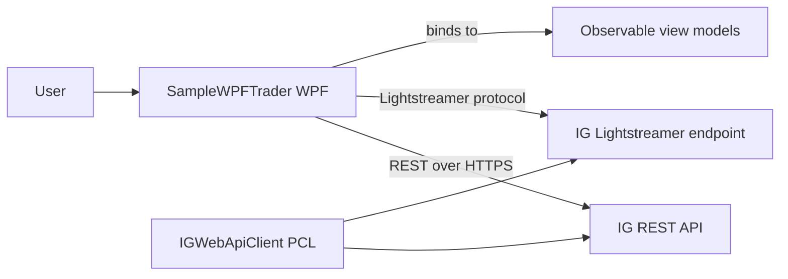
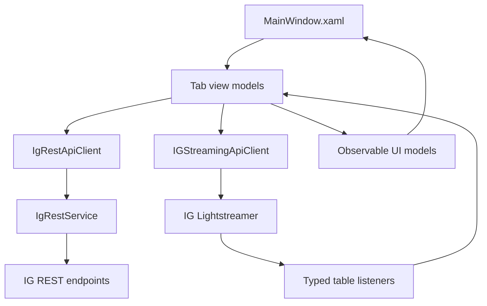

# Architecture

## Purpose

Show how the desktop application, client library, and IG services fit together.

## Key points (TL;DR)

* The root solution contains two projects: a .NET Framework WPF client and a
  Portable Class Library client.
* The WPF view models own view state and invoke a shared REST client and
  Lightstreamer client.
* REST responses seed observable UI collections; Lightstreamer callbacks update
  selected fields in those models.
* There is no application server, database, message broker, or deployment stack.

## Details

### Context

The diagram distinguishes logical responsibilities. In the actual process, the
WPF project references the `IGWebApiClient` assembly and constructs both client
types through `ViewModelBase`.

### Components and data flow

The REST layer serializes request DTOs with Newtonsoft.Json, sends the requested
`VERSION` header, parses CST and X-SECURITY-TOKEN response headers, and
deserializes HTTP-OK bodies into endpoint DTOs. The streaming layer constructs
Lightstreamer table subscriptions and transforms field strings into typed
nullable values. The view models reconcile both sources and WPF observes
`INotifyPropertyChanged` updates.

### Threading and state

REST calls use `async` signatures but block on `Task.Result` internally in the
HTTP service. UI-facing code uses `async void` handlers and catches exceptions
locally. Streaming callbacks can run away from the WPF thread; selected changes
are routed through `SmartDispatcher` in account/trade event handling, while
other market update callbacks directly change observable models. A new
implementation should explicitly marshal all UI-bound changes to its UI
scheduler.

`ViewModelBase` holds static REST and streaming clients, the current account ID,
and the logged-in flag. This is a single-session design, not an isolated
per-account service abstraction.

## Evidence (repo references)

* `IGWebApiDotNetSample.sln`: root solution membership.
* `SampleWPFTrader/SampleWPFTrader.csproj:12-13,170-173`: target framework and
  client project reference.
* `SampleWPFTrader/ViewModel/ViewModelBase.cs:8-42`: shared clients and global
  state.
* `IGWebApiClient/IGRestService.cs:57-222`: HTTP, headers, response status, and
  JSON handling.
* `IGWebApiClient/IGStreamingApi.cs:527-823`: streaming connection and callbacks.
* `SampleWPFTrader/Common/SmartDispatcher.cs:25-92`: WPF dispatcher behavior.

## Open questions / assumptions (if any)

* Assumption: The shown application is single-user and single-account at a time.
  * Missing evidence: No multi-window or multi-user runtime tests.
  * Risk/impact: Static client state would be unsafe for concurrent sessions.
