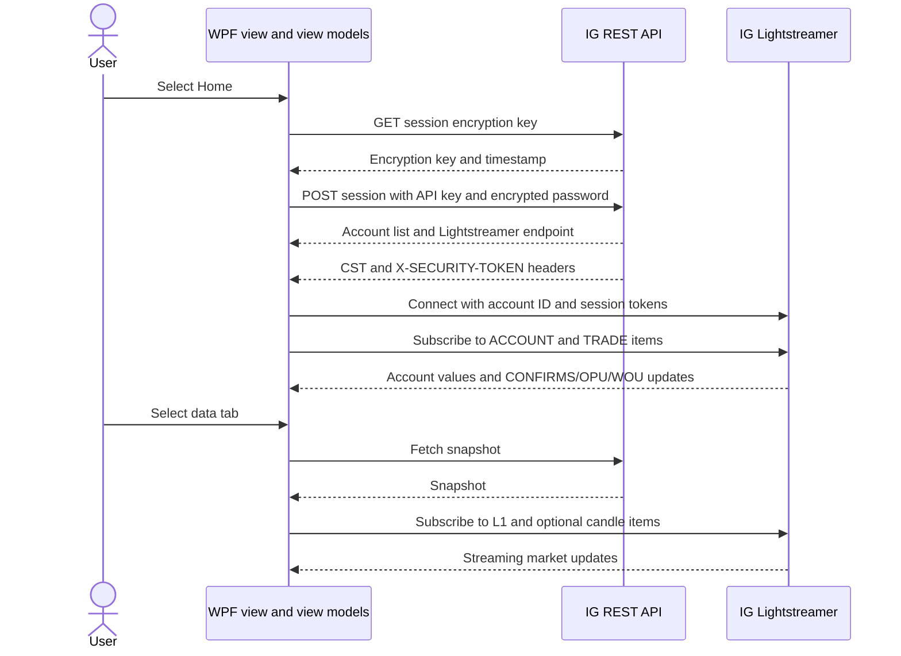

# User Workflows

## Purpose

Describe the user paths and API state transitions implemented by the WPF sample.

## Key points (TL;DR)

* Login is triggered when the Home tab becomes selected.
* Login obtains a REST session first, then connects Lightstreamer with the
  returned account ID, endpoint, and session tokens.
* Data tabs check the shared `LoggedIn` flag, fetch REST snapshots, then subscribe
  to unique EPICs with streaming prices enabled.
* Leaving a tab generally unsubscribes that tab's retained subscription key.
* Exit unsubscribes Home streams and requests REST logout before shutting down.

## Details

### Sign-in and session startup

1. Selecting Home when not logged in calls `Login`.
2. The app reads the configured environment, username, password, and API key.
3. `SecureAuthenticate` fetches an encryption key, encrypts the password, and
   posts an authentication request.
4. On an HTTP-OK response containing accounts, account rows are populated and
   `LoggedIn` is set.
5. The client context receives CST and X-SECURITY-TOKEN response headers.
   The app uses the current account ID, both tokens, API key, and the returned
   Lightstreamer endpoint to open the streaming session.
6. Once connected, it subscribes to account details and trade events.

The source does not implement a full interactive challenge, region rerouting,
silent login, or MFA flow. Those paths must be validated against current IG
requirements before rebuilding authentication.

### Market browsing

Selecting Browse while logged in calls the market-navigation root endpoint.
Choosing a node requests its children. If the response contains child nodes,
they replace the current tree. If it contains markets, the view populates
market rows and subscribes once for the distinct EPICs with streaming prices
enabled. Leaving Browse unsubscribes the L1 table.

### Positions and working orders

Selecting Positions retrieves V2 OTC positions. The view converts each response
into an observable UI model, extracts unique EPICs that support streaming, and
subscribes to L1 market updates. Selecting Working Orders follows the same
pattern using V2 working orders. Leaving either tab unsubscribes its retained
price subscription.

These are snapshot-and-price-update workflows. The source does not update the
position or order snapshot from the trade stream in those views, nor does it
provide controls to submit, edit, or close a trade.

### Watchlists and chart data

Selecting Watchlists retrieves the user's watchlists. Selecting a list retrieves
its markets, fills the grid, then subscribes to distinct streamable EPICs for
L1 quotes and one-minute candles. Changing the selected watchlist clears the
market view and unsubscribes the old L1 and chart subscriptions before loading
the selected list.

### End session

Exit requests unsubscription from account and trade streams, invokes REST logout,
marks the shared session state logged out, and shuts down the WPF process.
The logout method is `async void`, so the UI does not await or observe completion.

### Sequence

## Evidence (repo references)

* `SampleWPFTrader/ViewModel/ApplicationViewModel.cs:151-214`:
  Home selection and exit.
* `SampleWPFTrader/ViewModel/ApplicationViewModel.cs:229-359`:
  REST login, Lightstreamer connect, and subscription setup.
* `SampleWPFTrader/ViewModel/BrowseViewModel.cs:182-306`: market navigation.
* `SampleWPFTrader/ViewModel/PositionsViewModel.cs:22-186` and
  `SampleWPFTrader/ViewModel/OrdersViewModel.cs:110-255`: snapshot, live price,
  and unsubscribe paths.
* `SampleWPFTrader/ViewModel/WatchlistsViewModel.cs:206-507`: selection,
  watchlist loads, and stream lifecycle.

## Open questions / assumptions (if any)

* Assumption: UI selection is the normal path for starting each workflow because
  the tabs bind `IsSelected` to view-model state.
  * Missing evidence: No automated UI tests or runtime interaction recordings.
  * Risk/impact: Timing and WPF event ordering have not been tested here.
